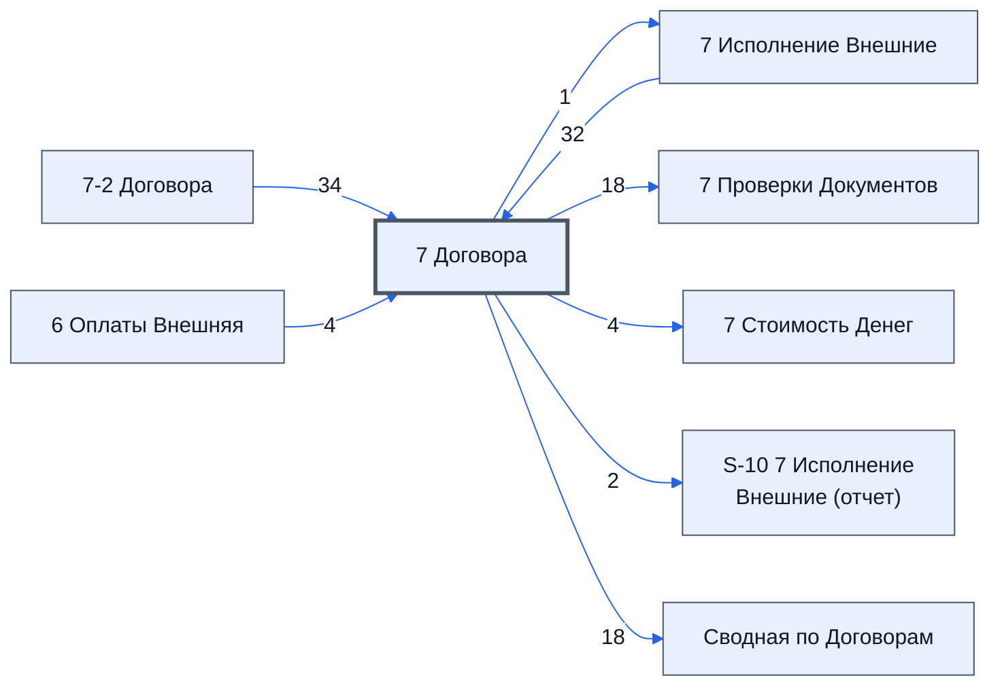

# Лист «7 Договора»

Таблица: внешняя таблица оплат · контур 3.

**Зачем** (со слов директора): продолжение договоров.

Устройство листа — заголовки, вид столбцов, списки, формулы, связи с другими листами — собрано из таблицы ниже. Строка заголовков на этом листе угадана по закреплённой области — проверить.

## Зачем лист — подробно

*Заполнить:* что на листе происходит, откуда приходят данные и куда уходят.

## Как заполнять

*Заполнить:* какие столбцы вводят руками, какие считаются сами. Что значит каждый столбец — в `stolbtsy.yaml` рядом (поля `chto` и `kak`).

## Что нельзя трогать

*Заполнить.*

## Инструкции и умения

*Заполнить:* какие инструкции и умения относятся к листу.

## Осталось сделать

- Заполнить разделы выше и `stolbtsy.yaml`.

## Устройство (из таблицы)

- **Таблица:** внешняя таблица оплат, лист «7 Договора»; контур 3
- **Размер:** `A1:BA15`, закреплено до `A11`
- **Каркас:** свой, не общий; строка заголовков — 10, угадана по закреплённой области — проверить
- **Формул:** 209; заполненных ячеек без формул в данных: 11; списков: 2; условного форматирования: 4; объединённых ячеек: 0

## Связи с другими листами

- **Берёт данные с листов:** [7-2 Договора](../k3-vo-7-2-dogovora/index.md) (34), [7 Исполнение Внешние](../k3-vo-7-ispolnenie-vneshnie/index.md) (32), [6 Оплаты Внешняя](../k3-vo-6-oplaty-vneshnyaya/index.md) (4)
- **Его данные используют:** [7 Исполнение Внешние](../k3-vo-7-ispolnenie-vneshnie/index.md) (1), [7 Проверки Документов](../k3-vo-7-proverki-dokumentov/index.md) (18), [7 Стоимость Денег](../k3-vo-7-stoimost-deneg/index.md) (4), [S-10 7 Исполнение Внешние (отчет)](../k3-vo-s-10-7-ispolnenie-vneshnie-otchet/index.md) (2), [Сводная по Договорам](../k3-vo-svodnaya-po-dogovoram/index.md) (18)

В скобках и на стрелках — сколько формул ссылаются.

## Столбцы

Устройство — из таблицы; «Что это» и «Как заполняют» — из `stolbtsy.yaml` (заполняем руками).

| Столбец | Заголовок | Служебное имя | Вид | Заполняется | Список | Что это | Как заполняют |
|---|---|---|---|---|---|---|---|
| A | Ошибки |  |  | формула |  |  |  |
| B | ID_Документа |  |  | формула |  |  |  |
| C | № |  |  | формула |  |  |  |
| D | Проект № |  |  | формула |  |  |  |
| E | Юр. лицо Продавец |  |  | формула |  |  |  |
| F | ИНН Продавца |  |  | формула |  |  |  |
| G | Юр. лицо Покупатель |  |  | формула |  |  |  |
| H | ИНН Покупателя |  |  | формула |  |  |  |
| I | Номер Договора |  |  | формула |  |  |  |
| J | Дата договора от |  |  | формула |  |  |  |
| K | Сумма договора |  |  | формула |  |  |  |
| L | Валюта договора |  |  | формула |  |  |  |
| M | НДС Договора |  |  | формула | 'Технический лист'!$C$2:$C$10 |  |  |
| N | Ориентировочная сумма договора в рублях |  |  | формула |  |  |  |
| O | Коэф |  |  | формула |  |  |  |
| P | Дата подписи продавцом |  |  | формула |  |  |  |
| Q | Дата подписи Покупателем |  |  | формула |  |  |  |
| R | Вид подписания договора |  |  | формула | 'Технический лист'!$B$2:$B$10 |  |  |
| S | Договора о закупке |  |  | формула |  |  |  |
| T | Частичная оплата за товар |  |  | формула |  |  |  |
| U | Частичная поставка товара |  |  | формула |  |  |  |
| V | Срок поставки |  |  | формула |  |  |  |
| W | Срок доставки |  |  | формула |  |  |  |
| X | Срок приемки |  |  | формула |  |  |  |
| Y | Срок оплаты |  |  | формула |  |  |  |
| Z | Сумма отгруженных товаров |  |  | формула |  |  |  |
| AA | Сумма полученых оплат |  |  | формула |  |  |  |
| AB | Комментарий Текстовое |  |  | формула |  |  |  |
| AC | Скан Версия |  |  | формула |  |  |  |
| AD | Скан с двумя печатями в папке |  |  | формула |  |  |  |
| AE | Бумажная версия продавца с двумя печатями |  |  | формула |  |  |  |
| AF | Бумажная версия покупателя с двумя печатями |  |  | формула |  |  |  |
| AG | Требуется ли Партнерская Договор |  |  | формула |  |  |  |
| AH | Папка |  |  | формула |  |  |  |
| AI | Автоматическая Проверка |  |  | формула |  |  |  |
| AJ | Комментарий логиста |  |  | формула |  |  |  |
| AK | Статус проекта |  |  | формула |  |  |  |
| AL | Результат проверки |  |  | формула |  |  |  |
| AM | Дата исправления ошибки |  |  | формула |  |  |  |
| AN | Актуален ли договор |  |  | формула |  |  |  |
| AO | ID |  |  | формула |  |  |  |
| AP | № Договора о закупке |  |  | формула |  |  |  |
| AQ | ТипДоговора |  |  | формула |  |  |  |
| AR | Сводка Документа |  |  | формула |  |  |  |
| AS | Оплаты Документа |  |  | формула |  |  |  |

Формулы столбцов (45)

| Столбец | Строка | Формула |
|---|---|---|
| A | 10 | <code>={A1;'7 Исполнение Внешние'!$X$11:$X15}</code> |
| B | 10 | <code>={"ID_Документа";'7 Исполнение Внешние'!$AJ$11:$AJ15}</code> |
| C | 10 | <code>={C1;LAMBDA(doFindValue, doFindCol, theData,theColNames,theKeys,theNameKey,theColName, doFindValue( theKeys, {INDEX(theData,,doFindCol(theColNames,theNameKey)) , INDEX(theData,,doFindCol(theColNames,theColName))} ))( LAMBDA(theKeyS, theData, BYROW(theKeys, LAMBDA(tk, IF(tk&lt;&gt;"", IFERROR(VLOOKUP(tk,theData,2,FALSE),),))) ), LAMBDA(theData,theName, MATCH(theName,theData,0)), '7-2 Договора'!$A$1:BA$20 …</code> |
| D | 10 | <code>={"Проект №";IF(E11:E15&lt;&gt;"",'7 Исполнение Внешние'!$B$3,) }</code> |
| E | 10 | <code>={E1; LAMBDA(doFind,theData,theName, BYROW(theData,LAMBDA(td,Dofind(td,theName))))(LAMBDA(theData,theName, IFERROR( INDEX(theData,1, MATCH(theName,theData,0)+1),)),'7 Исполнение Внешние'!$A$11:$AA$11, E$4); LAMBDA(doFind,theData,theName, BYROW(theData,LAMBDA(td,Dofind(td,theName))))(LAMBDA(theData,theName, IFERROR( INDEX(theData,1, MATCH(theName,theData,0)+1),)),'7 Исполнение Внешние'!$A$12:$AA$15 …</code> |
| F | 10 | <code>="ИНН Продавца"</code> |
| G | 10 | <code>={G1; LAMBDA(doFind,theData,theName, BYROW(theData,LAMBDA(td,Dofind(td,theName))))(LAMBDA(theData,theName, IFERROR( INDEX(theData,1, MATCH(theName,theData,0)+1),)),'7 Исполнение Внешние'!$A$11:$AA$11, G$4); LAMBDA(doFind,theData,theName, BYROW(theData,LAMBDA(td,Dofind(td,theName))))(LAMBDA(theData,theName, IFERROR( INDEX(theData,1, MATCH(theName,theData,0)+1),)),'7 Исполнение Внешние'!$A$12:$AA$15 …</code> |
| H | 10 | <code>="ИНН Покупателя"</code> |
| I | 10 | <code>={I1; LAMBDA(doFind,theData,theName, BYROW(theData,LAMBDA(td,Dofind(td,theName))))(LAMBDA(theData,theName, IFERROR( INDEX(theData,1, MATCH(theName,theData,0)+1),)),'7 Исполнение Внешние'!$A$11:$AA$11, I$4); LAMBDA(doFind,theData,theName, BYROW(theData,LAMBDA(td,Dofind(td,theName))))(LAMBDA(theData,theName, IFERROR( INDEX(theData,1, MATCH(theName,theData,0)+1),)),'7 Исполнение Внешние'!$A$12:$AA$15 …</code> |
| J | 10 | <code>={J1; LAMBDA(doFind,theData,theName, BYROW(theData,LAMBDA(td,Dofind(td,theName))))(LAMBDA(theData,theName, IFERROR( INDEX(theData,1, MATCH(theName,theData,0)+1),)),'7 Исполнение Внешние'!$A$11:$AA$11, J$4); LAMBDA(doFind,theData,theName, BYROW(theData,LAMBDA(td,Dofind(td,theName))))(LAMBDA(theData,theName, IFERROR( INDEX(theData,1, MATCH(theName,theData,0)+1),)),'7 Исполнение Внешние'!$A$12:$AA$15 …</code> |
| K | 10 | <code>={K1; LAMBDA(doFind,theData,theName, BYROW(theData,LAMBDA(td,Dofind(td,theName))))(LAMBDA(theData,theName, IFERROR( INDEX(theData,1, MATCH(theName,theData,0)+1),)),'7 Исполнение Внешние'!$A$11:$AA$11, K$4); LAMBDA(doFind,theData,theName, BYROW(theData,LAMBDA(td,Dofind(td,theName))))(LAMBDA(theData,theName, IFERROR( INDEX(theData,1, MATCH(theName,theData,0)+1),)),'7 Исполнение Внешние'!$A$12:$AA$15 …</code> |
| L | 10 | <code>={L1; LAMBDA(doFind,theData,theName, BYROW(theData,LAMBDA(td,Dofind(td,theName))))(LAMBDA(theData,theName, IFERROR( INDEX(theData,1, MATCH(theName,theData,0)+1),)),'7 Исполнение Внешние'!$A$11:$AA$11, L$4); LAMBDA(doFind,theData,theName, BYROW(theData,LAMBDA(td,Dofind(td,theName))))(LAMBDA(theData,theName, IFERROR( INDEX(theData,1, MATCH(theName,theData,0)+1),)),'7 Исполнение Внешние'!$A$12:$AA$15 …</code> |
| M | 10 | <code>={M1;'7 Исполнение Внешние'!$AM$11:$AM$15}</code> |
| N | 10 | <code>={N1; LAMBDA(doFind,theData,theName, BYROW(theData,LAMBDA(td,Dofind(td,theName))))(LAMBDA(theData,theName, IFERROR( INDEX(theData,1, MATCH(theName,theData,0)+1),)),'7 Исполнение Внешние'!$A$11:$AA$11, N$4); LAMBDA(doFind,theData,theName, BYROW(theData,LAMBDA(td,Dofind(td,theName))))(LAMBDA(theData,theName, IFERROR( INDEX(theData,1, MATCH(theName,theData,0)+1),)),'7 Исполнение Внешние'!$A$12:$AA$15 …</code> |
| O | 10 | <code>={O$1; LAMBDA(doFind,theData,theName, Dofind(theData,theName)) (LAMBDA(theData,theName, IFERROR( INDEX(theData,2, MATCH( theName, INDEX( theData,1,0) ,0)),)),'7 Исполнение Внешние'!$A$11:$AA$12,O$4)}</code> |
| P | 10 | <code>={P1; LAMBDA(doFind,theData,theName, BYROW(theData,LAMBDA(td,Dofind(td,theName))))(LAMBDA(theData,theName, IFERROR( INDEX(theData,1, MATCH(theName,theData,0)+1),)),'7 Исполнение Внешние'!$A$11:$AA$11, P$4); LAMBDA(doFind,theData,theName, BYROW(theData,LAMBDA(td,Dofind(td,theName))))(LAMBDA(theData,theName, IFERROR( INDEX(theData,1, MATCH(theName,theData,0)+1),)),'7 Исполнение Внешние'!$A$12:$AA$15 …</code> |
| Q | 10 | <code>={Q1; LAMBDA(doFind,theData,theName, BYROW(theData,LAMBDA(td,Dofind(td,theName))))(LAMBDA(theData,theName, IFERROR( INDEX(theData,1, MATCH(theName,theData,0)+1),)),'7 Исполнение Внешние'!$A$11:$AA$11, Q$4); LAMBDA(doFind,theData,theName, BYROW(theData,LAMBDA(td,Dofind(td,theName))))(LAMBDA(theData,theName, IFERROR( INDEX(theData,1, MATCH(theName,theData,0)+1),)),'7 Исполнение Внешние'!$A$12:$AA$15 …</code> |
| R | 10 | <code>={R1; LAMBDA(doFind,theData,theName, BYROW(theData,LAMBDA(td,Dofind(td,theName))))(LAMBDA(theData,theName, IFERROR( INDEX(theData,1, MATCH(theName,theData,0)+1),)),'7 Исполнение Внешние'!$A$11:$AA$11, R$4); LAMBDA(doFind,theData,theName, BYROW(theData,LAMBDA(td,Dofind(td,theName))))(LAMBDA(theData,theName, IFERROR( INDEX(theData,1, MATCH(theName,theData,0)+1),)),'7 Исполнение Внешние'!$A$12:$AA$15 …</code> |
| S | 10 | <code>={S1;'7 Исполнение Внешние'!$AH$11:$AH15}</code> |
| T | 10 | <code>={T1; LAMBDA(doFind,theData,theName, BYROW(theData,LAMBDA(td,Dofind(td,theName))))(LAMBDA(theData,theName, IFERROR( INDEX(theData,1, MATCH(theName,theData,0)+1),)),'7 Исполнение Внешние'!$A$11:$AA$11, T$4); LAMBDA(doFind,theData,theName, BYROW(theData,LAMBDA(td,Dofind(td,theName))))(LAMBDA(theData,theName, IFERROR( INDEX(theData,1, MATCH(theName,theData,0)+1),)),'7 Исполнение Внешние'!$A$12:$AA$15 …</code> |
| U | 10 | <code>={U1; LAMBDA(doFind,theData,theName, BYROW(theData,LAMBDA(td,Dofind(td,theName))))(LAMBDA(theData,theName, IFERROR( INDEX(theData,1, MATCH(theName,theData,0)+1),)),'7 Исполнение Внешние'!$A$11:$AA$11, U$4); LAMBDA(doFind,theData,theName, BYROW(theData,LAMBDA(td,Dofind(td,theName))))(LAMBDA(theData,theName, IFERROR( INDEX(theData,1, MATCH(theName,theData,0)+1),)),'7 Исполнение Внешние'!$A$12:$AA$15 …</code> |
| V | 10 | <code>={V1;LAMBDA(theStr,IFERROR(HLOOKUP(theStr,'6 Оплаты Внешняя'!$A$5:BA$6,2,FALSE),""))(V$4); IF($B12:$B15&lt;&gt;"",10,)}</code> |
| W | 10 | <code>={W1;LAMBDA(theStr,IFERROR(HLOOKUP(theStr,'6 Оплаты Внешняя'!$A$5:BA$6,2,FALSE),""))(W$4); IF($B12:$B15&lt;&gt;"",10,)}</code> |
| X | 10 | <code>={X1;LAMBDA(theStr,IFERROR(HLOOKUP(theStr,'6 Оплаты Внешняя'!$A$5:BA$6,2,FALSE),""))(X$4); IF($B12:$B15&lt;&gt;"",10,)}</code> |
| Y | 10 | <code>={Y1;LAMBDA(theStr,IFERROR(HLOOKUP(theStr,'6 Оплаты Внешняя'!$A$5:BA$6,2,FALSE),""))(Y$4); IF($B12:$B15&lt;&gt;"",10,)}</code> |
| Z | 10 | <code>="Сумма отгруженных товаров"</code> |
| AA | 10 | <code>="Сумма полученых оплат"</code> |
| AB | 10 | <code>={AB1;LAMBDA(doFindValue, doFindCol, theData,theColNames,theKeys,theNameKey,theColName, doFindValue( theKeys, {INDEX(theData,,doFindCol(theColNames,theNameKey)) , INDEX(theData,,doFindCol(theColNames,theColName))} ))( LAMBDA(theKeyS, theData, BYROW(theKeys, LAMBDA(tk, IF(tk&lt;&gt;"", IFERROR(VLOOKUP(tk,theData,2,FALSE),),))) ), LAMBDA(theData,theName, MATCH(theName,theData,0)), '7-2 Договора'!$A$1:BA$2 …</code> |
| AC | 10 | <code>={AC1;LAMBDA(doFindValue, doFindCol, theData,theColNames,theKeys,theNameKey,theColName, doFindValue( theKeys, {INDEX(theData,,doFindCol(theColNames,theNameKey)) , INDEX(theData,,doFindCol(theColNames,theColName))} ))( LAMBDA(theKeyS, theData, BYROW(theKeys, LAMBDA(tk, IF(tk&lt;&gt;"", IFERROR(VLOOKUP(tk,theData,2,FALSE),),))) ), LAMBDA(theData,theName, MATCH(theName,theData,0)), '7-2 Договора'!$A$1:BA$2 …</code> |
| AD | 10 | <code>={AD1;LAMBDA(doFindValue, doFindCol, theData,theColNames,theKeys,theNameKey,theColName, doFindValue( theKeys, {INDEX(theData,,doFindCol(theColNames,theNameKey)) , INDEX(theData,,doFindCol(theColNames,theColName))} ))( LAMBDA(theKeyS, theData, BYROW(theKeys, LAMBDA(tk, IF(tk&lt;&gt;"", IFERROR(VLOOKUP(tk,theData,2,FALSE),),))) ), LAMBDA(theData,theName, MATCH(theName,theData,0)), '7-2 Договора'!$A$1:BA$2 …</code> |
| AE | 10 | <code>={AE1;LAMBDA(doFindValue, doFindCol, theData,theColNames,theKeys,theNameKey,theColName, doFindValue( theKeys, {INDEX(theData,,doFindCol(theColNames,theNameKey)) , INDEX(theData,,doFindCol(theColNames,theColName))} ))( LAMBDA(theKeyS, theData, BYROW(theKeys, LAMBDA(tk, IF(tk&lt;&gt;"", IFERROR(VLOOKUP(tk,theData,2,FALSE),),))) ), LAMBDA(theData,theName, MATCH(theName,theData,0)), '7-2 Договора'!$A$1:BA$2 …</code> |
| AF | 10 | <code>={AF1;LAMBDA(doFindValue, doFindCol, theData,theColNames,theKeys,theNameKey,theColName, doFindValue( theKeys, {INDEX(theData,,doFindCol(theColNames,theNameKey)) , INDEX(theData,,doFindCol(theColNames,theColName))} ))( LAMBDA(theKeyS, theData, BYROW(theKeys, LAMBDA(tk, IF(tk&lt;&gt;"", IFERROR(VLOOKUP(tk,theData,2,FALSE),),))) ), LAMBDA(theData,theName, MATCH(theName,theData,0)), '7-2 Договора'!$A$1:BA$2 …</code> |
| AG | 10 | <code>={AG1;LAMBDA(doFindValue, doFindCol, theData,theColNames,theKeys,theNameKey,theColName, doFindValue( theKeys, {INDEX(theData,,doFindCol(theColNames,theNameKey)) , INDEX(theData,,doFindCol(theColNames,theColName))} ))( LAMBDA(theKeyS, theData, BYROW(theKeys, LAMBDA(tk, IF(tk&lt;&gt;"", IFERROR(VLOOKUP(tk,theData,2,FALSE),),))) ), LAMBDA(theData,theName, MATCH(theName,theData,0)), '7-2 Договора'!$A$1:BA$2 …</code> |
| AH | 10 | <code>={AH1;LAMBDA(doFindValue, doFindCol, theData,theColNames,theKeys,theNameKey,theColName, doFindValue( theKeys, {INDEX(theData,,doFindCol(theColNames,theNameKey)) , INDEX(theData,,doFindCol(theColNames,theColName))} ))( LAMBDA(theKeyS, theData, BYROW(theKeys, LAMBDA(tk, IF(tk&lt;&gt;"", IFERROR(VLOOKUP(tk,theData,2,FALSE),),))) ), LAMBDA(theData,theName, MATCH(theName,theData,0)), '7-2 Договора'!$A$1:BA$2 …</code> |
| AI | 10 | <code>={AI1;LAMBDA(doFindValue, doFindCol, theData,theColNames,theKeys,theNameKey,theColName, doFindValue( theKeys, {INDEX(theData,,doFindCol(theColNames,theNameKey)) , INDEX(theData,,doFindCol(theColNames,theColName))} ))( LAMBDA(theKeyS, theData, BYROW(theKeys, LAMBDA(tk, IF(tk&lt;&gt;"", IFERROR(VLOOKUP(tk,theData,2,FALSE),),))) ), LAMBDA(theData,theName, MATCH(theName,theData,0)), '7-2 Договора'!$A$1:BA$2 …</code> |
| AJ | 10 | <code>={AJ1;LAMBDA(doFindValue, doFindCol, theData,theColNames,theKeys,theNameKey,theColName, doFindValue( theKeys, {INDEX(theData,,doFindCol(theColNames,theNameKey)) , INDEX(theData,,doFindCol(theColNames,theColName))} ))( LAMBDA(theKeyS, theData, BYROW(theKeys, LAMBDA(tk, IF(tk&lt;&gt;"", IFERROR(VLOOKUP(tk,theData,2,FALSE),),))) ), LAMBDA(theData,theName, MATCH(theName,theData,0)), '7-2 Договора'!$A$1:BA$2 …</code> |
| AK | 10 | <code>={AK1;LAMBDA(doFindValue, doFindCol, theData,theColNames,theKeys,theNameKey,theColName, doFindValue( theKeys, {INDEX(theData,,doFindCol(theColNames,theNameKey)) , INDEX(theData,,doFindCol(theColNames,theColName))} ))( LAMBDA(theKeyS, theData, BYROW(theKeys, LAMBDA(tk, IF(tk&lt;&gt;"", IFERROR(VLOOKUP(tk,theData,2,FALSE),),))) ), LAMBDA(theData,theName, MATCH(theName,theData,0)), '7-2 Договора'!$A$1:BA$2 …</code> |
| AL | 10 | <code>={AL1;LAMBDA(doFindValue, doFindCol, theData,theColNames,theKeys,theNameKey,theColName, doFindValue( theKeys, {INDEX(theData,,doFindCol(theColNames,theNameKey)) , INDEX(theData,,doFindCol(theColNames,theColName))} ))( LAMBDA(theKeyS, theData, BYROW(theKeys, LAMBDA(tk, IF(tk&lt;&gt;"", IFERROR(VLOOKUP(tk,theData,2,FALSE),),))) ), LAMBDA(theData,theName, MATCH(theName,theData,0)), '7-2 Договора'!$A$1:BA$2 …</code> |
| AM | 10 | <code>={AM1;LAMBDA(doFindValue, doFindCol, theData,theColNames,theKeys,theNameKey,theColName, doFindValue( theKeys, {INDEX(theData,,doFindCol(theColNames,theNameKey)) , INDEX(theData,,doFindCol(theColNames,theColName))} ))( LAMBDA(theKeyS, theData, BYROW(theKeys, LAMBDA(tk, IF(tk&lt;&gt;"", IFERROR(VLOOKUP(tk,theData,2,FALSE),),))) ), LAMBDA(theData,theName, MATCH(theName,theData,0)), '7-2 Договора'!$A$1:BA$2 …</code> |
| AN | 10 | <code>={AN1;LAMBDA(doFindValue, doFindCol, theData,theColNames,theKeys,theNameKey,theColName, doFindValue( theKeys, {INDEX(theData,,doFindCol(theColNames,theNameKey)) , INDEX(theData,,doFindCol(theColNames,theColName))} ))( LAMBDA(theKeyS, theData, BYROW(theKeys, LAMBDA(tk, IF(tk&lt;&gt;"", IFERROR(VLOOKUP(tk,theData,2,FALSE),),))) ), LAMBDA(theData,theName, MATCH(theName,theData,0)), '7-2 Договора'!$A$1:BA$2 …</code> |
| AO | 10 | <code>={AO1;LAMBDA(doFindValue, doFindCol, theData,theColNames,theKeys,theNameKey,theColName, doFindValue( theKeys, {INDEX(theData,,doFindCol(theColNames,theNameKey)) , INDEX(theData,,doFindCol(theColNames,theColName))} ))( LAMBDA(theKeyS, theData, BYROW(theKeys, LAMBDA(tk, IF(tk&lt;&gt;"", IFERROR(VLOOKUP(tk,theData,2,FALSE),),))) ), LAMBDA(theData,theName, MATCH(theName,theData,0)), '7-2 Договора'!$A$1:BA$2 …</code> |
| AP | 10 | <code>={AP1;LAMBDA(doFindValue, doFindCol, theData,theColNames,theKeys,theNameKey,theColName, doFindValue( theKeys, {INDEX(theData,,doFindCol(theColNames,theNameKey)) , INDEX(theData,,doFindCol(theColNames,theColName))} ))( LAMBDA(theKeyS, theData, BYROW(theKeys, LAMBDA(tk, IF(tk&lt;&gt;"", IFERROR(VLOOKUP(tk,theData,2,FALSE),),))) ), LAMBDA(theData,theName, MATCH(theName,theData,0)), '7-2 Договора'!$A$1:BA$2 …</code> |
| AQ | 10 | <code>={AQ1;LAMBDA(doFindValue, doFindCol, theData,theColNames,theKeys,theNameKey,theColName, doFindValue( theKeys, {INDEX(theData,,doFindCol(theColNames,theNameKey)) , INDEX(theData,,doFindCol(theColNames,theColName))} ))( LAMBDA(theKeyS, theData, BYROW(theKeys, LAMBDA(tk, IF(tk&lt;&gt;"", IFERROR(VLOOKUP(tk,theData,2,FALSE),),))) ), LAMBDA(theData,theName, MATCH(theName,theData,0)), '7-2 Договора'!$A$1:BA$2 …</code> |
| AR | 10 | <code>={AR1; Let( proj,'7 Исполнение Внешние'!B3, fr_ar, '7 Договора'!E11:E15, to_ar, '7 Договора'!G11:G15, is_ar, Map(fr_ar,Lambda(fr, fr&lt;&gt;"")), met_Insp1, LAMBDA(A_ar, fn, MAP(A_ar, is_ar, LAMBDA(a_v, is, IF(is, fn(a_v), )))), met_Insp2, LAMBDA(A_ar, B_ar, fn, MAP(A_ar, B_ar, is_ar, LAMBDA(a_v, b_v, is, IF(is, fn(a_v, b_v), )))), tzA, "- Проект №: 1290 Хайверк -&gt; ЗиО Подольск", do_a, LAMBDA(fr,to, TEX …</code> |
| AS | 10 | <code>={AS1; Let( proj, '7 Исполнение Внешние'!B3, fr_ar, '7 Договора'!E11:E15, to_ar, '7 Договора'!G11:G15, is_ar, Map(fr_ar,Lambda(fr, fr&lt;&gt;"")), met_Insp1, LAMBDA(A_ar, fn, MAP(A_ar, is_ar, LAMBDA(a_v, is, IF(is, fn(a_v), )))), met_Insp,"Оплаты Документа")</code> |

