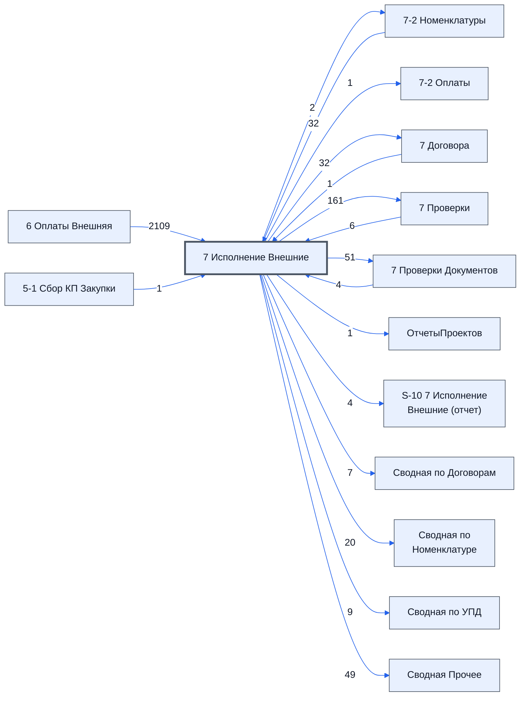

# Лист «7 Исполнение Внешние»

Таблица: внешняя таблица оплат · контур 3.

**Зачем** (со слов директора): договоры: номера и суммы.

Устройство листа — заголовки, вид столбцов, списки, формулы, связи с другими листами — собрано из таблицы ниже. Строка заголовков на этом листе угадана по закреплённой области — проверить.

## Зачем лист — подробно

*Заполнить:* что на листе происходит, откуда приходят данные и куда уходят.

## Как заполнять

*Заполнить:* какие столбцы вводят руками, какие считаются сами. Что значит каждый столбец — в `stolbtsy.yaml` рядом (поля `chto` и `kak`).

## Что нельзя трогать

*Заполнить.*

## Инструкции и умения

*Заполнить:* какие инструкции и умения относятся к листу.

## Осталось сделать

- Заполнить разделы выше и `stolbtsy.yaml`.

## Устройство (из таблицы)

- **Таблица:** внешняя таблица оплат, лист «7 Исполнение Внешние»; контур 3
- **Размер:** `A1:AM333`, закреплено до `A11`
- **Каркас:** свой, не общий; строка заголовков — 10, угадана по закреплённой области — проверить
- **Формул:** 2145; заполненных ячеек без формул в данных: 91; списков: 3; условного форматирования: 12; объединённых ячеек: 5
- **Данные из других таблиц (IMPORTRANGE):** 1

## Связи с другими листами

- **Берёт данные с листов:** [6 Оплаты Внешняя](../k3-vo-6-oplaty-vneshnyaya/index.md) (2109), [7-2 Номенклатуры](../k3-vo-7-2-nomenklatury/index.md) (32), [7 Проверки](../k3-vo-7-proverki/index.md) (6), [7 Проверки Документов](../k3-vo-7-proverki-dokumentov/index.md) (4), [5-1 Сбор КП Закупки](../k2-5-1-sbor-kp/index.md) (1), [7 Договора](../k3-vo-7-dogovora/index.md) (1)
- **Его данные используют:** [7-2 Номенклатуры](../k3-vo-7-2-nomenklatury/index.md) (2), [7-2 Оплаты](../k3-vo-7-2-oplaty/index.md) (1), [7 Договора](../k3-vo-7-dogovora/index.md) (32), [7 Проверки](../k3-vo-7-proverki/index.md) (161), [7 Проверки Документов](../k3-vo-7-proverki-dokumentov/index.md) (51), [ОтчетыПроектов](../k3-vo-otchetyproektov/index.md) (1), [S-10 7 Исполнение Внешние (отчет)](../k3-vo-s-10-7-ispolnenie-vneshnie-otchet/index.md) (4), [Сводная по Договорам](../k3-vo-svodnaya-po-dogovoram/index.md) (7), [Сводная по Номенклатуре](../k3-vo-svodnaya-po-nomenklature/index.md) (20), [Сводная по УПД](../k3-vo-svodnaya-po-upd/index.md) (9), [Сводная Прочее](../k3-vo-svodnaya-prochee/index.md) (49)

В скобках и на стрелках — сколько формул ссылаются.

## Столбцы

Устройство — из таблицы; «Что это» и «Как заполняют» — из `stolbtsy.yaml` (заполняем руками).

| Столбец | Заголовок | Служебное имя | Вид | Заполняется | Список | Что это | Как заполняют |
|---|---|---|---|---|---|---|---|
| A |  |  |  | формула |  |  |  |
| B |  |  |  | формула |  |  |  |
| C |  |  |  | формула |  |  |  |
| D |  |  |  | формула |  |  |  |
| E |  |  |  | формула |  |  |  |
| F |  |  |  | формула |  |  |  |
| G |  |  |  | формула |  |  |  |
| H |  |  |  | формула |  |  |  |
| I |  |  |  | формула |  |  |  |
| J |  |  |  | формула |  |  |  |
| K |  |  |  | формула |  |  |  |
| L |  |  |  | формула |  |  |  |
| M |  |  |  | формула |  |  |  |
| N |  |  |  | формула | "руб.,дол. США" |  |  |
| O |  |  |  | формула |  |  |  |
| P |  |  |  | формула |  |  |  |
| Q |  |  |  | формула |  |  |  |
| R |  |  |  | формула | 'Технический лист'!$B$2:$B$10 |  |  |
| T |  |  |  | формула |  |  |  |
| U |  |  |  | формула |  |  |  |
| V |  |  |  | формула |  |  |  |
| W |  |  |  | формула |  |  |  |
| X |  |  |  | формула |  |  |  |
| Y |  |  |  | формула |  |  |  |
| AF | Проверки |  |  | формула |  |  |  |
| AG | Цвета |  |  | формула |  |  |  |
| AH | № строки с Договором о закупке |  |  | формула |  |  |  |
| AI | № Договора |  |  | формула |  |  |  |
| AJ | ID Договора |  |  | формула |  |  |  |
| AK | Сводка Документа |  |  | формула |  |  |  |
| AM | НДС Договора |  |  | руками, из списка | 'Технический лист'!$C$2:$C$10 |  |  |

Формулы столбцов (30)

| Столбец | Строка | Формула |
|---|---|---|
| A | 18 | <code>="№"</code> |
| B | 18 | <code>="Номенклатура"</code> |
| C | 18 | <code>="Название товара по договору"</code> |
| D | 18 | <code>="ед"</code> |
| E | 18 | <code>="Кол"</code> |
| F | 18 | <code>="% оплаты"</code> |
| G | 18 | <code>={"Текущий статус"; LAMBDA(ном_ры,срок, BYROW(ном_ры,LAMBDA(ном, IF(ном="" ,,IFERROR( VLOOKUP(ном,срок,2,FALSE),"Текуший статус доставки не найден")))) )( IF(A19:A333&lt;&gt;"",A19:A333&amp;"🔗"&amp;B19:B333,), IF('7-2 Номенклатуры'!B11:B333&lt;&gt;"",{'7-2 Номенклатуры'!B11:B333&amp;"🔗"&amp;'7-2 Номенклатуры'!C11:C333,'7-2 Номенклатуры'!Q11:Q333},) ) }</code> |
| H | 18 | <code>={"Срок поставки по договору До";LAMBDA( doFind, theIDS, theDataIDS,theDataVLS, doFind(theIDS, {theDataIDS,theDataVLS} ) )( LAMBDA(theIDS, theData, ByRow(theIDS,LAMBDA(tid,IF(tid&lt;&gt;"", IFERROR(VLOOKUP(tid, theData,2,FALSE),) ,))) ), '7 Исполнение Внешние'!$AJ$19:$AJ333,'6 Оплаты Внешняя'!$I$1:$I333 ,'6 Оплаты Внешняя'!V1:V333 )}</code> |
| I | 18 | <code>={"Цена для партнера";IF(LEN(A19:A333)&gt;0,ROUND(N19:N333*AA$12,2),)}</code> |
| J | 17 | <code>=SUM(J19:J318)</code> |
| K | 18 | <code>="Юр лицо для партнера"</code> |
| L | 18 | <code>="№ СФ для партенра"</code> |
| M | 18 | <code>="Дата СФ для партнера"</code> |
| N | 18 | <code>="Цена для Заказчика"</code> |
| O | 17 | <code>=SUM(O19:O318)</code> |
| P | 18 | <code>="№ СФ для Заказчика"</code> |
| Q | 18 | <code>="Дата СФ для Заказчика"</code> |
| R | 18 | <code>={"Проверки";IF(A19:A333&amp;B19:B333="",, VLOOKUP(ROW(A19:A333),{'7 Проверки'!A19:A333,'7 Проверки'!B19:B333},2,FALSE))}</code> |
| T | 18 | <code>={"Ожидаемая дата готовности"; LAMBDA(ном_ры,срок, BYROW(ном_ры,LAMBDA(ном, IF(ном="" ,,IFERROR( VLOOKUP(ном,срок,2,FALSE),)))) )( IF(A19:A333&lt;&gt;"",A19:A333&amp;"🔗"&amp;B19:B333,), IF('7-2 Номенклатуры'!B11:B333&lt;&gt;"",{'7-2 Номенклатуры'!B11:B333&amp;"🔗"&amp;'7-2 Номенклатуры'!C11:C333,'7-2 Номенклатуры'!M11:M333},) ) }</code> |
| U | 18 | <code>={"Комментарий логиста"; LAMBDA(ном_ры,срок, BYROW(ном_ры,LAMBDA(ном, IF(ном="" ,,IFERROR( VLOOKUP(ном,срок,2,FALSE),)))) )( IF(A19:A333&lt;&gt;"",A19:A333&amp;"🔗"&amp;B19:B333,), IF('7-2 Номенклатуры'!B11:B333&lt;&gt;"",{'7-2 Номенклатуры'!B11:B333&amp;"🔗"&amp;'7-2 Номенклатуры'!C11:C333,'7-2 Номенклатуры'!O11:O333},) ) }</code> |
| V | 18 | <code>={"Комментарий [сотрудник контура 2]"; LAMBDA(ном_ры,срок, BYROW(ном_ры,LAMBDA(ном, IF(ном="" ,,IFERROR( VLOOKUP(ном,срок,2,FALSE),)))) )( IF(A19:A333&lt;&gt;"",A19:A333&amp;"🔗"&amp;B19:B333,), IF('7-2 Номенклатуры'!B11:B333&lt;&gt;"",{'7-2 Номенклатуры'!B11:B333&amp;"🔗"&amp;'7-2 Номенклатуры'!C11:C333,'7-2 Номенклатуры'!BF11:BF333},) ) }</code> |
| W | 18 | <code>={"Дата поступления к нам на склад" ; LAMBDA(ном_ры,срок, BYROW(ном_ры,LAMBDA(ном, IF(ном="" ,,IFERROR( VLOOKUP(ном,срок,2,FALSE),)))) )( IF(A19:A333&lt;&gt;"",A19:A333&amp;"🔗"&amp;B19:B333,), IF('7-2 Номенклатуры'!B11:B333&lt;&gt;"",{'7-2 Номенклатуры'!B11:B333&amp;"🔗"&amp;'7-2 Номенклатуры'!C11:C333,'7-2 Номенклатуры'!BG11:BG333},) ) }</code> |
| X | 18 | <code>={"Дата доставки Заказчику" ; LAMBDA(ном_ры,срок, BYROW(ном_ры,LAMBDA(ном, IF(ном="" ,,IFERROR( VLOOKUP(ном,срок,2,FALSE),)))) )( IF(A19:A333&lt;&gt;"",A19:A333&amp;"🔗"&amp;B19:B333,), IF('7-2 Номенклатуры'!B11:B333&lt;&gt;"",{'7-2 Номенклатуры'!B11:B333&amp;"🔗"&amp;'7-2 Номенклатуры'!C11:C333,'7-2 Номенклатуры'!AM11:AM333},) ) }</code> |
| Y | 18 | <code>={"Дата окончания приемки"; LAMBDA(ном_ры,срок, BYROW(ном_ры,LAMBDA(ном, IF(ном="" ,,IFERROR( VLOOKUP(ном,срок,2,FALSE),)))) )( IF(A19:A333&lt;&gt;"",A19:A333&amp;"🔗"&amp;B19:B333,), IF('7-2 Номенклатуры'!B11:B333&lt;&gt;"",{'7-2 Номенклатуры'!B11:B333&amp;"🔗"&amp;'7-2 Номенклатуры'!C11:C333,'7-2 Номенклатуры'!AO11:AO333},) ) }</code> |
| AF | 10 | <code>={"Проверки";IF(FALSE,, VLOOKUP(ROW(A11:A16),{'7 Проверки Документов'!A11:A16,'7 Проверки Документов'!B11:B16},2,FALSE));'7 Проверки'!B17}</code> |
| AG | 10 | <code>={"Цвета";IF(FALSE,, VLOOKUP(ROW(A11:A16),{'7 Проверки Документов'!A11:A16,'7 Проверки Документов'!C11:C16},2,FALSE));'7 Проверки'!C17}</code> |
| AH | 10 | <code>={"№ строки с Договором о закупке";ByRow(H11:H15,LAMBDA(продавец, IF(продавец="",, TEXTJOIN(", ",TRUE,IFERROR( QUERY({J11:J15,AJ11:AJ15},"Select Col2 Where Col1='"&amp;продавец&amp;"'"),)))))}</code> |
| AI | 10 | <code>="№ Договора"</code> |
| AJ | 10 | <code>="ID Договора"</code> |
| AK | 10 | <code>='7 Договора'!AR10:AR15</code> |

