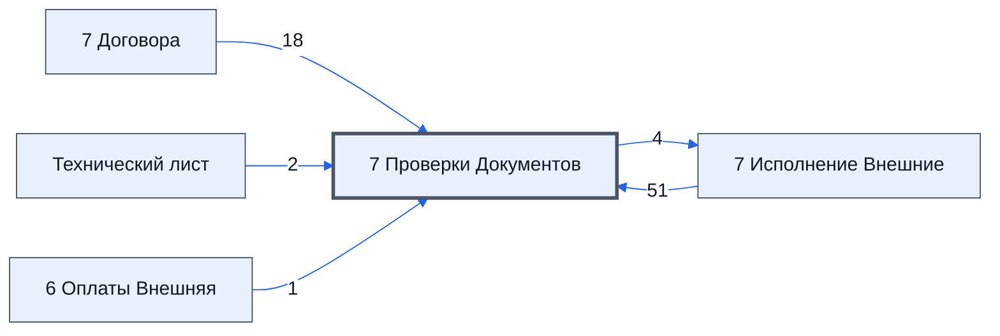

# Лист «7 Проверки Документов»

Таблица: внешняя таблица оплат · контур 3.

**Зачем** (со слов директора): проверка, правильно ли заполнены документы.

Устройство листа — заголовки, вид столбцов, списки, формулы, связи с другими листами — собрано из таблицы ниже. Строка заголовков на этом листе угадана по закреплённой области — проверить.

## Зачем лист — подробно

*Заполнить:* что на листе происходит, откуда приходят данные и куда уходят.

## Как заполнять

*Заполнить:* какие столбцы вводят руками, какие считаются сами. Что значит каждый столбец — в `stolbtsy.yaml` рядом (поля `chto` и `kak`).

## Что нельзя трогать

*Заполнить.*

## Инструкции и умения

*Заполнить:* какие инструкции и умения относятся к листу.

## Осталось сделать

- Заполнить разделы выше и `stolbtsy.yaml`.

## Устройство (из таблицы)

- **Таблица:** внешняя таблица оплат, лист «7 Проверки Документов»; контур 3
- **Размер:** `A1:CP333`
- **Каркас:** свой, не общий; строка заголовков — 1, угадана по закреплённой области — проверить
- **Формул:** 45; заполненных ячеек без формул в данных: 500; списков: 0; условного форматирования: 1; объединённых ячеек: 0

## Связи с другими листами

- **Берёт данные с листов:** [7 Исполнение Внешние](../k3-vo-7-ispolnenie-vneshnie/index.md) (51), [7 Договора](../k3-vo-7-dogovora/index.md) (18), [Технический лист](../k3-vo-tekhnicheskiy-list/index.md) (2), [6 Оплаты Внешняя](../k3-vo-6-oplaty-vneshnyaya/index.md) (1)
- **Его данные используют:** [7 Исполнение Внешние](../k3-vo-7-ispolnenie-vneshnie/index.md) (4)

В скобках и на стрелках — сколько формул ссылаются.

## Столбцы

Устройство — из таблицы; «Что это» и «Как заполняют» — из `stolbtsy.yaml` (заполняем руками).

| Столбец | Заголовок | Служебное имя | Вид | Заполняется | Список | Что это | Как заполняют |
|---|---|---|---|---|---|---|---|
| A | Строка |  |  | формула |  |  |  |
| B | Проверки |  |  | формула |  |  |  |
| C | Цвета |  |  | формула |  |  |  |
| O |  |  |  | формула |  |  |  |
| P |  |  |  | формула |  |  |  |
| Q |  |  |  | формула |  |  |  |
| U | A |  |  | руками? |  |  |  |
| V | B |  |  | руками? |  |  |  |
| W | C |  |  | руками? |  |  |  |
| X | D |  |  | формула |  |  |  |
| Y | E |  |  | руками? |  |  |  |
| Z | F |  |  | формула |  |  |  |
| AA | G |  |  | руками? |  |  |  |
| AB | H |  |  | руками? |  |  |  |
| AC | I |  |  | руками? |  |  |  |
| AD | J |  |  | руками? |  |  |  |
| AE | K |  |  | руками? |  |  |  |
| AF | L |  |  | формула |  |  |  |
| AG | M |  |  | руками? |  |  |  |
| AH | N |  |  | формула |  |  |  |
| AI | O |  |  | руками? |  |  |  |
| AJ | P |  |  | формула |  |  |  |
| AK | Q |  |  | руками? |  |  |  |
| AL | R |  |  | формула |  |  |  |
| AM | S |  |  | руками? |  |  |  |
| AN | T |  |  | руками? |  |  |  |
| AO | U |  |  | руками? |  |  |  |
| AP | V |  |  | руками? |  |  |  |
| AQ | W |  |  | руками? |  |  |  |
| AR | X |  |  | формула |  |  |  |
| AS | Y |  |  | руками? |  |  |  |
| AT | Z |  |  | формула |  |  |  |
| AU |  |  |  | формула |  |  |  |
| AW |  |  |  | формула |  |  |  |
| AY |  |  |  | формула |  |  |  |
| BD | A |  |  | формула |  |  |  |
| BE | B |  |  | формула |  |  |  |
| BF | C |  |  | формула |  |  |  |
| BG | D |  |  | формула |  |  |  |
| BH | E |  |  | формула |  |  |  |
| BI | F |  |  | формула |  |  |  |
| BJ | G |  |  | формула |  |  |  |
| BK | H |  |  | формула |  |  |  |
| BL | I |  |  | формула |  |  |  |
| BM | J |  |  | формула |  |  |  |
| BN | K |  |  | формула |  |  |  |
| BO | L |  |  | формула |  |  |  |
| BP | M |  |  | руками? |  |  |  |
| BQ | N |  |  | формула |  |  |  |
| BR | O |  |  | руками? |  |  |  |
| BS | P |  |  | формула |  |  |  |
| BT | Q |  |  | руками? |  |  |  |
| BU | R |  |  | формула |  |  |  |
| BV | S |  |  | формула |  |  |  |
| BW | T |  |  | формула |  |  |  |
| BX | U |  |  | формула |  |  |  |
| BY | V |  |  | формула |  |  |  |
| BZ | W |  |  | формула |  |  |  |
| CA | X |  |  | формула |  |  |  |
| CB | Y |  |  | формула |  |  |  |
| CC | Z |  |  | формула |  |  |  |
| CD | A |  |  | руками? |  |  |  |
| CE | B |  |  | руками? |  |  |  |
| CF | C |  |  | руками? |  |  |  |
| CG | D |  |  | руками? |  |  |  |
| CH | E |  |  | руками? |  |  |  |
| CI | F |  |  | руками? |  |  |  |
| CJ | G |  |  | руками? |  |  |  |
| CK | H |  |  | руками? |  |  |  |
| CL | I |  |  | руками? |  |  |  |
| CM | J |  |  | руками? |  |  |  |
| CN | K |  |  | руками? |  |  |  |
| CO | L |  |  | руками? |  |  |  |
| CP | M |  |  | формула |  |  |  |

Формулы столбцов (41)

| Столбец | Строка | Формула |
|---|---|---|
| A | 1 | <code>={"Строка";ROW(A2:A333)}</code> |
| B | 10 | <code>={"Итого По Документам";BYROW(U11:AZ16,LAMBDA(тт,TEXTJOIN(CHAR(10),TRUE,тт)))}</code> |
| C | 10 | <code>={"Итого По Цветам";BYROW(BD11:CP16,LAMBDA(тт,TEXTJOIN(";",FALSE,тт)))}</code> |
| O | 10 | <code>={"Это Договор?";'7 Проверки Документов'!$O$3;IF(('7 Исполнение Внешние'!$H$12:$H$15&amp;'7 Исполнение Внешние'!$J$12:$J$15)="",'7 Проверки Документов'!$O$4,'7 Проверки Документов'!$O$3)}</code> |
| P | 10 | <code>={"Есть посредники?"; IF(SUM( {1;IF(('7 Исполнение Внешние'!$H$12:$H$15&amp;'7 Исполнение Внешние'!$J$12:$J$15)="",0,1)} )&gt;1,TRUE,FALSE) }</code> |
| Q | 10 | <code>={"Кол-во номенклатур";COUNTUNIQUE('6 Оплаты Внешняя'!$J$11:$J333)}</code> |
| X | 8 | <code>="После заполнения, "&amp;TEXTJOIN(", ",TRUE,BYROW({AD18;AE18;AF18},LAMBDA(k,"'"&amp;k&amp;"'")))&amp;" будет добавлена новая строка, если данное сообщение не пропадет в течение 30 минут, то надо писать в тех поддержку."</code> |
| Z | 10 | <code>={ "Проверки Дат"; IF('7 Проверки Документов'!$O$11:$O$15='7 Проверки Документов'!$O$4,, IF('7 Исполнение Внешние'!$F$11:$F$15="","Дата " &amp; '7 Исполнение Внешние'!$E$11:$E$15 &amp;" - "&amp; '7 Проверки Документов'!$Z$3, IF( ISDATE_STRICT('7 Исполнение Внешние'!$F$11:$F$15),,"Дата " &amp; '7 Исполнение Внешние'!$E$11:$E$15 &amp;" - "&amp; '7 Проверки Документов'!$Z$4)) ) }</code> |
| AF | 9 | <code>=TEXTJOIN("",TRUE,IF('7 Проверки Документов'!$O$19:$O333='7 Проверки Документов'!$O$4,,IF(ISBLANK('7 Исполнение Внешние'!$K$19:$K333),"-",)))=""</code> |
| AH | 10 | <code>={"Проверка Валюта договора"; IF('7 Проверки Документов'!$O$11:$O$15='7 Проверки Документов'!$O$4,, IF( '7 Исполнение Внешние'!$N$11:$N$15="", '7 Исполнение Внешние'!$M$11:$M$15&amp; " - "&amp;"Укажите Валюту" ,))}</code> |
| AJ | 10 | <code>={"Проверка Ориентировочная сумма договора в рублях"; IF('7 Проверки Документов'!$O$11:$O$15='7 Проверки Документов'!$O$4,, IF( (0+( '7 Исполнение Внешние'!$N$11:$N$15&lt;&gt;"")+ ('7 Исполнение Внешние'!$N$11:$N$15&lt;&gt;"руб.") )=2 ,IF('7 Исполнение Внешние'!$P$11:$P$15&lt;&gt;"",,'7 Исполнение Внешние'!$O$11:$O$15&amp; " - "&amp;"Укажите сумму в рублях") , ))}</code> |
| AL | 3 | <code>='7 Исполнение Внешние'!$Q$11</code> |
| AR | 10 | <code>={ "Проверки Дат"; IF('7 Проверки Документов'!$O$11:$O$15='7 Проверки Документов'!$O$4,, IF('7 Исполнение Внешние'!$X$11:$X$15="",'7 Исполнение Внешние'!$W$11:$W$15 &amp;" - "&amp; '7 Проверки Документов'!$AR$3, IF( ISDATE_STRICT('7 Исполнение Внешние'!$X$11:$X$15),,'7 Исполнение Внешние'!$W$11:$W$15 &amp;" - "&amp; '7 Проверки Документов'!$AR$4)) ) }</code> |
| AT | 10 | <code>={ "Проверки Дат"; IF('7 Проверки Документов'!$O$11:$O$15='7 Проверки Документов'!$O$4,, IF('7 Исполнение Внешние'!$Z$11:$Z$15="",'7 Исполнение Внешние'!$Y$11:$Y$15 &amp;" - "&amp; '7 Проверки Документов'!$AT$3, IF( ISDATE_STRICT('7 Исполнение Внешние'!$Z$11:$Z$15),,'7 Исполнение Внешние'!$Y$11:$Y$15 &amp;" - "&amp; '7 Проверки Документов'!$AT$4)) ) }</code> |
| AU | 10 | <code>={"Проверки ИНН " &amp;'7 Договора'!E10; IF('7 Договора'!E11:E15&lt;&gt;"", IF( IF('7 Договора'!F11:F15&lt;&gt;"",'7 Договора'!F11:F15, IFERROR(VLOOKUP('7 Договора'!E11:E15,'Технический лист'!$D$1:$E333,2,FALSE),))&lt;&gt;"",,"Нет ИНН "&amp;'7 Договора'!E10 &amp; " лист '7 Договора'"),) }</code> |
| AW | 10 | <code>={"Проверки ИНН " &amp;'7 Договора'!G10; IF('7 Договора'!G11:G15&lt;&gt;"", IF( IF('7 Договора'!H11:H15&lt;&gt;"",'7 Договора'!H11:H15, IFERROR(VLOOKUP('7 Договора'!G11:G15,'Технический лист'!$D$1:$E333,2,FALSE),))&lt;&gt;"",,"Нет ИНН "&amp;'7 Договора'!G10 &amp; " лист '7 Договора'"),) }</code> |
| AY | 10 | <code>={"Проверки " &amp;'7 Договора'!M10; IF(TRUE, IF( '7 Договора'!M11&lt;&gt;"" ,,"Нет '"&amp;'7 Договора'!M10 &amp; "', заполнитье на листе '7 Исполнение Внешние' столбец AM"),) ;IF('7 Договора'!K12:K15&lt;&gt;"", IF( '7 Договора'!M12:M15&lt;&gt;"" ,,"Нет '"&amp;'7 Договора'!M10 &amp; "', заполнитье на листе '7 Исполнение Внешние' столбец AM"),) }</code> |
| BD | 10 | <code>={'7 Исполнение Внешние'!$A$11; ifs( '7 Проверки Документов'!$U$11:$U$17="",'7 Проверки Документов'!$BC$1, TRUE,'7 Проверки Документов'!$BC$5 ) }</code> |
| BE | 10 | <code>={'7 Исполнение Внешние'!B$11; ifs( '7 Проверки Документов'!V$11:V$17="",'7 Проверки Документов'!$BC$1, TRUE,'7 Проверки Документов'!$BC$5 ) }</code> |
| BF | 10 | <code>={'7 Исполнение Внешние'!C$11; ifs( '7 Проверки Документов'!W$11:W$17="",'7 Проверки Документов'!$BC$1, TRUE,'7 Проверки Документов'!$BC$5 ) }</code> |
| BG | 10 | <code>={'7 Исполнение Внешние'!D$11; ifs( '7 Проверки Документов'!X$11:X$17="",'7 Проверки Документов'!$BC$1, TRUE,'7 Проверки Документов'!$BC$5 ) }</code> |
| BH | 10 | <code>={'7 Исполнение Внешние'!E$11; ifs( '7 Проверки Документов'!Y$11:Y$17="",'7 Проверки Документов'!$BC$1, TRUE,'7 Проверки Документов'!$BC$5 ) }</code> |
| BI | 10 | <code>={'7 Исполнение Внешние'!F$11; ifs( '7 Проверки Документов'!Z$11:Z$17="",'7 Проверки Документов'!$BC$1, TRUE,'7 Проверки Документов'!$BC$5 ) }</code> |
| BJ | 10 | <code>={'7 Исполнение Внешние'!G$11; ifs( '7 Проверки Документов'!AA$11:AA$17="",'7 Проверки Документов'!$BC$1, TRUE,'7 Проверки Документов'!$BC$5 ) }</code> |
| BK | 10 | <code>={'7 Исполнение Внешние'!H$11; ifs( '7 Проверки Документов'!AB$11:AB$17 &amp; '7 Проверки Документов'!AU$11:AU$17="",'7 Проверки Документов'!$BC$1, TRUE,'7 Проверки Документов'!$BC$5 ) }</code> |
| BL | 10 | <code>={'7 Исполнение Внешние'!I$11; ifs( '7 Проверки Документов'!AC$11:AC$17="",'7 Проверки Документов'!$BC$1, TRUE,'7 Проверки Документов'!$BC$5 ) }</code> |
| BM | 10 | <code>={'7 Исполнение Внешние'!J$11; ifs( '7 Проверки Документов'!AD$11:AD$17 &amp; '7 Проверки Документов'!AW$11:AW$17="",'7 Проверки Документов'!$BC$1, TRUE,'7 Проверки Документов'!$BC$5 ) }</code> |
| BN | 10 | <code>={'7 Исполнение Внешние'!K$11; ifs( '7 Проверки Документов'!AE$11:AE$17="",'7 Проверки Документов'!$BC$1, TRUE,'7 Проверки Документов'!$BC$5 ) }</code> |
| BO | 10 | <code>={'7 Исполнение Внешние'!L$11; ifs( '7 Проверки Документов'!AY$11:AY$17&amp;'7 Проверки Документов'!AF$11:AF$17="",'7 Проверки Документов'!$BC$1, TRUE,'7 Проверки Документов'!$BC$5 ) }</code> |
| BQ | 10 | <code>={'7 Исполнение Внешние'!M$11; ifs( '7 Проверки Документов'!AH$11:AH$17="",'7 Проверки Документов'!$BC$1, TRUE,'7 Проверки Документов'!$BC$5 ) }</code> |
| BS | 10 | <code>={'7 Исполнение Внешние'!O$11; ifs( '7 Проверки Документов'!AJ$11:AJ$17="",'7 Проверки Документов'!$BC$1, TRUE,'7 Проверки Документов'!$BC$5 ) }</code> |
| BU | 10 | <code>={'7 Исполнение Внешние'!Q$11; ifs( '7 Проверки Документов'!AL$11:AL$17="",'7 Проверки Документов'!$BC$1, TRUE,'7 Проверки Документов'!$BC$5 ) }</code> |
| BV | 10 | <code>={'7 Исполнение Внешние'!S$11; ifs( '7 Проверки Документов'!AM$11:AM$17="",'7 Проверки Документов'!$BC$1, TRUE,'7 Проверки Документов'!$BC$5 ) }</code> |
| BW | 10 | <code>={'7 Исполнение Внешние'!T$11; ifs( '7 Проверки Документов'!AN$11:AN$17="",'7 Проверки Документов'!$BC$1, TRUE,'7 Проверки Документов'!$BC$5 ) }</code> |
| BX | 10 | <code>={'7 Исполнение Внешние'!U$11; ifs( '7 Проверки Документов'!AO$11:AO$17="",'7 Проверки Документов'!$BC$1, TRUE,'7 Проверки Документов'!$BC$5 ) }</code> |
| BY | 10 | <code>={'7 Исполнение Внешние'!V$11; ifs( '7 Проверки Документов'!AP$11:AP$17="",'7 Проверки Документов'!$BC$1, TRUE,'7 Проверки Документов'!$BC$5 ) }</code> |
| BZ | 10 | <code>={'7 Исполнение Внешние'!W$11; ifs( '7 Проверки Документов'!AQ$11:AQ$17="",'7 Проверки Документов'!$BC$1, TRUE,'7 Проверки Документов'!$BC$5 ) }</code> |
| CA | 10 | <code>={'7 Исполнение Внешние'!X$11; ifs( '7 Проверки Документов'!AR$11:AR$17="",'7 Проверки Документов'!$BC$1, TRUE,'7 Проверки Документов'!$BC$5 ) }</code> |
| CB | 10 | <code>={'7 Исполнение Внешние'!Y$11; ifs( '7 Проверки Документов'!AS$11:AS$17="",'7 Проверки Документов'!$BC$1, TRUE,'7 Проверки Документов'!$BC$5 ) }</code> |
| CC | 10 | <code>={'7 Исполнение Внешние'!Z$11; ifs( '7 Проверки Документов'!AT$11:AT$17="",'7 Проверки Документов'!$BC$1, TRUE,'7 Проверки Документов'!$BC$5 ) }</code> |
| CP | 10 | <code>={'7 Исполнение Внешние'!AL$11; ifs( '7 Проверки Документов'!AY$11:AY$17="",'7 Проверки Документов'!$BC$1, TRUE,'7 Проверки Документов'!$BC$5 ) }</code> |

