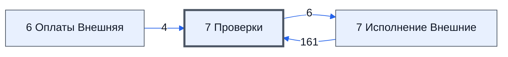

# Лист «7 Проверки»

Таблица: внешняя таблица оплат · контур 3.

**Зачем** (со слов): проверка, заполнены ли УПД на листе 7.

Устройство листа — заголовки, вид столбцов, списки, формулы, связи с другими листами — собрано из таблицы ниже. Строка заголовков на этом листе угадана по закреплённой области — проверить.

## Зачем лист — подробно

*Заполнить:* что на листе происходит, откуда приходят данные и куда уходят.

## Как заполнять

*Заполнить:* какие столбцы вводят руками, какие считаются сами. Что значит каждый столбец — в `stolbtsy.yaml` рядом (поля `chto` и `kak`).

## Что нельзя трогать

*Заполнить.*

## Инструкции и умения

*Заполнить:* какие инструкции и умения относятся к листу.

## Осталось сделать

- Заполнить разделы выше и `stolbtsy.yaml`.

## Устройство (из таблицы)

- **Таблица:** внешняя таблица оплат, лист «7 Проверки»; контур 3
- **Размер:** `A1:BZ333`
- **Каркас:** свой, не общий; строка заголовков — 1, угадана по закреплённой области — проверить
- **Формул:** 54; заполненных ячеек без формул в данных: 2780; списков: 0; условного форматирования: 1; объединённых ячеек: 0

## Связи с другими листами

- **Берёт данные с листов:** [7 Исполнение Внешние](../k3-vo-7-ispolnenie-vneshnie/index.md) (161), [6 Оплаты Внешняя](../k3-vo-6-oplaty-vneshnyaya/index.md) (4)
- **Его данные используют:** [7 Исполнение Внешние](../k3-vo-7-ispolnenie-vneshnie/index.md) (6)

В скобках и на стрелках — сколько формул ссылаются.

## Столбцы

Устройство — из таблицы; «Что это» и «Как заполняют» — из `stolbtsy.yaml` (заполняем руками).

| Столбец | Заголовок | Служебное имя | Вид | Заполняется | Список | Что это | Как заполняют |
|---|---|---|---|---|---|---|---|
| A | Строка |  |  | формула |  |  |  |
| B | Проверки |  |  | формула |  |  |  |
| C | Цвета |  |  | формула |  |  |  |
| H |  |  |  | формула |  |  |  |
| L |  |  |  | формула |  |  |  |
| O |  |  |  | формула |  |  |  |
| P |  |  |  | формула |  |  |  |
| Q |  |  |  | формула |  |  |  |
| R |  |  |  | формула |  |  |  |
| S |  |  |  | формула |  |  |  |
| T |  |  |  | формула |  |  |  |
| U | A |  |  | формула |  |  |  |
| V | B |  |  | формула |  |  |  |
| W | C |  |  | руками? |  |  |  |
| X | D |  |  | формула |  |  |  |
| Y | E |  |  | формула |  |  |  |
| Z | F |  |  | руками? |  |  |  |
| AA | G |  |  | руками? |  |  |  |
| AB | H |  |  | руками? |  |  |  |
| AC | I |  |  | формула |  |  |  |
| AD | J |  |  | формула |  |  |  |
| AE | K |  |  | формула |  |  |  |
| AF | L |  |  | формула |  |  |  |
| AG | M |  |  | формула |  |  |  |
| AH | N |  |  | формула |  |  |  |
| AI | O |  |  | формула |  |  |  |
| AJ | P |  |  | формула |  |  |  |
| AK | Q |  |  | формула |  |  |  |
| AL | R |  |  | руками? |  |  |  |
| AM | S |  |  | руками? |  |  |  |
| AN | T |  |  | руками? |  |  |  |
| AO | U |  |  | руками? |  |  |  |
| AP | V |  |  | руками? |  |  |  |
| AQ | W |  |  | руками? |  |  |  |
| AR | X |  |  | руками? |  |  |  |
| AS | Y |  |  | руками? |  |  |  |
| AT | Z |  |  | руками? |  |  |  |
| AX |  |  |  | формула |  |  |  |
| AY | A |  |  | формула |  |  |  |
| AZ | B |  |  | формула |  |  |  |
| BA | C |  |  | формула |  |  |  |
| BB | D |  |  | формула |  |  |  |
| BC | E |  |  | формула |  |  |  |
| BD | F |  |  | формула |  |  |  |
| BE | G |  |  | формула |  |  |  |
| BF | H |  |  | руками? |  |  |  |
| BG | I |  |  | формула |  |  |  |
| BH | J |  |  | формула |  |  |  |
| BI | K |  |  | формула |  |  |  |
| BJ | L |  |  | формула |  |  |  |
| BK | M |  |  | формула |  |  |  |
| BL | N |  |  | формула |  |  |  |
| BM | O |  |  | формула |  |  |  |
| BN | P |  |  | формула |  |  |  |
| BO | Q |  |  | формула |  |  |  |
| BP | R |  |  | руками? |  |  |  |
| BQ | S |  |  | руками? |  |  |  |
| BR | T |  |  | руками? |  |  |  |
| BS | U |  |  | руками? |  |  |  |
| BT | V |  |  | руками? |  |  |  |
| BU | W |  |  | руками? |  |  |  |
| BV | X |  |  | руками? |  |  |  |
| BW | Y |  |  | руками? |  |  |  |
| BX | Z |  |  | руками? |  |  |  |

Формулы столбцов (41)

| Столбец | Строка | Формула |
|---|---|---|
| A | 1 | <code>={"Строка";ROW(A2:A333)}</code> |
| B | 10 | <code>={"Итого По Документам";BYROW(U11:AU16,LAMBDA(тт,TEXTJOIN(CHAR(10),TRUE,тт)));BYROW(U17:AU17,LAMBDA(тт,TEXTJOIN(CHAR(10),TRUE,тт)))}</code> |
| C | 10 | <code>={"Итого По Цветам";BYROW(AY11:BT16,LAMBDA(тт,TEXTJOIN(";",FALSE,тт)));BYROW(AY17:BT17,LAMBDA(тт,TEXTJOIN(";",FALSE,тт)))}</code> |
| H | 10 | <code>={"УПД Закупки";IF(F11:F333="",,(G11:G333 + I11:I333)=0)}</code> |
| L | 10 | <code>={"УПД Поставки";IF(F11:F333="",,(K11:K333 + M11:M333)=0)}</code> |
| O | 10 | <code>={"Это Договор?";'7 Проверки'!$O$3;IF(('7 Исполнение Внешние'!$H$12:$H$15&amp;'7 Исполнение Внешние'!$J$12:$J$15)="",'7 Проверки'!$O$4,'7 Проверки'!$O$3)}</code> |
| P | 10 | <code>={"Есть посредники?"; IF(SUM( {1;IF(('7 Исполнение Внешние'!$H$12:$H$15&amp;'7 Исполнение Внешние'!$J$12:$J$15)="",0,1)} )&gt;1,TRUE,FALSE) }</code> |
| Q | 10 | <code>={"Кол-во номенклатур";COUNTUNIQUE('6 Оплаты Внешняя'!$J$11:$J333)}</code> |
| R | 18 | <code>={"Статус Доставки";'7 Исполнение Внешние'!$G$19:$G333}</code> |
| S | 18 | <code>={ "УПД З"; IF('7 Проверки'!$O$19:$O333='7 Проверки'!$O$4,, ifs( ISBLANK('7 Исполнение Внешние'!$G$19:$G333),, TRUE, ) )}</code> |
| T | 18 | <code>={ "УПД П"; IF('7 Проверки'!$O$19:$O333='7 Проверки'!$O$4,, ifs( ISBLANK('7 Исполнение Внешние'!$I$19:$I333),, TRUE, ) )}</code> |
| U | 18 | <code>={ '7 Исполнение Внешние'!$A$18; IF('7 Проверки'!$O$19:$O333='7 Проверки'!$O$4, IF("" &amp;'7 Исполнение Внешние'!$B$19:$B333 &amp;'7 Исполнение Внешние'!$D$19:$D333 &amp;'7 Исполнение Внешние'!$E$19:$E333 &amp;'7 Исполнение Внешние'!$F$19:$F333 &amp;'7 Исполнение Внешние'!$G$19:$G333 &amp;'7 Исполнение Внешние'!$I$19:$I333 &amp;'7 Исполнение Внешние'!$J$19:$J333 &amp;'7 Исполнение Внешние'!$K$19:$K333 &amp;'7 Исполнение Внешние'!$L …</code> |
| V | 18 | <code>={ '7 Исполнение Внешние'!B18; IF($O$19:$O333=$O$4, IF("" &amp;'7 Исполнение Внешние'!$A$19:$A333 &amp;'7 Исполнение Внешние'!$D$19:$D333 &amp;'7 Исполнение Внешние'!$E$19:$E333 &amp;'7 Исполнение Внешние'!$F$19:$F333 &amp;'7 Исполнение Внешние'!$G$19:$G333 &amp;'7 Исполнение Внешние'!$I$19:$I333 &amp;'7 Исполнение Внешние'!$J$19:$J333 &amp;'7 Исполнение Внешние'!$K$19:$K333 &amp;'7 Исполнение Внешние'!$L$19:$L333 &amp;'7 Исполнение Вне …</code> |
| X | 8 | <code>="После заполнения, "&amp;TEXTJOIN(", ",TRUE,BYROW({AE18;AF18;AG18},LAMBDA(k,"'"&amp;k&amp;"'")))&amp;" будет добавлена новая строка, если данное сообщение не пропадет в течение 30 минут, то надо писать в тех поддержку."</code> |
| Y | 18 | <code>={ '7 Исполнение Внешние'!$E$18;BYROW(ifs( '7 Проверки'!$O$19:$O333='7 Проверки'!$O$4,, ISBLANK('7 Исполнение Внешние'!$B$19:$B333) ,, ISBLANK('7 Исполнение Внешние'!$A$19:$A333) ,, ISBLANK('7 Исполнение Внешние'!$E$19:$E333),'7 Исполнение Внешние'!$E$18 &amp;" - "&amp;'7 Проверки'!$X$3, NOT(ISNUMBER('7 Исполнение Внешние'!$E$19:$E333*1)),'7 Исполнение Внешние'!$E$18 &amp;" - "&amp;'7 Проверки'!$X$4, '7 Исполнени …</code> |
| AC | 18 | <code>={ '7 Исполнение Внешние'!$I$18; IF('7 Проверки'!$O$19:$O333='7 Проверки'!$O$4,, ifs( ISBLANK('7 Исполнение Внешние'!$I$19:$I333),'7 Исполнение Внешние'!$I$18 &amp;" - "&amp;'7 Проверки'!$AA$3, NOT(ISNUMBER('7 Исполнение Внешние'!$I$19:$I333*1)),'7 Исполнение Внешние'!$I$18 &amp;" - "&amp;'7 Проверки'!$AA$4, '7 Исполнение Внешние'!$I$19:$I333*1&lt;0,'7 Исполнение Внешние'!$I$18 &amp;" - "&amp;'7 Проверки'!$AA$5, TRUE, ) )}</code> |
| AD | 17 | <code>=LAMBDA(суммДог,сумУпд, ifs((суммДог- сумУпд)=0,,(суммДог-сумУпд) &gt; 0,'7 Проверки'!$AC$4&amp;" "&amp;(суммДог- сумУпд),(суммДог-сумУпд) &lt; 0,'7 Проверки'!$AC$3) ) (ROUND( SUM('7 Исполнение Внешние'!$L$12:$L$15),2),ROUND( '7 Исполнение Внешние'!$J$17,2))</code> |
| AE | 18 | <code>={ '7 Исполнение Внешние'!$K$18; IF('7 Проверки'!$O$19:$O333='7 Проверки'!$O$4,, IF('7 Проверки'!$P$19:$P333='7 Проверки'!$P$3, ifs( ISBLANK('7 Исполнение Внешние'!$K$19:$K333), '7 Исполнение Внешние'!$K$18 &amp;" - "&amp;'7 Проверки'!$AD$3, TRUE, ),) &amp; IF('7 Проверки'!$P$19:$P333&lt;&gt;'7 Проверки'!$P$3, ifs( ISBLANK('7 Исполнение Внешние'!$K$19:$K333), IF('7 Исполнение Внешние'!$L$19:$L333&amp;'7 Исполнение Внеш …</code> |
| AF | 18 | <code>={ '7 Исполнение Внешние'!$L$18; IF('7 Проверки'!$O$19:$O333='7 Проверки'!$O$4,, IF('7 Проверки'!$P$19:$P333='7 Проверки'!$P$3, ifs( ISBLANK('7 Исполнение Внешние'!$L$19:$L333),'7 Исполнение Внешние'!$L$18 &amp;" - "&amp; '7 Проверки'!$AE$3, TRUE, ),)&amp; IF('7 Проверки'!$P$19:$P333=$P$4, ifs( NOT(ISBLANK('7 Исполнение Внешние'!$L$19:$L333)),'7 Исполнение Внешние'!$L$18 &amp; IF('7 Исполнение Внешние'!$I$19:$I33 …</code> |
| AG | 9 | <code>=TEXTJOIN("",TRUE,IF('7 Проверки'!$O$19:$O333='7 Проверки'!$O$4,,IF(ISBLANK('7 Исполнение Внешние'!$K$19:$K333),"-",)))=""</code> |
| AH | 18 | <code>={ '7 Исполнение Внешние'!$N$18; IF('7 Проверки'!$O$19:$O333='7 Проверки'!$O$4,, ifs( ISBLANK('7 Исполнение Внешние'!$N19:$N333),'7 Исполнение Внешние'!$N$18 &amp;" - "&amp;'7 Проверки'!$AA$3, NOT(ISNUMBER('7 Исполнение Внешние'!$N$19:$N333*1)),'7 Исполнение Внешние'!$N$18 &amp;" - "&amp;'7 Проверки'!$AA$4, '7 Исполнение Внешние'!$N$19:$N333*1&lt;0,'7 Исполнение Внешние'!$N$18 &amp;" - "&amp;'7 Проверки'!$AA$5, TRUE, ) )}</code> |
| AI | 17 | <code>=IF(ROUND('7 Исполнение Внешние'!$O$17,2)=ROUND('7 Исполнение Внешние'!$L$11,2),,'7 Проверки'!$AG$5)</code> |
| AJ | 18 | <code>={ '7 Исполнение Внешние'!$P$18; IF('7 Проверки'!$O$19:$O333='7 Проверки'!$O$4,, IF('7 Проверки'!$Q$19:$Q333='7 Проверки'!$Q$3, ifs( ISBLANK('7 Исполнение Внешние'!$P$19:$P333),'7 Исполнение Внешние'!$P$18 &amp;" - "&amp; '7 Проверки'!$AI$3, TRUE, ),) &amp; IF('7 Проверки'!$Q$19:$Q333='7 Проверки'!$Q$4,ifs( NOT(ISBLANK('7 Исполнение Внешние'!$P$19:$P333)),'7 Исполнение Внешние'!$P$18 &amp;" - Для Статуса: '"&amp; '7  …</code> |
| AK | 18 | <code>={ '7 Исполнение Внешние'!Q$18; IF('7 Проверки'!$O$19:$O333='7 Проверки'!$O$4,, IF('7 Проверки'!$Q$19:$Q333=$Q$3,ifs( ISBLANK('7 Исполнение Внешние'!$Q$19:$Q333),'7 Исполнение Внешние'!$Q$18 &amp;" - "&amp; '7 Проверки'!$AF$3, NOT( ISDATE_STRICT('7 Исполнение Внешние'!$Q$19:$Q333)),'7 Исполнение Внешние'!$Q$18&amp;" - " &amp; '7 Проверки'!$AF$4, TRUE, ),) &amp; IF('7 Проверки'!$Q$19:$Q333='7 Проверки'!$Q$4,ifs( NOT(I …</code> |
| AX | 18 | <code>={"Итого По Цветам";BYROW('7 Проверки'!$AY$19:$BO333,LAMBDA(тт,TEXTJOIN(";",FALSE,тт)))}</code> |
| AY | 18 | <code>={'7 Исполнение Внешние'!$A$18; ifs( '7 Проверки'!$U$19:$U333="",'7 Проверки'!$AX$1, TRUE,'7 Проверки'!$AX$5 ) }</code> |
| AZ | 18 | <code>={'7 Исполнение Внешние'!$B$18; ifs( '7 Проверки'!$V$19:$V333="",'7 Проверки'!$AX$1, TRUE,'7 Проверки'!$AX$5 ) }</code> |
| BA | 18 | <code>={'7 Исполнение Внешние'!$C$18; ifs( '7 Проверки'!$W$19:$W333="",'7 Проверки'!$AX$1, TRUE,'7 Проверки'!$AX$5 ) }</code> |
| BB | 18 | <code>={'7 Исполнение Внешние'!$D$18; ifs( '7 Проверки'!$X$19:$X333="",'7 Проверки'!$AX$1, TRUE,'7 Проверки'!$AX$5 ) }</code> |
| BC | 18 | <code>={'7 Исполнение Внешние'!$E$18; ifs( '7 Проверки'!$Y$19:$Y333="",'7 Проверки'!$AX$1, TRUE,'7 Проверки'!$AX$5 ) }</code> |
| BD | 18 | <code>={'7 Исполнение Внешние'!$F$18; ifs( '7 Проверки'!$Z$19:$Z333="",'7 Проверки'!$AX$1, TRUE,'7 Проверки'!$AX$5 ) }</code> |
| BE | 18 | <code>={'7 Исполнение Внешние'!$G$18; ifs( '7 Проверки'!$AA$19:$AA333="",'7 Проверки'!$AX$1, TRUE,'7 Проверки'!$AX$5 ) }</code> |
| BG | 18 | <code>={'7 Исполнение Внешние'!$I$18; ifs( '7 Проверки'!$AC$19:$AC333="",'7 Проверки'!$AX$1, TRUE,'7 Проверки'!$AX$5 ) }</code> |
| BH | 17 | <code>=ifs( '7 Проверки'!AD$17="",'7 Проверки'!$AX$1, TRUE,'7 Проверки'!$AX$5 )</code> |
| BI | 18 | <code>={'7 Исполнение Внешние'!$K$18; IF('7 Проверки'!$P19:$P333='7 Проверки'!$P$3, ifs( '7 Проверки'!$AE$19:$AE333="",'7 Проверки'!$AX$1, TRUE,'7 Проверки'!$AX$5 ),)&amp; IF( '7 Проверки'!$P19:$P333='7 Проверки'!$P$4, ifs( '7 Проверки'!$AE$19:$AE333="",'7 Проверки'!$AX$1, TRUE,'7 Проверки'!$AX$8 )&amp;'7 Проверки'!$AX$4,)}</code> |
| BJ | 18 | <code>={'7 Исполнение Внешние'!$L$18;IF('7 Проверки'!$P19:$P333='7 Проверки'!$P$3, ifs( '7 Проверки'!$AF$19:$AF333="",'7 Проверки'!$AX$1, TRUE,'7 Проверки'!$AX$5 ),) &amp; IF( '7 Проверки'!$P19:$P333='7 Проверки'!$P$4, ifs( '7 Проверки'!$AF$19:$AF333="",'7 Проверки'!$AX$1, TRUE,'7 Проверки'!$AX$8 )&amp;'7 Проверки'!$AX$4,)}</code> |
| BK | 18 | <code>={'7 Исполнение Внешние'!$M$18;IF( '7 Проверки'!$P19:$P333='7 Проверки'!$P$3, ifs( '7 Проверки'!$AG$19:$AG333="",'7 Проверки'!$AX$1, TRUE,'7 Проверки'!$AX$5 ),) &amp; IF( '7 Проверки'!$P19:$P333='7 Проверки'!$P$4, ifs( '7 Проверки'!$AG$19:$AG333="",'7 Проверки'!$AX$1, TRUE,'7 Проверки'!$AX$8 )&amp;'7 Проверки'!$AX$4,) }</code> |
| BL | 18 | <code>={'7 Исполнение Внешние'!$N$18; ifs( '7 Проверки'!$AH$19:$AH333="",'7 Проверки'!$AX$1, TRUE,'7 Проверки'!$AX$5 ) }</code> |
| BM | 17 | <code>=ifs( '7 Проверки'!AI$17="",'7 Проверки'!$AX$1, TRUE,'7 Проверки'!$AX$5 )</code> |
| BN | 18 | <code>={'7 Исполнение Внешние'!$P$18;IF('7 Проверки'!$Q19:$Q333='7 Проверки'!$Q$3, ifs( '7 Проверки'!$AJ$19:$AJ333="",'7 Проверки'!$AX$1, TRUE,'7 Проверки'!$AX$5 ),) &amp; IF( '7 Проверки'!$Q19:$Q333='7 Проверки'!$P$4, ifs( '7 Проверки'!$AJ$19:$AJ333="",'7 Проверки'!$AX$1, TRUE,'7 Проверки'!$AX$8 )&amp;'7 Проверки'!$AX$4,)}</code> |
| BO | 18 | <code>={'7 Исполнение Внешние'!$Q$18;IF('7 Проверки'!$Q19:$Q333='7 Проверки'!$Q$3, ifs( '7 Проверки'!$AK$19:$AK333="",'7 Проверки'!$AX$1, TRUE,'7 Проверки'!$AX$5 ),) &amp; IF( '7 Проверки'!$Q19:$Q333='7 Проверки'!$P$4, ifs( '7 Проверки'!$AK$19:$AK333="",'7 Проверки'!$AX$1, TRUE,'7 Проверки'!$AX$8 )&amp;'7 Проверки'!$AX$4,)}</code> |

