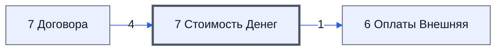

# Лист «7 Стоимость Денег»

Таблица: внешняя таблица оплат · контур 3.

**Зачем** (со слов директора): расчёт стоимости денег.

Устройство листа — заголовки, вид столбцов, списки, формулы, связи с другими листами — собрано из таблицы ниже. Строка заголовков на этом листе угадана по закреплённой области — проверить.

## Зачем лист — подробно

*Заполнить:* что на листе происходит, откуда приходят данные и куда уходят.

## Как заполнять

*Заполнить:* какие столбцы вводят руками, какие считаются сами. Что значит каждый столбец — в `stolbtsy.yaml` рядом (поля `chto` и `kak`).

## Что нельзя трогать

*Заполнить.*

## Инструкции и умения

*Заполнить:* какие инструкции и умения относятся к листу.

## Осталось сделать

- Заполнить разделы выше и `stolbtsy.yaml`.

## Устройство (из таблицы)

- **Таблица:** внешняя таблица оплат, лист «7 Стоимость Денег»; контур 3
- **Размер:** `A1:N1001`, закреплено до `A11`
- **Каркас:** свой, не общий; строка заголовков — 10, угадана по закреплённой области — проверить
- **Формул:** 25; заполненных ячеек без формул в данных: 2856; списков: 0; условного форматирования: 0; объединённых ячеек: 0

## Связи с другими листами

- **Берёт данные с листов:** [7 Договора](../k3-vo-7-dogovora/index.md) (4)
- **Его данные используют:** [6 Оплаты Внешняя](../k3-vo-6-oplaty-vneshnyaya/index.md) (1)

В скобках и на стрелках — сколько формул ссылаются.

## Столбцы

Устройство — из таблицы; «Что это» и «Как заполняют» — из `stolbtsy.yaml` (заполняем руками).

| Столбец | Заголовок | Служебное имя | Вид | Заполняется | Список | Что это | Как заполняют |
|---|---|---|---|---|---|---|---|
| A | Дата От |  |  | руками? |  |  |  |
| B | Ставка День |  |  | руками? |  |  |  |
| D | theStr |  |  | руками? |  |  |  |
| E | Дата |  |  | руками? |  |  |  |
| F | Выбытие |  |  | руками? |  |  |  |
| G | Поступление |  |  | руками? |  |  |  |
| H | Чистый поток за день |  |  | руками? |  |  |  |
| I | Остаток |  |  | руками? |  |  |  |
| J | Ставка за пользование деньгами |  |  | руками? |  |  |  |
| K | Стоимость финансирования |  |  | руками? |  |  |  |
| L | Итого Стоимость финансирования |  |  | руками? |  |  |  |
