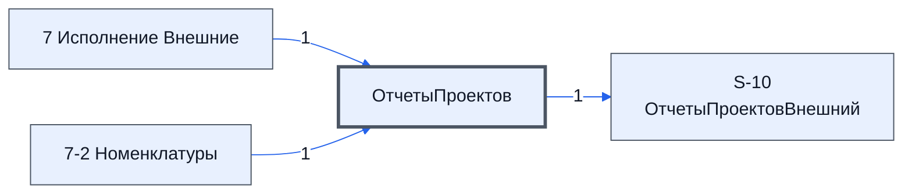

# Лист «ОтчетыПроектов»

Таблица: внешняя таблица оплат · контур 3.

**Зачем** (со слов): не используется.

Устройство листа — заголовки, вид столбцов, списки, формулы, связи с другими листами — собрано из таблицы ниже. Строка заголовков на этом листе угадана по закреплённой области — проверить.

## Зачем лист — подробно

*Заполнить:* что на листе происходит, откуда приходят данные и куда уходят.

## Как заполнять

*Заполнить:* какие столбцы вводят руками, какие считаются сами. Что значит каждый столбец — в `stolbtsy.yaml` рядом (поля `chto` и `kak`).

## Что нельзя трогать

*Заполнить.*

## Инструкции и умения

*Заполнить:* какие инструкции и умения относятся к листу.

## Осталось сделать

- Заполнить разделы выше и `stolbtsy.yaml`.

## Устройство (из таблицы)

- **Таблица:** внешняя таблица оплат, лист «ОтчетыПроектов»; контур 3
- **Размер:** `A1:Z20`
- **Каркас:** свой, не общий; строка заголовков — 1, угадана по закреплённой области — проверить
- **Формул:** 17; заполненных ячеек без формул в данных: 2; списков: 0; условного форматирования: 0; объединённых ячеек: 0

## Связи с другими листами

- **Берёт данные с листов:** [7 Исполнение Внешние](../k3-vo-7-ispolnenie-vneshnie/index.md) (1), [7-2 Номенклатуры](../k3-vo-7-2-nomenklatury/index.md) (1)
- **Его данные используют:** [S-10 ОтчетыПроектовВнешний](../k0-s-10-otchetyproektovvneshniy/index.md) (1)

В скобках и на стрелках — сколько формул ссылаются.

## Столбцы

Устройство — из таблицы; «Что это» и «Как заполняют» — из `stolbtsy.yaml` (заполняем руками).

| Столбец | Заголовок | Служебное имя | Вид | Заполняется | Список | Что это | Как заполняют |
|---|---|---|---|---|---|---|---|
| A |  |  |  | формула |  |  |  |
| C |  |  |  | формула |  |  |  |
| D |  |  |  | формула |  |  |  |
| E |  |  |  | формула |  |  |  |
| F |  |  |  | формула |  |  |  |
| G |  |  |  | формула |  |  |  |
| H |  |  |  | формула |  |  |  |

Формулы столбцов (7)

| Столбец | Строка | Формула |
|---|---|---|
| A | 2 | <code>={"Актуально";TEXT( NOW(),"DD.MM.YYYY HH:mm:ss")}</code> |
| C | 9 | <code>=Let( doErr, LAMBDA (txt_ar, TEXTJOIN(CHAR(10),TRUE, Map( Unique(split( TEXTJOIN(CHAR(10),TRUE,txt_ar), CHAR(10),0,TRUE ),TRUE) , LAMBDA(e," - "&amp;e)) ) ), doRez, LAMBDA(n,err, IF( IFERROR( err,)="", ,n&amp;":"&amp;CHAR(10)&amp;err ) ), rez, TEXTJOIN,"ОшибкиИсполнениеВнешние")</code> |
| D | 9 | <code>=LET( head , "Рабочий Лист"&amp;CHAR(10)&amp;"Ожидаемая дата готовности последнего товара", tz_a , "Берем максимальную дату из поля 'Ожидаемая дата готовности' из таблицы логиста для товаров со статусами отличными от", tz_b , "'Д,"Рабочий Лист Ожидаемая дата готовности последнего товара")</code> |
| E | 9 | <code>={"Рабочий Лист"&amp;CHAR(10)&amp;"Даты доставок товара заказчику";"Рабочий Лист"&amp;CHAR(10)&amp;"Даты доставок товара заказчику"; LET( theТermTxt_ar , sort( '7-2 Номенклатуры'!AM11:AM20),TEXTJOIN( CHAR(10),TRUE, UNIQUE( Map( IFERROR( FILTER(theТermTxt_ar,"Рабочий Лист Даты доставок товара заказчику")</code> |
| F | 9 | <code>={"Рабочий Лист"&amp;CHAR(10)&amp;"Сводка по доставке Товаров";"Рабочий Лист"&amp;CHAR(10)&amp;"Сводка по доставке Товаров"; LAMBDA(тб,tz, IF (ISNA(тб),"Нет данных по доставке товаров на "&amp; 'ОтчетыПроектов'!$A$3 , TEXTJOIN(CHAR(10),TRUE,Query({ {INDEX(тб,2,2),","Рабочий Лист Сводка по доставке Товаров")</code> |
| G | 9 | <code>=LET( head , "Рабочий Лист"&amp;CHAR(10)&amp;"Дата доставки Заказчику последнего товара", tz , "Если для всех товаров есть 'Дата доставки Заказчику' то Максимальная из 'Дата доставки Заказчику' иначе пусто ", theTov_ar , '7-2 Номен,"Рабочий Лист Дата доставки Заказчику последнего товара")</code> |
| H | 9 | <code>=LET( head , "Рабочий Лист"&amp;CHAR(10)&amp;"Дата поступления к нам на склад последнего товара", tz , "Если для всех товаров есть 'Дата доставки Заказчику' то Максимальная из 'Дата доставки Заказчику' иначе пусто ", theTov_ar , '7,"Рабочий Лист Дата поступления к нам на склад последнего товара")</code> |

