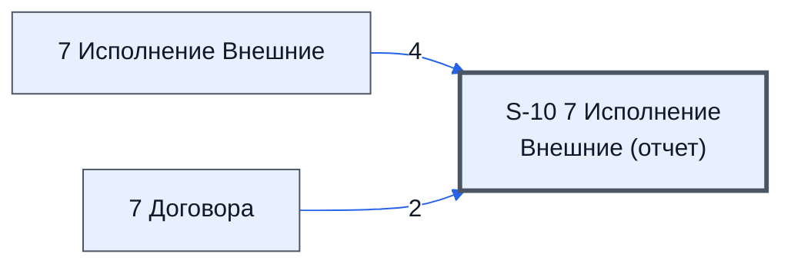

# Лист «S-10 7 Исполнение Внешние (отчет)»

Таблица: внешняя таблица оплат · контур 3.

**Зачем** (со слов): отчёт по листу «7 Договора».

Устройство листа — заголовки, вид столбцов, списки, формулы, связи с другими листами — собрано из таблицы ниже. Строка заголовков на этом листе угадана по закреплённой области — проверить.

## Зачем лист — подробно

*Заполнить:* что на листе происходит, откуда приходят данные и куда уходят.

## Как заполнять

*Заполнить:* какие столбцы вводят руками, какие считаются сами. Что значит каждый столбец — в `stolbtsy.yaml` рядом (поля `chto` и `kak`).

## Что нельзя трогать

*Заполнить.*

## Инструкции и умения

*Заполнить:* какие инструкции и умения относятся к листу.

## Осталось сделать

- Заполнить разделы выше и `stolbtsy.yaml`.

## Устройство (из таблицы)

- **Таблица:** внешняя таблица оплат, лист «S-10 7 Исполнение Внешние (отче»; контур 3
- **Размер:** `A1:AK333`
- **Каркас:** свой, не общий; строка заголовков — 1, угадана по закреплённой области — проверить
- **Формул:** 1; заполненных ячеек без формул в данных: 166; списков: 0; условного форматирования: 0; объединённых ячеек: 0

## Связи с другими листами

- **Берёт данные с листов:** [7 Исполнение Внешние](../k3-vo-7-ispolnenie-vneshnie/index.md) (4), [7 Договора](../k3-vo-7-dogovora/index.md) (2)

В скобках и на стрелках — сколько формул ссылаются.

## Столбцы

Устройство — из таблицы; «Что это» и «Как заполняют» — из `stolbtsy.yaml` (заполняем руками).

| Столбец | Заголовок | Служебное имя | Вид | Заполняется | Список | Что это | Как заполняют |
|---|---|---|---|---|---|---|---|
| A | v05 |  |  | формула |  |  |  |
| M | #N/A |  |  | руками? |  |  |  |

Формулы столбцов (1)

| Столбец | Строка | Формула |
|---|---|---|
| A | 1 | <code>={ '7 Исполнение Внешние'!A1:J1000 , {'7 Исполнение Внешние'!K1:K10; Let( head_ar,'7 Договора'!A10:AA10 , find_v, "НДС Договора" , body_arr, '7 Договора'!A11:AA15 , col, MATCH(find_v,head_ar,0) , ret_ar,INDEX(body_arr,,col) , ret_ar ); '7 Исполнение Внешние'!K16:K1000 } , '7 Исполнение Внешние'!L1:AK1000 }</code> |

