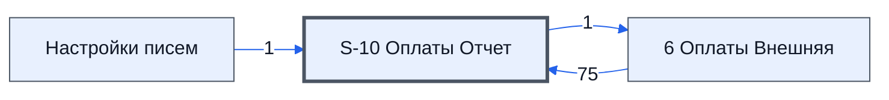

# Лист «S-10 Оплаты Отчет»

Таблица: внешняя таблица оплат · контур 3.

**Зачем** (со слов): для листа «S-10 ОтчетыПроектовВнешний» таблицы проекта.

Устройство листа — заголовки, вид столбцов, списки, формулы, связи с другими листами — собрано из таблицы ниже. Строка заголовков на этом листе угадана по закреплённой области — проверить.

## Зачем лист — подробно

*Заполнить:* что на листе происходит, откуда приходят данные и куда уходят.

## Как заполнять

*Заполнить:* какие столбцы вводят руками, какие считаются сами. Что значит каждый столбец — в `stolbtsy.yaml` рядом (поля `chto` и `kak`).

## Что нельзя трогать

*Заполнить.*

## Инструкции и умения

*Заполнить:* какие инструкции и умения относятся к листу.

## Осталось сделать

- Заполнить разделы выше и `stolbtsy.yaml`.

## Устройство (из таблицы)

- **Таблица:** внешняя таблица оплат, лист «S-10 Оплаты Отчет»; контур 3
- **Размер:** `A1:EZ310`, закреплено до `A11`
- **Каркас:** свой, не общий; строка заголовков — 10, угадана по закреплённой области — проверить
- **Формул:** 686; заполненных ячеек без формул в данных: 112; списков: 0; условного форматирования: 1; объединённых ячеек: 0
- **Данные из других таблиц (IMPORTRANGE):** 1

## Связи с другими листами

- **Берёт данные с листов:** [6 Оплаты Внешняя](../k3-vo-6-oplaty-vneshnyaya/index.md) (75), [Настройки писем](../k0-nastroyki-pisem/index.md) (1)
- **Его данные используют:** [6 Оплаты Внешняя](../k3-vo-6-oplaty-vneshnyaya/index.md) (1)

В скобках и на стрелках — сколько формул ссылаются.

## Столбцы

Устройство — из таблицы; «Что это» и «Как заполняют» — из `stolbtsy.yaml` (заполняем руками).

| Столбец | Заголовок | Служебное имя | Вид | Заполняется | Список | Что это | Как заполняют |
|---|---|---|---|---|---|---|---|
| A | № |  |  | руками? |  |  |  |
| B | Описание |  |  | руками? |  |  |  |
| C | Значение |  |  | руками? |  |  |  |
| AA | № |  |  | формула |  |  |  |
| AB | Описание |  |  | формула |  |  |  |
| AC | Значение |  |  | формула |  |  |  |
| AH |  |  |  | формула |  |  |  |
| AP | 0 |  |  | формула |  |  |  |
| AQ | 0 |  |  | формула |  |  |  |
| AR | 0 |  |  | формула |  |  |  |
| AS | 0 |  |  | формула |  |  |  |
| AT | 0 |  |  | формула |  |  |  |
| AU | 0 |  |  | формула |  |  |  |
| AV | #N/A |  |  | формула |  |  |  |
| AW |  |  |  | формула |  |  |  |
| AY | 1. |  |  | формула |  |  |  |
| AZ | Планируемые оплаты за товары |  |  | формула |  |  |  |
| BA | Значения |  |  | формула |  |  |  |
| BB |  |  |  | формула |  |  |  |
| BD | № проекта |  |  | формула |  |  |  |
| BE | Дата |  |  | формула |  |  |  |
| BF | Тип |  |  | формула |  |  |  |
| BG | Плательщик |  |  | формула |  |  |  |
| BH | Кому |  |  | формула |  |  |  |
| BI | ИНН Поставщика |  |  | формула |  |  |  |
| BJ | Сумма / Выбытие |  |  | формула |  |  |  |
| BK | НДС |  |  | формула |  |  |  |
| BL | Вид оплаты / Вид оплаты |  |  | формула |  |  |  |
| BM | № счета / Назначение платежа |  |  | формула |  |  |  |
| BN | Назначение платежа |  |  | формула |  |  |  |
| BO | Платежи / Касса |  |  | формула |  |  |  |
| BP | #N/A |  |  | формула |  |  |  |
| BQ | #N/A |  |  | формула |  |  |  |
| BR | #N/A |  |  | формула |  |  |  |
| BS | #N/A |  |  | формула |  |  |  |
| BT | #N/A |  |  | формула |  |  |  |
| BU | #N/A |  |  | руками? |  |  |  |
| BW | #N/A |  |  | формула |  |  |  |
| BX | #N/A |  |  | формула |  |  |  |
| BY | #N/A |  |  | формула |  |  |  |
| BZ | #N/A |  |  | формула |  |  |  |
| CA | #N/A |  |  | формула |  |  |  |
| CB | #N/A |  |  | формула |  |  |  |
| CC | #N/A |  |  | руками? |  |  |  |
| CE | #N/A |  |  | формула |  |  |  |
| CF | #N/A |  |  | формула |  |  |  |
| CG | #N/A |  |  | формула |  |  |  |
| CI | #N/A |  |  | формула |  |  |  |
| CJ | #N/A |  |  | формула |  |  |  |
| CK | #N/A |  |  | формула |  |  |  |
| CM | #N/A |  |  | формула |  |  |  |
| CN | #N/A |  |  | формула |  |  |  |
| CP | #N/A |  |  | формула |  |  |  |
| CQ | #N/A |  |  | формула |  |  |  |
| CR | #N/A |  |  | формула |  |  |  |
| CT | #N/A |  |  | формула |  |  |  |
| CV | #N/A |  |  | формула |  |  |  |
| CW |  |  |  | формула |  |  |  |
| CX | 2. |  |  | формула |  |  |  |
| CY | Фактические показатели за товары |  |  | формула |  |  |  |
| CZ | Значения |  |  | формула |  |  |  |
| DA |  |  |  | формула |  |  |  |
| DG |  |  |  | формула |  |  |  |
| DN |  |  |  | формула |  |  |  |
| DT |  |  |  | формула |  |  |  |
| DV |  |  |  | формула |  |  |  |
| EB | 0 |  |  | формула |  |  |  |
| EC | 0 |  |  | формула |  |  |  |
| ED | 0 |  |  | формула |  |  |  |
| EE | 0 |  |  | формула |  |  |  |
| EF | 0 |  |  | формула |  |  |  |
| EH | 0 |  |  | формула |  |  |  |
| EI |  |  |  | формула |  |  |  |
| EK | 3. |  |  | формула |  |  |  |
| EL | Доплата за товары, плановые суммы |  |  | формула |  |  |  |
| EM | Значения |  |  | формула |  |  |  |
| EN |  |  |  | формула |  |  |  |
| EU | Проверка ошибок |  |  | формула |  |  |  |
| EW |  |  |  | формула |  |  |  |
| EX |  |  |  | формула |  |  |  |
| EY |  |  |  | формула |  |  |  |

Формулы столбцов (76)

| Столбец | Строка | Формула |
|---|---|---|
| AA | 10 | <code>="№"</code> |
| AB | 10 | <code>="Описание"</code> |
| AC | 10 | <code>="Значение"</code> |
| AH | 11 | <code>=LAMBDA(theFilter,thePlatS,theContS,thePostS,theNameS,theSumS,theIdS,theNDSs,theVids, FILTER({thePlatS ,theContS ,thePostS ,theNameS,theIdS,theNDSs,theVids,theSumS}, theFilter) )( ARRAYFORMULA('6 Оплаты Внешняя'!K11:K310&lt;&gt;""), '6 Оплаты Внешняя'!AP11:AP3,"#N/A")</code> |
| AP | 10 | <code>=SUMPRODUCT(AP$11:AP310, $AO$11:$AO310)</code> |
| AQ | 11 | <code>=IF( ((AP11:AP310=1)+(AN11:AN310="Нал"))=2,1,)</code> |
| AR | 11 | <code>=IF( ((AP11:AP310=1)+(AN11:AN310="Без нал") + (COUNTIF(L$1:L$10, AM11:AM310) = 0) )=3,1,)</code> |
| AS | 11 | <code>=IF( ((AP11:AP310=1)+(AN11:AN310="Без нал")+ (COUNTIF(L$1:L$10, AM11:AM310) &gt; 0) )=3,1,)</code> |
| AT | 11 | <code>=IF( ((AP11:AP310=1)+(AN11:AN310&lt;&gt;"Без нал")+(AN11:AN310&lt;&gt;"Нал"))=3,1,)</code> |
| AU | 11 | <code>=BYROW(AQ11:AT310,LAMBDA(theRow,IF(SUM(theRow)=1,1,)))</code> |
| AV | 10 | <code>=SUMPRODUCT($AV$11:$AV310,$AW$11:$AW310,$AO$11:$AO310)</code> |
| AW | 11 | <code>=LAMBDA(doChekName,doChekDate,theNdsNames,theNdsKefsS,theFrS,TheToS,thePlNameS,thePlDateS, BYROW({thePlNameS,thePlDateS},LAMBDA(thePl,IF(INDEX( thePl,,1)="",, INDEX( IFERROR( QUERY( { doChekName(LOWER( INDEX( thePl,,1)),theNdsNames) , doChekDate(IND,"#N/A")</code> |
| AY | 10 | <code>= LAMBDA(theGr,theIndS, ByRow(theIndS,LAMBDA(theInd, IF(INDEX(theInd,,1)&lt;&gt;"",TheGr&amp;INDEX(theInd,,3),) )) )("1.",AZ10:BB310 )</code> |
| AZ | 10 | <code>="Планируемые оплаты за товары"</code> |
| BA | 10 | <code>="Значения"</code> |
| BB | 11 | <code>="COMPUTED_VALUE"</code> |
| BD | 10 | <code>='6 Оплаты Внешняя'!$BB$10</code> |
| BE | 10 | <code>='6 Оплаты Внешняя'!$BC$10</code> |
| BF | 10 | <code>='6 Оплаты Внешняя'!$BD$10</code> |
| BG | 10 | <code>='6 Оплаты Внешняя'!$BE$10</code> |
| BH | 10 | <code>='6 Оплаты Внешняя'!$BG$10</code> |
| BI | 10 | <code>='6 Оплаты Внешняя'!$BH$10</code> |
| BJ | 10 | <code>='6 Оплаты Внешняя'!$BI$10 &amp;" / "&amp; '6 Оплаты Внешняя'!$BT$10</code> |
| BK | 10 | <code>='6 Оплаты Внешняя'!$BJ$10</code> |
| BL | 10 | <code>='6 Оплаты Внешняя'!$BK$10 &amp;" / "&amp;'6 Оплаты Внешняя'!$BQ$10</code> |
| BM | 10 | <code>='6 Оплаты Внешняя'!$BL$10 &amp;" / "&amp; '6 Оплаты Внешняя'!$BX$10</code> |
| BN | 10 | <code>='6 Оплаты Внешняя'!$BM$10</code> |
| BO | 10 | <code>="Платежи" &amp;" / "&amp; "Касса"</code> |
| BP | 10 | <code>=SUMPRODUCT(BP$11:BP310, $BJ$11:$BJ310)</code> |
| BQ | 11 | <code>=IF( ((BP11:BP310=1)+(BL11:BL310="Нал"))=2,1,)</code> |
| BR | 11 | <code>=IF( ((BP11:BP310=1)+(BL11:BL310="Без нал") + (COUNTIF(L$1:L$10, BK11:BK310) = 0) )=3,1,)</code> |
| BS | 11 | <code>=IF( ((BP11:BP310=1)+(BL11:BL310="Без нал") + (COUNTIF(L$1:L$10, BK11:BK310) &gt; 0) )=3,1,)</code> |
| BT | 11 | <code>=IF( ((BP11:BP310=1)+(BL11:BL310&lt;&gt;"Без нал")+(BL11:BL310&lt;&gt;"Нал"))=3,1,)</code> |
| BW | 10 | <code>=SUMPRODUCT(BW$11:BW310, $BJ$11:$BJ310)</code> |
| BX | 11 | <code>=LAMBDA(doFind,doJoin,theSchS,theOplS, LAMBDA(theOplSJ,theSchSJ, BYROW(theSchSJ,LAMBDA(theS,IF(theS="",,doFind(theS,theOplSJ)))))( doJoin(theOplS),doJoin(theSchS)) ) ( LAMBDA(theS,theOplS, IF(IFERROR(VLOOKUP(theS,theOplS,1,FALSE),)&lt;&gt;"",1,)), LAMBDA(theData,BYROW(theData,LAMBDA(td,TEXTJOIN("&#124;",TRUE,td)))), {$BM$11:$BM310,$BH$11:$BH310,$BG$11:$BG310} , {'6 Оплаты Внешняя'!$AO$11:$AO310,'6 Оплаты Вне …</code> |
| BY | 11 | <code>=IF( (($BP$11:$BP310=1)+($BF$11:$BF310="Закупка оборудования")+(BF11:BF310="По спецификации"))=2,1,)</code> |
| BZ | 11 | <code>=IF( (($BP$11:$BP310=1)+($BF$11:$BF310="Транспортные услуги"))=2,1,)</code> |
| CA | 11 | <code>=IF( (($BP$11:$BP310=1)+($BF$11:$BF310="ЗП производственного персонала сдельная"))=2,1,)</code> |
| CB | 11 | <code>=IF( (($BP$11:$BP310=1)+($BF$11:$BF310&lt;&gt;"Закупка оборудования")+($BF$11:$BF310&lt;&gt;"По спецификации")+($BF$11:$BF310&lt;&gt;"Транспортные услуги")+($BF$11:$BF310&lt;&gt;"ЗП производственного персонала сдельная"))=5,1,)</code> |
| CE | 10 | <code>=SUMPRODUCT(CE$11:CE310, $BJ$11:$BJ310)</code> |
| CF | 11 | <code>=IF( (($BP$11:$BP310=1)+($BY$11:$BY310=1)+($BR$11:$BR310=1))=3,1,)</code> |
| CG | 11 | <code>=IF( (($BP$11:$BP310=1)+($BY$11:$BY310=1)+($BS$11:$BS310=1))=3,1,)</code> |
| CI | 10 | <code>=SUMPRODUCT(CI$11:CI310, $BJ$11:$BJ310)</code> |
| CJ | 11 | <code>=IF( (($BP$11:$BP310=1)+($BZ$11:$BZ310=1)+($BR$11:$BR310=1))=3,1,)</code> |
| CK | 11 | <code>=IF( (($BP$11:$BP310=1)+($BZ$11:$BZ310=1)+($BS$11:$BS310=1))=3,1,)</code> |
| CM | 10 | <code>=SUMPRODUCT(CM$11:CM310, $BJ$11:$BJ310)</code> |
| CN | 11 | <code>=IF( (($BP$11:$BP310=1)+($CA$11:$CA310=1)+ ((($BR$11:$BR310=1) + ($BS$11:$BS310=1))=1) )=3,1,)</code> |
| CP | 10 | <code>=SUMPRODUCT(CP$11:CP310, $BJ$11:$BJ310)</code> |
| CQ | 11 | <code>=IF( (($BP$11:$BP310=1)+($CB$11:$CB310=1)+($BR$11:$BR310=1))=3,1,)</code> |
| CR | 11 | <code>=IF( (($BP$11:$BP310=1)+($CB$11:$CB310=1)+($BS$11:$BS310=1))=3,1,)</code> |
| CT | 11 | <code>=BYROW(CE11:CS310,LAMBDA(theRow,IF(SUM(theRow)=1,1,)))</code> |
| CV | 10 | <code>=SUMPRODUCT($BP$11:$BP310, CW$11:CW310,$CV$11:$CV310,$BJ$11:$BJ310)</code> |
| CW | 11 | <code>=LAMBDA(doChekName,doChekDate,theNdsNames,theNdsKefsS,theFrS,TheToS,thePlNameS,thePlDateS, BYROW({thePlNameS,thePlDateS},LAMBDA(thePl,IF(INDEX( thePl,,1)="",, INDEX( IFERROR( QUERY( { doChekName(LOWER( INDEX( thePl,,1)),theNdsNames) , doChekDate(IND,"#N/A")</code> |
| CX | 10 | <code>= LAMBDA(theGr,theIndS, ByRow(theIndS,LAMBDA(theInd, IF(INDEX(theInd,,1)&lt;&gt;"",TheGr&amp;INDEX(theInd,,3),) )) )("2.",CY10:DA310 )</code> |
| CY | 10 | <code>="Фактические показатели за товары"</code> |
| CZ | 10 | <code>="Значения"</code> |
| DA | 11 | <code>="COMPUTED_VALUE"</code> |
| DG | 11 | <code>=QUERY({$AH$11:$AH310, $AI$11:$AI310, $AJ$11:$AJ310, $AM$11:$AM310, $AN$11:$AN310, $AO$11:$AO310, $AP$11:$AP310},"Select Col1,Col2,Col3, Col4,Col5,Sum( Col6) where Col7=1 and Col6 is not null group by Col1,Col2,Col3, Col4, Col5 Label Sum(Col6) ''",0)</code> |
| DN | 11 | <code>=QUERY({$BG$11:$BG310,$BM$11:$BM310,$BH$11:$BH310,$BK$11:$BK310,$BL$11:$BL310,$BJ$11:$BJ310,$BX$11:$BX310},"Select Col1, Col2, Col3, Col4,Col5,Sum( Col6) where Col7=1 and Col6 is not null group by Col1, Col2, Col3, Col4, Col5 Label Sum(Col6) ''",0)</code> |
| DT | 11 | <code>=IF(DS11:DS310&lt;&gt;"",DS11:DS310* -1,)</code> |
| DV | 11 | <code>=IFERROR(QUERY( BYROW( QUERY( {{DG11:DG310;DN11:DN310} ,{DH11:DH310;DO11:DO310} ,{DI11:DI310;DP11:DP310} ,{DJ11:DJ310;DQ11:DQ310} ,{DK11:DK310;DR11:DR310} ,{DL11:DL310;DT11:DT310} } ,"Select Col1, Col2,Col3,Col4,Col5, Sum(Col6) Where Col6 is not,"")</code> |
| EB | 10 | <code>=SUMPRODUCT(EB$11:EB310, $EA$11:$EA310)</code> |
| EC | 11 | <code>=IF( ((EB11:EB310=1)+(DZ11:DZ310="Нал"))=2,1,)</code> |
| ED | 11 | <code>=IF( ((EB11:EB310=1)+(DZ11:DZ310="Без нал") + (COUNTIF(L$1:L$10, DY11:DY310) = 0) )=3,1,)</code> |
| EE | 11 | <code>=IF( ((EB11:EB310=1)+(DZ11:DZ310="Без нал")+ (COUNTIF(L$1:L$10, DY11:DY310) &gt; 0) +(DY11:DY310=20%))=3,1,)</code> |
| EF | 11 | <code>=IF( ((EB11:EB310=1)+(DZ11:DZ310&lt;&gt;"Без нал")+(DZ11:DZ310&lt;&gt;"Нал"))=3,1,)</code> |
| EH | 10 | <code>=SUMPRODUCT($EB$11:$EB310, EI$11:EI310,$EH$11:$EH310,$EA$11:$EA310)</code> |
| EI | 11 | <code>=LAMBDA(doChek,doFind,theNdsNames,theNdsKefsS,theNameS,{ BYROW(theNameS,LAMBDA(thePl,IF(thePl="",, doChek(doFind, LOWER( thePl),theNdsNames,theNdsKefsS))))} )( LAMBDA(doFind,thePl,theNames,theKefsS,doFind( theKefsS, BYROW(theNames,LAMBDA(theName,IF(theNa,"")</code> |
| EK | 10 | <code>= LAMBDA(theGr,theIndS, ByRow(theIndS,LAMBDA(theInd, if(INDEX(theInd,,1)&lt;&gt;"",TheGr&amp;INDEX(theInd,,3),) )) )("3.",EL10:EN310 )</code> |
| EL | 10 | <code>="Доплата за товары, плановые суммы"</code> |
| EM | 10 | <code>="Значения"</code> |
| EN | 11 | <code>="COMPUTED_VALUE"</code> |
| EU | 10 | <code>="Проверка ошибок"</code> |
| EW | 11 | <code>="4."</code> |
| EX | 11 | <code>="Проверка ошибок"</code> |
| EY | 11 | <code>=LAMBDA(doOk,doJoin,theErr, doOk(doJoin(theErr)) )( LAMBDA(theErrS,IF(theErrS="","Ошибок нет",theErrS)), LAMBDA(theErrS, TextJoin(CHAR(10),TRUE,theErrS)), EU11:EU310)</code> |

