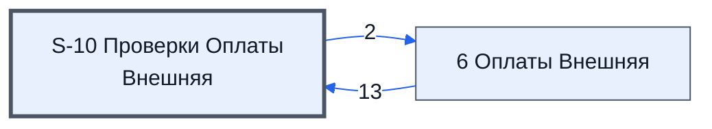

# Лист «S-10 Проверки Оплаты Внешняя»

Таблица: внешняя таблица оплат · контур 3.

**Зачем** (со слов директора): проверки внешней оплаты.

Устройство листа — заголовки, вид столбцов, списки, формулы, связи с другими листами — собрано из таблицы ниже. Строка заголовков на этом листе угадана по закреплённой области — проверить.

## Зачем лист — подробно

*Заполнить:* что на листе происходит, откуда приходят данные и куда уходят.

## Как заполнять

*Заполнить:* какие столбцы вводят руками, какие считаются сами. Что значит каждый столбец — в `stolbtsy.yaml` рядом (поля `chto` и `kak`).

## Что нельзя трогать

*Заполнить.*

## Инструкции и умения

*Заполнить:* какие инструкции и умения относятся к листу.

## Осталось сделать

- Заполнить разделы выше и `stolbtsy.yaml`.

## Устройство (из таблицы)

- **Таблица:** внешняя таблица оплат, лист «S-10 Проверки Оплаты Внешняя»; контур 3
- **Размер:** `A1:AZ857`
- **Каркас:** свой, не общий; строка заголовков — 1, угадана по закреплённой области — проверить
- **Формул:** 615; заполненных ячеек без формул в данных: 7; списков: 0; условного форматирования: 1; объединённых ячеек: 0

## Связи с другими листами

- **Берёт данные с листов:** [6 Оплаты Внешняя](../k3-vo-6-oplaty-vneshnyaya/index.md) (13)
- **Его данные используют:** [6 Оплаты Внешняя](../k3-vo-6-oplaty-vneshnyaya/index.md) (2)

В скобках и на стрелках — сколько формул ссылаются.

## Столбцы

Устройство — из таблицы; «Что это» и «Как заполняют» — из `stolbtsy.yaml` (заполняем руками).

| Столбец | Заголовок | Служебное имя | Вид | Заполняется | Список | Что это | Как заполняют |
|---|---|---|---|---|---|---|---|
| A |  |  |  | формула |  |  |  |
| J |  |  |  | формула |  |  |  |
| R |  |  |  | формула |  |  |  |
| AA |  |  |  | формула |  |  |  |
| AB |  |  |  | формула |  |  |  |
| AE |  |  |  | формула |  |  |  |
| AG |  |  |  | формула |  |  |  |
| AI |  |  |  | формула |  |  |  |
| AK |  |  |  | формула |  |  |  |
| AM |  |  |  | формула |  |  |  |
| AO |  |  |  | формула |  |  |  |
| AQ |  |  |  | формула |  |  |  |

Формулы столбцов (12)

| Столбец | Строка | Формула |
|---|---|---|
| A | 1 | <code>=AA1:AB857</code> |
| J | 10 | <code>={'6 Оплаты Внешняя'!I10:I857,'6 Оплаты Внешняя'!S10:S857,'6 Оплаты Внешняя'!AU10:AU857,'6 Оплаты Внешняя'!AS10:AS857,'6 Оплаты Внешняя'!AT10:AT857}</code> |
| R | 10 | <code>="Факт Все платежи"</code> |
| AA | 9 | <code>="ID_Товаров"</code> |
| AB | 9 | <code>="Проверки"</code> |
| AE | 10 | <code>={"Проверка 'Тип / Статья'";LAMBDA( doCtA,doCtB,doCtC,doCtD,doCtE ,doFindPlanCat,doFindPlanSCat, theInnS,thePostS, thePlanS, theFactS, BYROW({theInnS,thePostS,doFindPlanSCat(doFindPlanCat,thePlanS, theFactS)} ,LAMBDA(theR, TEXTJOIN(CHAR(10),TRUE, { ,"Проверка 'Тип / Статья'")</code> |
| AG | 10 | <code>={"Проверка ИНН";LAMBDA(doFind,doCmp, doFindPlanCat,doFindPlanSCat, theData,theInnS,thePostS, thePlanS, theFactS, BYROW({theInnS,thePostS,doFindPlanSCat(doFindPlanCat,thePlanS, theFactS)} ,LAMBDA(theR, TEXTJOIN(CHAR(10),TRUE, { IF(INDEX(theR,1,3)=15,"Проверка ИНН")</code> |
| AI | 10 | <code>={"Проверка НДС";LAMBDA( doComp,doSelect, thePlanS, theFactS, BYROW(thePlanS,LAMBDA(thePlan, IF(thePlan="", ,doComp(thePlan,doSelect(thePlan,theFactS)) ) )) )( LAMBDA(thePlan, theFactS, IF(ISNA(theFactS),, "3.a НДС '"&amp;INDEX( thePlan,,2)&amp;"' из пл,"Проверка НДС")</code> |
| AK | 10 | <code>={"Проверка 'Вид оплаты'";LAMBDA( doComp,doSelect, thePlanS, theFactS, BYROW(thePlanS,LAMBDA(thePlan, IF(thePlan="", ,doComp(thePlan,doSelect(thePlan,theFactS)) ) )) )( LAMBDA(thePlan, theFactS, IF(ISNA(theFactS),, "3.b Вид оплаты '"&amp;INDEX( thePl,"Проверка 'Вид оплаты'")</code> |
| AM | 10 | <code>={"Проверка Верной Суммы"; LAMBDA(doMs,doKak,oKakS,BYROW(oKakS,LAMBDA(oKak, IF(doKak(oKak),doMs(oKak),))))( LAMBDA(oKak,"4.a Верная сумма ("&amp;INDEX(oKak,,3)&amp;") отличается от плана ("&amp;INDEX(oKak,,2)&amp;")"), LAMBDA(oKak, AND(INDEX(oKak,,1)&lt;&gt;"",INDEX(oKak,,3)&lt;&gt;0,INDEX(oKak,,2)&lt;&gt;INDEX(oKak,,3))), {J11:J857,K11:K857,L11:L857})}</code> |
| AO | 10 | <code>={"Проверка Переплаты"; LAMBDA(doMs,doKak,oKakS,BYROW(oKakS,LAMBDA(oKak, IF(doKak(oKak),doMs(oKak),))))( LAMBDA(oKak,"4.b Переплата на ("&amp;INDEX(oKak,,3)-INDEX(oKak,,2)&amp;"). ошибка"), LAMBDA(oKak, AND(INDEX(oKak,,1)&lt;&gt;"",INDEX(oKak,,3)&lt;&gt;0,INDEX(oKak,,2)&lt;INDEX(oKak,,3))), {J11:J857,K11:K857,M11:M857})}</code> |
| AQ | 10 | <code>={"Проверка Недоплаты"; LAMBDA(doMs,doKak,oKakS,BYROW(oKakS,LAMBDA(oKak, IF(doKak(oKak),doMs(oKak),))))( LAMBDA(oKak,"4.с До полной оплаты не хватает менее 5%"), LAMBDA(oKak, AND(INDEX(oKak,,1)&lt;&gt;"",INDEX(oKak,,2)&lt;&gt;0,INDEX(oKak,,2)&gt;=95%,INDEX(oKak,,2)&lt;100%)), {J11:J857,N11:N857})}</code> |

