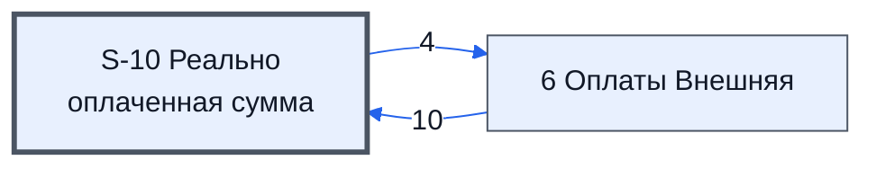

# Лист «S-10 Реально оплаченная сумма»

Таблица: внешняя таблица оплат · контур 3.

**Зачем** (со слов директора): расчёт реально оплаченной суммы.

Устройство листа — заголовки, вид столбцов, списки, формулы, связи с другими листами — собрано из таблицы ниже. Строка заголовков на этом листе угадана по закреплённой области — проверить.

## Зачем лист — подробно

*Заполнить:* что на листе происходит, откуда приходят данные и куда уходят.

## Как заполнять

*Заполнить:* какие столбцы вводят руками, какие считаются сами. Что значит каждый столбец — в `stolbtsy.yaml` рядом (поля `chto` и `kak`).

## Что нельзя трогать

*Заполнить.*

## Инструкции и умения

*Заполнить:* какие инструкции и умения относятся к листу.

## Осталось сделать

- Заполнить разделы выше и `stolbtsy.yaml`.

## Устройство (из таблицы)

- **Таблица:** внешняя таблица оплат, лист «S-10 Реально оплаченная сумма»; контур 3
- **Размер:** `A1:AZ857`
- **Каркас:** свой, не общий; строка заголовков — 1, угадана по закреплённой области — проверить
- **Формул:** 44; заполненных ячеек без формул в данных: 3; списков: 0; условного форматирования: 1; объединённых ячеек: 0

## Связи с другими листами

- **Берёт данные с листов:** [6 Оплаты Внешняя](../k3-vo-6-oplaty-vneshnyaya/index.md) (10)
- **Его данные используют:** [6 Оплаты Внешняя](../k3-vo-6-oplaty-vneshnyaya/index.md) (4)

В скобках и на стрелках — сколько формул ссылаются.

## Столбцы

Устройство — из таблицы; «Что это» и «Как заполняют» — из `stolbtsy.yaml` (заполняем руками).

| Столбец | Заголовок | Служебное имя | Вид | Заполняется | Список | Что это | Как заполняют |
|---|---|---|---|---|---|---|---|
| A |  |  |  | формула |  |  |  |
| J |  |  |  | формула |  |  |  |
| L |  |  |  | формула |  |  |  |
| O |  |  |  | формула |  |  |  |
| P |  |  |  | формула |  |  |  |
| S |  |  |  | формула |  |  |  |
| T |  |  |  | формула |  |  |  |
| V |  |  |  | формула |  |  |  |
| W |  |  |  | формула |  |  |  |
| X |  |  |  | формула |  |  |  |
| Y |  |  |  | формула |  |  |  |
| Z |  |  |  | формула |  |  |  |
| AA |  |  |  | формула |  |  |  |
| AB |  |  |  | формула |  |  |  |
| AD |  |  |  | формула |  |  |  |
| AF |  |  |  | формула |  |  |  |
| AG |  |  |  | формула |  |  |  |
| AH |  |  |  | формула |  |  |  |
| AJ |  |  |  | формула |  |  |  |
| AK |  |  |  | формула |  |  |  |
| AL |  |  |  | формула |  |  |  |
| AN |  |  |  | формула |  |  |  |
| AP |  |  |  | формула |  |  |  |
| AQ |  |  |  | формула |  |  |  |
| AR |  |  |  | формула |  |  |  |
| AT |  |  |  | формула |  |  |  |
| AW |  |  |  | формула |  |  |  |
| AY |  |  |  | формула |  |  |  |

Формулы столбцов (28)

| Столбец | Строка | Формула |
|---|---|---|
| A | 1 | <code>={J1:J857,AW1:AW857,AY1:AY857}</code> |
| J | 10 | <code>="ID_Товара"</code> |
| L | 10 | <code>="План"</code> |
| O | 11 | <code>=QUERY( { ARRAYFORMULA({'6 Оплаты Внешняя'!$BL$11:BL857 &amp;'6 Оплаты Внешняя'!$BG$11:$BG857&amp;'6 Оплаты Внешняя'!$BE$11:$BE857,'6 Оплаты Внешняя'!$BI$11:$BI857 , IF('6 Оплаты Внешняя'!$BD$11:$BD857="По спецификации",15,3) } ) ; ARRAYFORMULA({'6 Опла,"#N/A")</code> |
| P | 10 | <code>="Факт"</code> |
| S | 11 | <code>=QUERY( {O11:P857},"Select Col1, Sum(Col2) Where Col1 is not Null Group by Col1 Label Sum(Col2) ''",0 )</code> |
| T | 10 | <code>="Сумма Факт по Оплате"</code> |
| V | 11 | <code>=QUERY( {K11:K857,L11:L857},"Select Col1, Sum(Col2) Where Col1 is not Null Group by Col1 Label Sum(Col2) ''",0 )</code> |
| W | 10 | <code>="Сумма План по Оплате"</code> |
| X | 10 | <code>="Сумма Факт по Оплате"</code> |
| Y | 10 | <code>="Разница"</code> |
| Z | 10 | <code>="Ровно"</code> |
| AA | 10 | <code>="Недоплата"</code> |
| AB | 10 | <code>="Переплата"</code> |
| AD | 10 | <code>="Процент"</code> |
| AF | 11 | <code>=QUERY( {K11:K857,AN11:AN857},"Select Col1, Sum(Col2) Where Col1 is not Null Group by Col1 Label Sum(Col2) ''",0 )</code> |
| AG | 10 | <code>="Пром Сумм по Оплате"</code> |
| AH | 10 | <code>="Поправка"</code> |
| AJ | 10 | <code>="Ровно"</code> |
| AK | 10 | <code>="Недоплата"</code> |
| AL | 10 | <code>="Переплата"</code> |
| AN | 10 | <code>="Пром Сумм"</code> |
| AP | 10 | <code>="Поправка"</code> |
| AQ | 11 | <code>=LAMBDA(doFind,thePlanS, BYROW(thePlanS,LAMBDA(thePlan, IF(thePlan&lt;&gt;"",doFind(thePlan,thePlanS), ) )) )( LAMBDA(thePlan ,thePlanS, IF(INDEX(thePlan,,2)= MAX(IFERROR( QUERY(thePlanS,"Select Col2 Where Col1='"&amp;thePlan&amp;"'",0),0) ),1,0 )), {K11:K857,L1,"")</code> |
| AR | 11 | <code>=LAMBDA(doFindFirstMax,doFindMax,thePlanS, BYROW(thePlanS,LAMBDA(thePlan, IF(thePlan&lt;&gt;"", doFindFirstMax(doFindMax(thePlan,thePlanS),thePlan,thePlanS) , ) )) )( LAMBDA(theMax, thePlan ,thePlanS, IF(INDEX(thePlan,,3)= MIN(IFERROR( QUERY(thePlanS,"Selec,"")</code> |
| AT | 10 | <code>="Добавить Сумм"</code> |
| AW | 10 | <code>="Реально оплаченная сумма"</code> |
| AY | 10 | <code>="% оплатытт"</code> |

