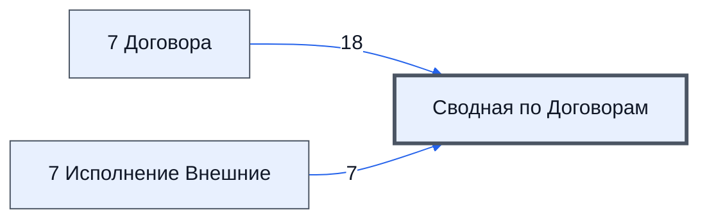

# Лист «Сводная по Договорам»

Таблица: внешняя таблица оплат · контур 3.

**Зачем** (со слов): по листу «7 Исполнение Внешние» — для контура 4.

Устройство листа — заголовки, вид столбцов, списки, формулы, связи с другими листами — собрано из таблицы ниже. Строка заголовков на этом листе угадана по закреплённой области — проверить.

## Зачем лист — подробно

*Заполнить:* что на листе происходит, откуда приходят данные и куда уходят.

## Как заполнять

*Заполнить:* какие столбцы вводят руками, какие считаются сами. Что значит каждый столбец — в `stolbtsy.yaml` рядом (поля `chto` и `kak`).

## Что нельзя трогать

*Заполнить.*

## Инструкции и умения

*Заполнить:* какие инструкции и умения относятся к листу.

## Осталось сделать

- Заполнить разделы выше и `stolbtsy.yaml`.

## Устройство (из таблицы)

- **Таблица:** внешняя таблица оплат, лист «Сводная по Договорам»; контур 3
- **Размер:** `A1:Z30`, закреплено до `A11`
- **Каркас:** свой, не общий; строка заголовков — 10, угадана по закреплённой области — проверить
- **Формул:** 79; заполненных ячеек без формул в данных: 20; списков: 0; условного форматирования: 0; объединённых ячеек: 0

## Связи с другими листами

- **Берёт данные с листов:** [7 Договора](../k3-vo-7-dogovora/index.md) (18), [7 Исполнение Внешние](../k3-vo-7-ispolnenie-vneshnie/index.md) (7), «Col1» *(листа нет в реестре)* (1)

В скобках и на стрелках — сколько формул ссылаются.

## Столбцы

Устройство — из таблицы; «Что это» и «Как заполняют» — из `stolbtsy.yaml` (заполняем руками).

| Столбец | Заголовок | Служебное имя | Вид | Заполняется | Список | Что это | Как заполняют |
|---|---|---|---|---|---|---|---|
| B | № |  |  | формула |  |  |  |
| C | Проект № |  |  | формула |  |  |  |
| D | Юр. лицо Продавец |  |  | формула |  |  |  |
| E | Юр. лицо Покупатель |  |  | формула |  |  |  |
| F | Номер Договора |  |  | формула |  |  |  |
| G | Дата подписи продавцом |  |  | формула |  |  |  |
| H | Сумма договора |  |  | формула |  |  |  |
| I | Дата подписи Покупателем |  |  | формула |  |  |  |
| J | Частичная оплата за товар |  |  | формула |  |  |  |
| K | Частичная поставка товара |  |  | формула |  |  |  |
| L | № Договора о закупке |  |  | формула |  |  |  |
| M | key |  |  | формула |  |  |  |
| N | Дата договора от |  |  | формула |  |  |  |
| O | ТипДоговора |  |  | формула |  |  |  |
| P | Вид подписания договора |  |  | формула |  |  |  |
| Q | для проверки расхождения данных с логистом |  |  | руками? |  |  |  |
| R | Ошибки при заполнение договора во внешней |  |  | руками? |  |  |  |
| S | ИНН Продавца |  |  | руками? |  |  |  |
| T | ИНН Покупателя |  |  | руками? |  |  |  |
| U | Срок поставки |  |  | руками? |  |  |  |
| V | Срок доставки |  |  | руками? |  |  |  |
| W | Срок приемки |  |  | руками? |  |  |  |
| X | Срок оплаты |  |  | руками? |  |  |  |

Формулы столбцов (15)

| Столбец | Строка | Формула |
|---|---|---|
| B | 10 | <code>="COMPUTED_VALUE"</code> |
| C | 10 | <code>="COMPUTED_VALUE"</code> |
| D | 10 | <code>="COMPUTED_VALUE"</code> |
| E | 10 | <code>="COMPUTED_VALUE"</code> |
| F | 10 | <code>="COMPUTED_VALUE"</code> |
| G | 10 | <code>="COMPUTED_VALUE"</code> |
| H | 10 | <code>="COMPUTED_VALUE"</code> |
| I | 10 | <code>="COMPUTED_VALUE"</code> |
| J | 10 | <code>="COMPUTED_VALUE"</code> |
| K | 10 | <code>="COMPUTED_VALUE"</code> |
| L | 10 | <code>="COMPUTED_VALUE"</code> |
| M | 10 | <code>="COMPUTED_VALUE"</code> |
| N | 10 | <code>="COMPUTED_VALUE"</code> |
| O | 10 | <code>="COMPUTED_VALUE"</code> |
| P | 10 | <code>="COMPUTED_VALUE"</code> |

