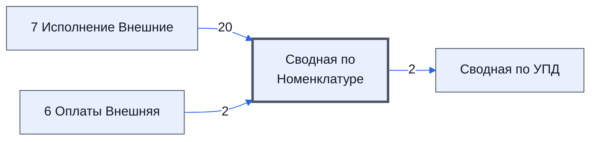

# Лист «Сводная по Номенклатуре»

Таблица: внешняя таблица оплат · контур 3.

**Зачем** (со слов): по листу «7 Исполнение Внешние» — для контура 4.

Устройство листа — заголовки, вид столбцов, списки, формулы, связи с другими листами — собрано из таблицы ниже. Строка заголовков на этом листе угадана по закреплённой области — проверить.

## Зачем лист — подробно

*Заполнить:* что на листе происходит, откуда приходят данные и куда уходят.

## Как заполнять

*Заполнить:* какие столбцы вводят руками, какие считаются сами. Что значит каждый столбец — в `stolbtsy.yaml` рядом (поля `chto` и `kak`).

## Что нельзя трогать

*Заполнить.*

## Инструкции и умения

*Заполнить:* какие инструкции и умения относятся к листу.

## Осталось сделать

- Заполнить разделы выше и `stolbtsy.yaml`.

## Устройство (из таблицы)

- **Таблица:** внешняя таблица оплат, лист «Сводная по Номенклатуре»; контур 3
- **Размер:** `A1:X30`, закреплено до `A11`
- **Каркас:** свой, не общий; строка заголовков — 10, угадана по закреплённой области — проверить
- **Формул:** 33; заполненных ячеек без формул в данных: 0; списков: 0; условного форматирования: 0; объединённых ячеек: 0

## Связи с другими листами

- **Берёт данные с листов:** [7 Исполнение Внешние](../k3-vo-7-ispolnenie-vneshnie/index.md) (20), [6 Оплаты Внешняя](../k3-vo-6-oplaty-vneshnyaya/index.md) (2)
- **Его данные используют:** [Сводная по УПД](../k3-vo-svodnaya-po-upd/index.md) (2)

В скобках и на стрелках — сколько формул ссылаются.

## Столбцы

Устройство — из таблицы; «Что это» и «Как заполняют» — из `stolbtsy.yaml` (заполняем руками).

| Столбец | Заголовок | Служебное имя | Вид | Заполняется | Список | Что это | Как заполняют |
|---|---|---|---|---|---|---|---|
| B | № |  |  | формула |  |  |  |
| C | Номенклатура |  |  | формула |  |  |  |
| D | № отгрузочных документов |  |  | формула |  |  |  |
| F | №🔗Номенклатура |  |  | формула |  |  |  |
| G | Сводная Исполнителей |  |  | формула |  |  |  |
| H | count |  |  | формула |  |  |  |
| I | Кол-во Отгрузок |  |  | формула |  |  |  |
| J | - частичная отгрузка |  |  | руками? |  |  |  |
| L | №🔗Номенклатура |  |  | формула |  |  |  |
| M | Сводная Продавеца |  |  | формула |  |  |  |
| N | count |  |  | формула |  |  |  |
| O | Кол-во Поставок |  |  | формула |  |  |  |
| P | - частичная поставка |  |  | руками? |  |  |  |
| R | № Поставки для Закупки |  |  | формула |  |  |  |
| S | № Закупки для Поставки |  |  | формула |  |  |  |
| T | Дата Закупки |  |  | руками? |  |  |  |
| U | Дата Поставки |  |  | руками? |  |  |  |
| V | ID Закупки |  |  | руками? |  |  |  |
| W | ID Поставки |  |  | руками? |  |  |  |
| X | Название товара по договору |  |  | формула |  |  |  |

Формулы столбцов (14)

| Столбец | Строка | Формула |
|---|---|---|
| B | 10 | <code>="COMPUTED_VALUE"</code> |
| C | 10 | <code>="COMPUTED_VALUE"</code> |
| D | 10 | <code>="COMPUTED_VALUE"</code> |
| F | 10 | <code>="COMPUTED_VALUE"</code> |
| G | 10 | <code>="COMPUTED_VALUE"</code> |
| H | 10 | <code>="COMPUTED_VALUE"</code> |
| I | 10 | <code>="COMPUTED_VALUE"</code> |
| L | 10 | <code>="COMPUTED_VALUE"</code> |
| M | 10 | <code>="COMPUTED_VALUE"</code> |
| N | 10 | <code>="COMPUTED_VALUE"</code> |
| O | 10 | <code>="COMPUTED_VALUE"</code> |
| R | 10 | <code>="COMPUTED_VALUE"</code> |
| S | 10 | <code>="COMPUTED_VALUE"</code> |
| X | 10 | <code>="COMPUTED_VALUE"</code> |

