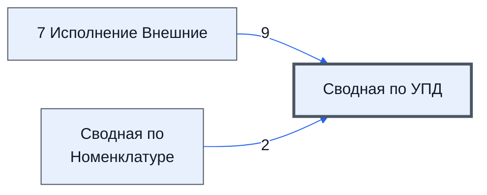

# Лист «Сводная по УПД»

Таблица: внешняя таблица оплат · контур 3.

**Зачем** (со слов директора): по листу «7 Исполнение Внешние» — для контура 4.

Устройство листа — заголовки, вид столбцов, списки, формулы, связи с другими листами — собрано из таблицы ниже. Строка заголовков на этом листе угадана по закреплённой области — проверить.

## Зачем лист — подробно

*Заполнить:* что на листе происходит, откуда приходят данные и куда уходят.

## Как заполнять

*Заполнить:* какие столбцы вводят руками, какие считаются сами. Что значит каждый столбец — в `stolbtsy.yaml` рядом (поля `chto` и `kak`).

## Что нельзя трогать

*Заполнить.*

## Инструкции и умения

*Заполнить:* какие инструкции и умения относятся к листу.

## Осталось сделать

- Заполнить разделы выше и `stolbtsy.yaml`.

## Устройство (из таблицы)

- **Таблица:** внешняя таблица оплат, лист «Сводная по УПД»; контур 3
- **Размер:** `A1:O30`, закреплено до `A11`
- **Каркас:** свой, не общий; строка заголовков — 10, угадана по закреплённой области — проверить
- **Формул:** 51; заполненных ячеек без формул в данных: 0; списков: 0; условного форматирования: 0; объединённых ячеек: 0

## Связи с другими листами

- **Берёт данные с листов:** [7 Исполнение Внешние](../k3-vo-7-ispolnenie-vneshnie/index.md) (9), [Сводная по Номенклатуре](../k3-vo-svodnaya-po-nomenklature/index.md) (2), «VALUE» *(листа нет в реестре)* (1)

В скобках и на стрелках — сколько формул ссылаются.

## Столбцы

Устройство — из таблицы; «Что это» и «Как заполняют» — из `stolbtsy.yaml` (заполняем руками).

| Столбец | Заголовок | Служебное имя | Вид | Заполняется | Список | Что это | Как заполняют |
|---|---|---|---|---|---|---|---|
| B | № |  |  | руками? |  |  |  |
| J | key |  |  | руками? |  |  |  |
| L | № УПД о закупке |  |  | формула |  |  |  |
| M | другой вариант ключа |  |  | руками? |  |  |  |
| N | для проверки расхождения данных с логистом |  |  | руками? |  |  |  |
| O | Ошибки при заполнение УПД во внешней |  |  | формула |  |  |  |

Формулы столбцов (2)

| Столбец | Строка | Формула |
|---|---|---|
| L | 10 | <code>="COMPUTED_VALUE"</code> |
| O | 10 | <code>="COMPUTED_VALUE"</code> |

