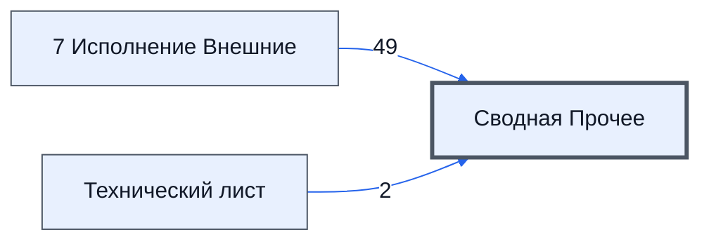

# Лист «Сводная Прочее»

Таблица: внешняя таблица оплат · контур 3.

**Зачем** (со слов): сводные прочие показатели.

Устройство листа — заголовки, вид столбцов, списки, формулы, связи с другими листами — собрано из таблицы ниже. Строка заголовков на этом листе угадана по закреплённой области — проверить.

## Зачем лист — подробно

*Заполнить:* что на листе происходит, откуда приходят данные и куда уходят.

## Как заполнять

*Заполнить:* какие столбцы вводят руками, какие считаются сами. Что значит каждый столбец — в `stolbtsy.yaml` рядом (поля `chto` и `kak`).

## Что нельзя трогать

*Заполнить.*

## Инструкции и умения

*Заполнить:* какие инструкции и умения относятся к листу.

## Осталось сделать

- Заполнить разделы выше и `stolbtsy.yaml`.

## Устройство (из таблицы)

- **Таблица:** внешняя таблица оплат, лист «Сводная Прочее»; контур 3
- **Размер:** `A1:N30`, закреплено до `A11`
- **Каркас:** свой, не общий; строка заголовков — 10, угадана по закреплённой области — проверить
- **Формул:** 51; заполненных ячеек без формул в данных: 10; списков: 0; условного форматирования: 0; объединённых ячеек: 0

## Связи с другими листами

- **Берёт данные с листов:** [7 Исполнение Внешние](../k3-vo-7-ispolnenie-vneshnie/index.md) (49), [Технический лист](../k3-vo-tekhnicheskiy-list/index.md) (2), «Col1» *(листа нет в реестре)* (1)

В скобках и на стрелках — сколько формул ссылаются.

## Столбцы

Устройство — из таблицы; «Что это» и «Как заполняют» — из `stolbtsy.yaml` (заполняем руками).

| Столбец | Заголовок | Служебное имя | Вид | Заполняется | Список | Что это | Как заполняют |
|---|---|---|---|---|---|---|---|
| A | key |  |  | руками? |  |  |  |
| B | Время Последней Синхронизации |  |  | формула |  |  |  |
| C | Посредник |  |  | формула |  |  |  |
| D |  |  |  | формула |  |  |  |
| E |  |  |  | формула |  |  |  |
| F |  |  |  | формула |  |  |  |
| G |  |  |  | формула |  |  |  |
| H |  |  |  | формула |  |  |  |
| I |  |  |  | формула |  |  |  |
| J |  |  |  | формула |  |  |  |
| K |  |  |  | формула |  |  |  |
| L |  |  |  | формула |  |  |  |
| M |  |  |  | формула |  |  |  |
| N | 1 |  |  | руками? |  |  |  |

Формулы столбцов (12)

| Столбец | Строка | Формула |
|---|---|---|
| B | 18 | <code>=VLOOKUP(B$10,{'Технический лист'!$K$11:$K30,'Технический лист'!$L$11:$L30},2,0)</code> |
| C | 18 | <code>= LAMBDA(Посредник,ifs(Посредник="","Нет Посредника",TRUE,Посредник)) ( LAMBDA(Победил,ЮрЛицаДляПартнера, TEXTJOIN(","&amp;CHAR(10),TRUE, IFERROR( QUERY(UNIQUE(ЮрЛицаДляПартнера),"select Col1 where Col1!='"&amp;Победил&amp;"' and Col1 is not null",0 ),) )) (,"Нет Посредника")</code> |
| D | 20 | <code>=TEXTJOIN("",TRUE,'7 Исполнение Внешние'!AF11:AF15)&lt;&gt;""</code> |
| E | 11 | <code>='7 Исполнение Внешние'!D$11</code> |
| F | 11 | <code>='7 Исполнение Внешние'!F$11</code> |
| G | 11 | <code>='7 Исполнение Внешние'!H$11</code> |
| H | 11 | <code>='7 Исполнение Внешние'!J$11</code> |
| I | 11 | <code>='7 Исполнение Внешние'!L$11</code> |
| J | 11 | <code>='7 Исполнение Внешние'!T$11</code> |
| K | 11 | <code>='7 Исполнение Внешние'!V$11</code> |
| L | 11 | <code>='7 Исполнение Внешние'!X$11</code> |
| M | 11 | <code>='7 Исполнение Внешние'!Z$11</code> |

