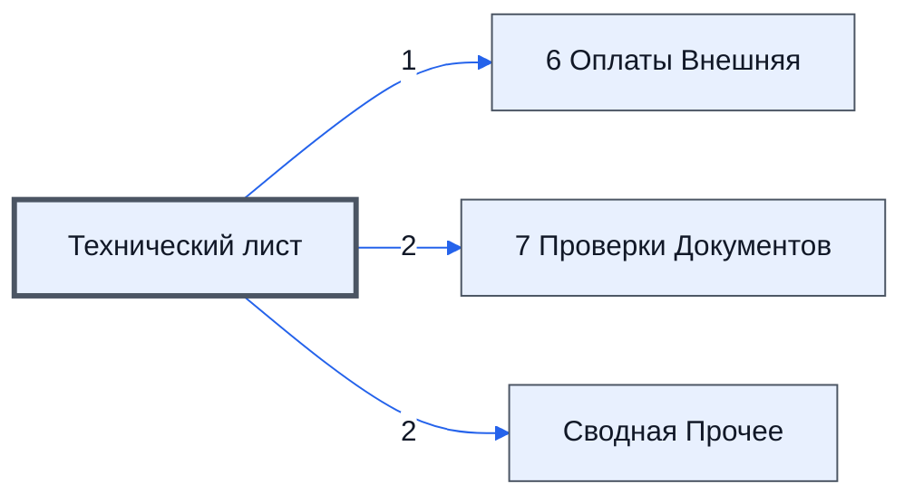

# Лист «Технический лист»

Таблица: внешняя таблица оплат · контур 3.

**Зачем:** сведений нет — по названию лист можно сравнить с регламентом, это позже (ответ директора, раунд 5).

Устройство листа — заголовки, вид столбцов, списки, формулы, связи с другими листами — собрано из таблицы ниже. Строка заголовков на этом листе угадана по закреплённой области — проверить.

## Зачем лист — подробно

*Заполнить:* что на листе происходит, откуда приходят данные и куда уходят.

## Как заполнять

*Заполнить:* какие столбцы вводят руками, какие считаются сами. Что значит каждый столбец — в `stolbtsy.yaml` рядом (поля `chto` и `kak`).

## Что нельзя трогать

*Заполнить.*

## Инструкции и умения

*Заполнить:* какие инструкции и умения относятся к листу.

## Осталось сделать

- Заполнить разделы выше и `stolbtsy.yaml`.

## Устройство (из таблицы)

- **Таблица:** внешняя таблица оплат, лист «Технический лист»; контур 3
- **Размер:** `A1:R698`, закреплено до `A11`
- **Каркас:** свой, не общий; строка заголовков — 10, угадана по закреплённой области — проверить
- **Формул:** 1; заполненных ячеек без формул в данных: 7; списков: 0; условного форматирования: 0; объединённых ячеек: 0

## Связи с другими листами

- **Его данные используют:** [6 Оплаты Внешняя](../k3-vo-6-oplaty-vneshnyaya/index.md) (1), [7 Проверки Документов](../k3-vo-7-proverki-dokumentov/index.md) (2), [Сводная Прочее](../k3-vo-svodnaya-prochee/index.md) (2)

В скобках и на стрелках — сколько формул ссылаются.

