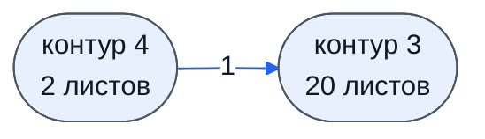
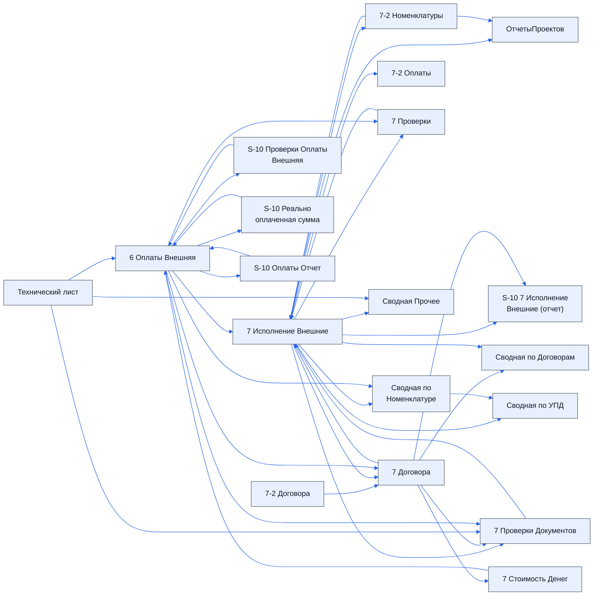

> Черновик: текст не проверен.

# Внешняя таблица оплат: все листы

Отдельная таблица на проект — шаблон «ТАБЛИЦА ОПЛАТ ВНЕШНЯЯ ДатаСоздания». Назначение листов — со слов («краткое описание листов», 2026-10-19); состав — по шаблону (`raw/2026-10-19-ak-xls`). Контуры 3 и 4 — [контуры](../../zna/tab-kontury/index.md); пока не описываем подробно.

Связь с таблицей проекта ([листы таблицы проекта](../../lis/tab-proekta/index.md)): данные готовит лист «S-10 Для Внешней Оплаты» таблицы проекта, сюда они попадают через функцию импорта; обратно в таблицу проекта возвращаются на лист «6 Оплаты».

Список листов и карта связей собраны ниже из реестра `lis/listy.yaml` и устройства таблицы.

## Осталось сделать

- Строки «S-10 Оплаты Отчет» и «S-10 7 Исполнение Внешние (отчет)» в описании похожи на ссылки на другие листы, а не на назначение — проверить.

## Листы по контурам

Зачем — со слов; устройство — из таблицы; у каждого листа своя страница-заготовка.

### Контур 3

| Лист | Зачем | Каркас | Столбцов | Формул | Описание |
|---|---|---|---|---|---|
| [6 Оплаты Внешняя](../k3-vo-6-oplaty-vneshnyaya/index.md) | данные готовит второй контур (лист «S-10 Для Внешней Оплаты»), сюда — импортом | свой | 45 | 19 | заглушка |
| [7 Исполнение Внешние](../k3-vo-7-ispolnenie-vneshnie/index.md) | договоры: номера и суммы | свой | 31 | 2145 | заглушка |
| [7 Договора](../k3-vo-7-dogovora/index.md) | продолжение договоров | свой | 45 | 209 | заглушка |
| [7 Стоимость Денег](../k3-vo-7-stoimost-deneg/index.md) | расчёт стоимости денег | свой | 11 | 25 | заглушка |
| [7-2 Номенклатуры](../k3-vo-7-2-nomenklatury/index.md) | отчёт по номенклатурам из контура 4 | свой | 70 | 105 | заглушка |
| [S-10 Проверки Оплаты Внешняя](../k3-vo-s-10-proverki-oplaty-vneshnyaya/index.md) | проверки внешней оплаты | свой | 12 | 615 | заглушка |
| [S-10 Реально оплаченная сумма](../k3-vo-s-10-realno-oplachennaya-summa/index.md) | расчёт реально оплаченной суммы | свой | 28 | 44 | заглушка |
| [S-10 Оплаты Отчет](../k3-vo-s-10-oplaty-otchet/index.md) | для листа «S-10 ОтчетыПроектовВнешний» таблицы проекта | свой | 81 | 686 | заглушка |
| [S-10 7 Исполнение Внешние (отчет)](../k3-vo-s-10-7-ispolnenie-vneshnie-otchet/index.md) | отчёт по листу «7 Договора» | свой | 2 | 1 | заглушка |
| [7-2 УПД](../k3-vo-7-2-upd/index.md) | отчёт по УПД из контура 4 | свой | 1 | 1 | заглушка |
| [7-2 Договора](../k3-vo-7-2-dogovora/index.md) | отчёт по договорам из контура 4 | свой | 1 | 1 | заглушка |
| [7-2 Оплаты](../k3-vo-7-2-oplaty/index.md) | отчёт по оплатам из контура 4 | свой | 46 | 134 | заглушка |
| [7 Проверки Документов](../k3-vo-7-proverki-dokumentov/index.md) | проверка, правильно ли заполнены документы | свой | 74 | 45 | заглушка |
| [ОтчетыПроектов](../k3-vo-otchetyproektov/index.md) | не используется | свой | 7 | 17 | заглушка |
| [7 Проверки](../k3-vo-7-proverki/index.md) | проверка, заполнены ли УПД на листе 7 | свой | 64 | 54 | заглушка |
| [Сводная Прочее](../k3-vo-svodnaya-prochee/index.md) | сводные прочие показатели | свой | 14 | 51 | заглушка |
| [Сводная по Номенклатуре](../k3-vo-svodnaya-po-nomenklature/index.md) | по листу «7 Исполнение Внешние» — для контура 4 | свой | 20 | 33 | заглушка |
| [Сводная по УПД](../k3-vo-svodnaya-po-upd/index.md) | по листу «7 Исполнение Внешние» — для контура 4 | свой | 6 | 51 | заглушка |
| [Сводная по Договорам](../k3-vo-svodnaya-po-dogovoram/index.md) | по листу «7 Исполнение Внешние» — для контура 4 | свой | 23 | 79 | заглушка |
| [Технический лист](../k3-vo-tekhnicheskiy-list/index.md) | сведений нет | свой | 0 | 1 | заглушка |

### Контур 4

| Лист | Зачем | Каркас | Столбцов | Формул | Описание |
|---|---|---|---|---|---|
| [7-2 Касса](../k4-vo-7-2-kassa/index.md) | отчёт по кассе из контура 4 | свой | 12 | 25 | заглушка |
| [S-10 ИНН](../k4-vo-s-10-inn/index.md) | для контура 4: оттуда берутся ИНН | свой | 6 | 15 | заглушка |

## Карта контуров

Сколько связей «лист берёт данные с листа» (по ссылкам в формулах) идёт из контура в контур.

## Карты листов по контурам

Листы контура и связи между ними: стрелка — данные идут с листа на лист. Листы без связей внутри контура не показаны; связи с другими контурами — на карте контуров и на странице каждого листа.

### Контур 3

### Контур 4

Связей между листами внутри контура нет.
