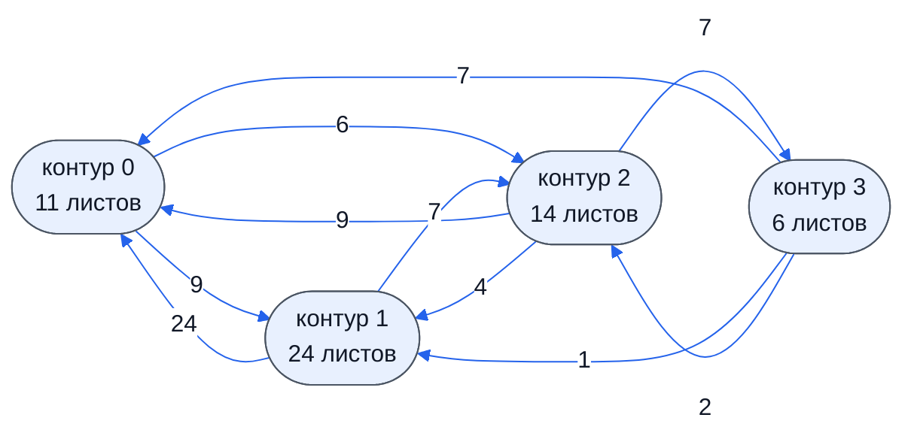
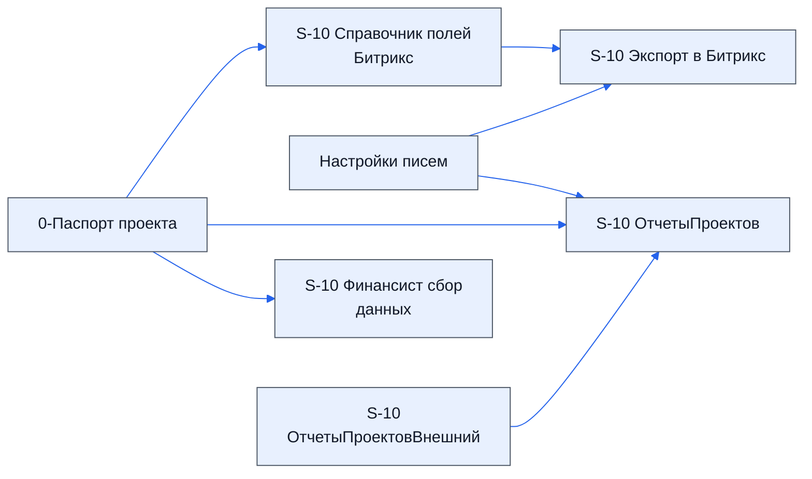
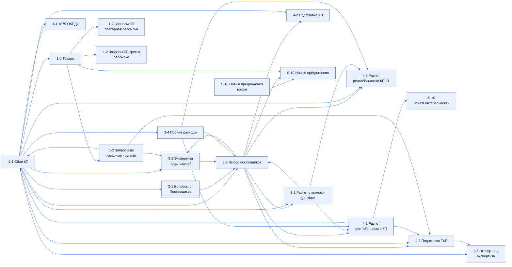
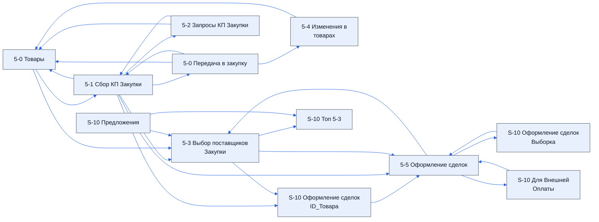

> Черновик: текст не проверен.

# Таблица проекта: все листы

Назначение листов — со слов («краткое описание листов», 2026-10-19); состав листов — по чистой копии таблицы (`raw/2026-10-19-ak-xls`). Что такое контур — [контуры](../../zna/tab-kontury/index.md). Листы `S-10` — служебные: их заполняют скрипты и формулы.

Список листов по контурам и карта связей собраны ниже из реестра `lis/listy.yaml` и устройства таблицы.

## Осталось сделать

- У листа «S-10 Оформление сделок ID_Товара» в описании сказано «формируется список для листа 5-3». По формулам он берёт товары с 5-3 (где «Сделка» — «Да») и отдаёт их на 5-5: похоже, имелся в виду лист 5-5 — подтвердить.
- «Сведений нет» — назначение не записано; по названиям сравнить с регламентом — позже (ответ директора, раунд 5). «Лист49» и «Справочники» — служебные.

## Листы по контурам

Зачем — со слов; устройство — из таблицы; у каждого листа своя страница-заготовка.

### Контур 0

| Лист | Зачем | Каркас | Столбцов | Формул | Описание |
|---|---|---|---|---|---|
| [0-Паспорт проекта](../k0-0-pasport-proekta/index.md) | основные настройки, приходят из Битрикс24 | свой | 10 | 44 | заглушка |
| [0-1 Данные из ИИ](../k0-0-1-dannye-iz-ii/index.md) | пустой, не важен | свой | 5 | 0 | заглушка |
| [Технический](../k0-tekhnicheskiy/index.md) | технический лист со справочниками | свой | 0 | 0 | заглушка |
| [Справочники](../k0-spravochniki/index.md) | служебный — подписи ссылок на внешние справочники адресов — органы по сертификации и лаборатории, агенты ВЭД, транспортные компании, брокеры ВЭД; формулы и списки на лист не ссылаются | свой | 0 | 0 | заглушка |
| [Настройки писем](../k0-nastroyki-pisem/index.md) | настройки писем | свой | 50 | 84 | заглушка |
| [S-10 Экспорт в Битрикс](../k0-s-10-eksport-v-bitriks/index.md) | собирает данные для выгрузки в Битрикс24 | общий | 8 | 48 | заглушка |
| [S-10 Справочник полей Битрикс](../k0-s-10-spravochnik-poley-bitriks/index.md) | сопоставление полей с кодами Битрикс24 | общий | 6 | 2 | заглушка |
| [S-10 ОтчетыПроектов](../k0-s-10-otchetyproektov/index.md) | собирает отчётные данные для контура 0 | свой | 194 | 656 | заглушка |
| [S-10 ОтчетыПроектовВнешний](../k0-s-10-otchetyproektovvneshniy/index.md) | то же по данным из внешней таблицы оплат | свой | 1 | 1 | заглушка |
| [S-10 Финансист сбор данных](../k0-s-10-finansist-sbor-dannykh/index.md) | готовит данные для листа 4-9 | свой | 92 | 464 | заглушка |
| [S-10 Триггеры](../k0-s-10-triggery/index.md) | показывает, как выполняются триггеры | общий | 17 | 13 | заглушка |

### Контур 1

| Лист | Зачем | Каркас | Столбцов | Формул | Описание |
|---|---|---|---|---|---|
| [1-1 Сбор КП](../k1-1-1-sbor-kp/index.md) | данные о товарах и предложениях поставщиков | свой | 41 | 3012 | проверить, столбцов описано 35 |
| [1-0 Товары](../k1-1-0-tovary/index.md) | собирает данные по товарам и передаёт их дальше | общий | 16 | 614 | проверить, столбцов описано 16 |
| [1-4 1875 ОКПД2](../k1-1-4-1875-okpd2/index.md) | по ОКПД2; назначение неясно | свой | 18 | 895 | заглушка |
| [1-2 Запросы по товарным группам](../k1-1-2-zaprosy-po-tovarnym-gruppam/index.md) | товарные группы и рассылка писем | общий | 52 | 427 | проверить, столбцов описано 20 |
| [1-2 Запросы КП повторная рассылка](../k1-1-2-zaprosy-kp-povtornaya-rassylka/index.md) | резервный лист рассылки | общий | 52 | 427 | заглушка |
| [1-2 Запросы КП третья рассылка](../k1-1-2-zaprosy-kp-tretya-rassylka/index.md) | резервный лист рассылки | общий | 52 | 427 | заглушка |
| [2-1 Вопросы от Поставщиков](../k1-2-1-voprosy-ot-postavshchikov/index.md) | заполняется редко | свой | 29 | 102 | заглушка |
| [2-2 Проблемы по проекту](../k1-2-2-problemy-po-proektu/index.md) | заполняется редко | свой | 24 | 0 | заглушка |
| [3-1 Расчет стоимости доставки](../k1-3-1-raschet-stoimosti-dostavki/index.md) | расчёт доставки | свой | 21 | 3040 | заглушка |
| [3-2 Экспертиза предложений](../k1-3-2-ekspertiza-predlozheniy/index.md) | важный: эксперт оценивает предложения поставщиков и предложенные модели | свой | 248 | 71057 | заглушка |
| [3-3 Выбор поставщиков](../k1-3-3-vybor-postavshchikov/index.md) | выбор поставщиков из списка топ-7 | свой | 102 | 27977 | проверить, столбцов описано 38 |
| [3-4 Прочие расходы](../k1-3-4-prochie-raskhody/index.md) | сведений нет | свой | 16 | 208 | заглушка |
| [3-5 Экспортная экспертиза](../k1-3-5-eksportnaya-ekspertiza/index.md) | сведений нет | свой | 26 | 313 | заглушка |
| [4-1 Расчет рентабельности КП в1](../k1-4-1-raschet-rentabelnosti-kp-v1/index.md) | сведений нет | свой | 24 | 117 | заглушка |
| [4-2 Подготовка КП](../k1-4-2-podgotovka-kp/index.md) | сведений нет | свой | 39 | 11425 | заглушка |
| [4-1 Расчет рентабельности КП](../k1-4-1-raschet-rentabelnosti-kp/index.md) | сведений нет | свой | 25 | 7938 | заглушка |
| [S-10 ОтчетРентабельности](../k1-s-10-otchetrentabelnosti/index.md) | сведений нет | свой | 5 | 74 | заглушка |
| [4-3 Подготовка ТКП](../k1-4-3-podgotovka-tkp/index.md) | важный: участвует в подготовке ТКП | свой | 24 | 3025 | заглушка |
| [4-9 Финансист](../k1-4-9-finansist/index.md) | отчёт для финансиста; не используется | свой | 5 | 85 | заглушка |
| [Отзывы о поставщиках](../k1-otzyvy-o-postavshchikakh/index.md) | отражение таблицы проверки контрагентов (ответ директора, раунд 2) | свой | 31 | 0 | заглушка |
| [Товары](../k1-tovary/index.md) | сведений нет | свой | 3 | 0 | заглушка |
| [S-10 Новые предложения](../k1-s-10-novye-predlozheniya/index.md) | следит за новыми предложениями: если цена заметно ниже, чем на листе 3-3, эксперт получает предупреждение | общий | 36 | 90 | заглушка |
| [S-10 Конвейер Запросов КП](../k1-s-10-konveyer-zaprosov-kp/index.md) | следит за письмами, запоминает дату обнаружения и «температуру» | общий | 7 | 0 | заглушка |
| [S-10 Новые предложения (сохр)](../k1-s-10-novye-predlozheniya-sokhr/index.md) | копия — чтобы находить разницу | общий | 36 | 0 | заглушка |

### Контур 2

| Лист | Зачем | Каркас | Столбцов | Формул | Описание |
|---|---|---|---|---|---|
| [5-0 Товары](../k2-5-0-tovary/index.md) | все данные по товарам для второго контура | общий | 15 | 9 | проверить, столбцов описано 15 |
| [5-0 Передача в закупку](../k2-5-0-peredacha/index.md) | товары как в договоре | общий | 15 | 623 | проверить, столбцов описано 15 |
| [5-1 Сбор КП Закупки](../k2-5-1-sbor-kp/index.md) | сбор коммерческих предложений | общий | 104 | 3407 | проверить, столбцов описано 27 |
| [5-2 Запросы КП Закупки](../k2-5-2-zaprosy-kp/index.md) | рассылка писем второго контура | общий | 53 | 437 | проверить, столбцов описано 19 |
| [5-3 Выбор поставщиков Закупки](../k2-5-3-vybor-postavshchikov/index.md) | выбор поставщиков, убираются ненужные товары | общий | 135 | 17062 | проверить, столбцов описано 37 |
| [5-4 Изменения в товарах](../k2-5-4-izmeneniya/index.md) | добавляем и изменяем товары; данные собираются на лист 5-0 | свой | 17 | 8 | проверить, столбцов описано 17 |
| [5-5 Оформление сделок](../k2-5-5-sdelki/index.md) | с листа 5-3 забираются товары и поставщики, по ним оформляются сделки | общий | 75 | 5791 | проверить, столбцов описано 54 |
| [S-10 Оформление сделок ID_Товара](../k2-s-10-oformlenie-sdelok-id-tovara/index.md) | товары листа 5-3 с «Да» в столбце A; по ним строится список | общий | 8 | 306 | заглушка |
| [S-10 Оформление сделок Выборка](../k2-s-10-oformlenie-sdelok-vyborka/index.md) | данные для листа 5-5 по сохранённым комментариям | общий | 79 | 335 | заглушка |
| [S-10 Для Внешней Оплаты](../k2-s-10-dlya-vneshney-oplaty/index.md) | по листу 5-5 готовит данные для контура 3 — для листа «6 Оплаты Внешняя» | общий | 33 | 53 | заглушка |
| [S-10 Оформление сделок Комментарии](../k2-s-10-oformlenie-sdelok-kommentarii/index.md) | поставщик может смениться во время оформления сделки — здесь хранятся комментарии, цены и статусы, вписанные на листе 5-5 | общий | 30 | 0 | заглушка |
| [S-10 Комментарии](../k2-s-10-kommentarii/index.md) | хранит комментарии, вписанные на листе 5-3 | общий | 12 | 0 | заглушка |
| [S-10 Предложения](../k2-s-10-predlozheniya/index.md) | собирает предложения с листов 1-1 и 5-1 | общий | 78 | 330 | заглушка |
| [S-10 Топ 5-3](../k2-s-10-top-5-3/index.md) | топ-7 для листа 5-3 | общий | 14 | 33 | заглушка |

### Контур 3

| Лист | Зачем | Каркас | Столбцов | Формул | Описание |
|---|---|---|---|---|---|
| [6 Оплаты](../k3-6-oplaty/index.md) | загружается из внешней таблицы оплат — для контроля и обратной связи | свой | 6 | 7 | проверить |
| [7 Исполнение](../k3-7-ispolnenie/index.md) | контроль и обратная связь | свой | 0 | 1 | заглушка |
| [7 Договора](../k3-7-dogovora/index.md) | контроль и обратная связь | свой | 1 | 1 | заглушка |
| [7 Стоимость Денег](../k3-7-stoimost-deneg/index.md) | контроль и обратная связь | свой | 0 | 1 | заглушка |
| [7-2 Документация исполнение](../k3-7-2-dokumentatsiya-ispolnenie/index.md) | контроль и обратная связь | общий | 27 | 321 | заглушка |
| [7-2 Оплаты](../k3-7-2-oplaty/index.md) | контроль и обратная связь | свой | 1 | 1 | заглушка |

## Карта контуров

Сколько связей «лист берёт данные с листа» (по ссылкам в формулах) идёт из контура в контур.

## Карты листов по контурам

Листы контура и связи между ними: стрелка — данные идут с листа на лист. Листы без связей внутри контура не показаны; связи с другими контурами — на карте контуров и на странице каждого листа.

### Контур 0

### Контур 1

### Контур 2

### Контур 3

Связей между листами внутри контура нет.
