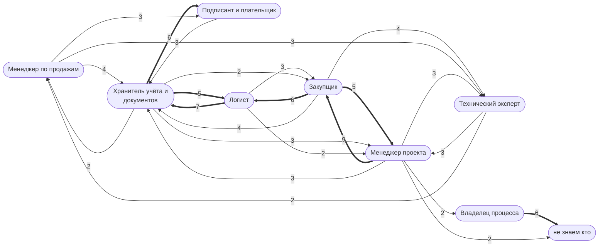

> Черновик: текст не проверен.

# Дорожки по должностям

Обзор всего регламента «Распределение задач» на уровне должностей — для показа. Подробности по каждому процессу и
список расхождений — [обзор процессов](../../pro/obzor/index.md). Должности здесь — наши догадки: какая должность выполняет обязанность шага.
Поменяется догадка в `reg/oby.yaml` — схемы пересоберутся.

## Весь проект по дорожкам

Вертикальная дорожка — должность (по нашей догадке, кто выполняет обязанность шага). Цветной блок — процесс; в дорожке — обязанности, которые должность там выполняет; стрелка — работа переходит к другой должности. Подробно, шаг за шагом, — на странице каждого процесса.

```mermaid
sequenceDiagram
  participant r_prodazhi as Менеджер по продажам
  participant r_proekt as Менеджер проекта
  participant r_vladelets as Владелец процесса
  participant r_tekh as Технический эксперт
  participant r_zakupka as Закупщик
  participant r_khranitel as Хранитель учёта и документов
  participant r_podpisant as Подписант и плательщик
  participant r_logist as Логист
  participant r_none as не знаем кто
  rect rgb(232, 240, 254)
  Note over r_prodazhi,r_none: Процесс. Передача в контрактацию
  Note over r_prodazhi: Решающий начать контрактацию<br/>Ведущий папку проекта<br/>Ставящий задачу на контрактацию
  end
  rect rgb(253, 246, 227)
  Note over r_prodazhi,r_none: Процесс. Контрактация
  Note over r_prodazhi: Ведущий договор с заказчиком<br/>Ведущий раздел «Контрактация» паспорта<br/>Ведущий папку проекта
  r_prodazhi->>r_khranitel: передаёт
  Note over r_khranitel: Проверяющий проект договора
  r_khranitel->>r_prodazhi: передаёт
  Note over r_prodazhi: Ведущий договор с заказчиком
  r_prodazhi->>r_tekh: передаёт
  Note over r_tekh: Проверяющий ТЗ договора
  r_tekh->>r_prodazhi: передаёт
  Note over r_prodazhi: Ведущий договор с заказчиком
  r_prodazhi->>r_podpisant: передаёт
  Note over r_podpisant: Подписывающий договор
  r_podpisant->>r_prodazhi: передаёт
  Note over r_prodazhi: Ведущий договор с заказчиком
  r_prodazhi->>r_logist: передаёт
  Note over r_logist: Отправляющий оригиналы документов
  r_logist->>r_prodazhi: передаёт
  Note over r_prodazhi: Передающий договор в учёт<br/>Закрывающий контрактацию
  end
  rect rgb(232, 240, 254)
  Note over r_prodazhi,r_none: Процесс. Передача в закупки
  Note over r_prodazhi: Решающий передать проект в закупки
  r_prodazhi->>r_proekt: передаёт
  Note over r_proekt: Передающий проект в закупку<br/>Фиксирующий задание на закупку (лист 5-0)<br/>Проверяющий комплектность передачи в закупку<br/>и ещё 1
  r_proekt->>r_zakupka: передаёт
  Note over r_zakupka: Принимающий задачу на закупку
  r_zakupka->>r_proekt: передаёт
  Note over r_proekt: Ставящий задачу на закупку
  end
  rect rgb(253, 246, 227)
  Note over r_prodazhi,r_none: Процесс. Закупка товара
  r_proekt->>r_zakupka: передаёт
  Note over r_zakupka: Принимающий задачу на закупку<br/>Ведущий папку закупки<br/>Рассылающий повторные запросы
  r_zakupka->>r_proekt: передаёт
  Note over r_proekt: Отслеживающий выбор поставщиков
  r_proekt->>r_zakupka: передаёт
  Note over r_zakupka: Готовящий выбор поставщика<br/>Проверяющий контрагента<br/>Ставящий задачи на техническое согласование
  r_zakupka->>r_tekh: передаёт
  Note over r_tekh: Согласующий техническую часть
  r_tekh->>r_proekt: передаёт
  Note over r_proekt: Решающий о сделке с поставщиком
  r_proekt->>r_zakupka: передаёт
  Note over r_zakupka: Готовящий договор поставки<br/>Добывающий счета и договоры<br/>Ведущий лист оформления сделок<br/>и ещё 4
  r_zakupka->>r_khranitel: передаёт
  Note over r_khranitel: Проверяющий счета перед оплатой<br/>Ведущий учёт в 1С<br/>Передающий счета на оплату
  r_khranitel->>r_podpisant: передаёт
  Note over r_podpisant: Оплачивающий счета
  r_podpisant->>r_khranitel: передаёт
  Note over r_khranitel: Раскладывающий оплаченное<br/>Ведущий таблицу оплат
  r_khranitel->>r_zakupka: передаёт
  Note over r_zakupka: Закрывающий закупку
  end
  rect rgb(232, 240, 254)
  Note over r_prodazhi,r_none: Процесс. Планирование и контроль исполнения
  r_zakupka->>r_proekt: передаёт
  Note over r_proekt: Составляющий план исполнения<br/>Управляющий изменениями
  r_proekt->>r_none: передаёт
  Note over r_none: Проводящий отчётность
  end
  rect rgb(253, 246, 227)
  Note over r_prodazhi,r_none: Процесс. Поступление: контроль поставки, доплаты, доставка, приёмка
  r_none->>r_proekt: передаёт
  Note over r_proekt: Назначающий формат приёмки
  r_proekt->>r_logist: передаёт
  Note over r_logist: Отслеживающий поставку
  r_logist->>r_zakupka: передаёт
  Note over r_zakupka: Отправляющий поставщикам наши подписанные договоры<br/>Определяющий плановые сроки поставки
  r_zakupka->>r_logist: передаёт
  Note over r_logist: Отслеживающий поставку
  r_logist->>r_zakupka: передаёт
  Note over r_zakupka: Эскалирующий задержки поставки
  r_zakupka->>r_proekt: передаёт
  Note over r_proekt: Решающий по проблемам поставки
  r_proekt->>r_zakupka: передаёт
  Note over r_zakupka: Готовящий претензии поставщикам<br/>Проверяющий готовность к отгрузке<br/>Собирающий техническую документацию
  r_zakupka->>r_logist: передаёт
  Note over r_logist: Сообщающий о доплате
  r_logist->>r_khranitel: передаёт
  Note over r_khranitel: Передающий счета на оплату
  r_khranitel->>r_podpisant: передаёт
  Note over r_podpisant: Оплачивающий счета
  r_podpisant->>r_khranitel: передаёт
  Note over r_khranitel: Ведущий таблицу оплат
  r_khranitel->>r_logist: передаёт
  Note over r_logist: Выбирающий способ доставки<br/>Организующий доставку<br/>Собирающий транспортные документы
  r_logist->>r_zakupka: передаёт
  Note over r_zakupka: Предъявляющий к приёмке УПД поставщика
  r_zakupka->>r_logist: передаёт
  Note over r_logist: Принимающий товар по количеству
  r_logist->>r_tekh: передаёт
  Note over r_tekh: Принимающий товар по качеству
  r_tekh->>r_proekt: передаёт
  Note over r_proekt: Решающий о приёмке
  r_proekt->>r_zakupka: передаёт
  Note over r_zakupka: Направляющий мотивированный отказ
  r_zakupka->>r_logist: передаёт
  Note over r_logist: Учитывающий приходные документы
  r_logist->>r_khranitel: передаёт
  Note over r_khranitel: Ведущий учёт в 1С
  r_khranitel->>r_logist: передаёт
  Note over r_logist: Хранящий товар
  end
  rect rgb(232, 240, 254)
  Note over r_prodazhi,r_none: Процесс. Подготовка к отгрузке
  Note over r_logist: Планирующий отгрузки<br/>Запрашивающий отгрузочные документы
  r_logist->>r_khranitel: передаёт
  Note over r_khranitel: Изготавливающий отгрузочные документы
  r_khranitel->>r_logist: передаёт
  Note over r_logist: Хранящий отгрузочные документы<br/>Проверяющий комплектность отгрузки<br/>Комплектующий партию
  end
  rect rgb(253, 246, 227)
  Note over r_prodazhi,r_none: Процесс. Отгрузка
  Note over r_logist: Отгружающий заказчику<br/>Отслеживающий приёмку заказчиком<br/>Хранящий отгрузочные документы
  r_logist->>r_proekt: передаёт
  Note over r_proekt: Отслеживающий исполнение договора<br/>Добивающийся приёмки и оплаты от заказчика
  end
  rect rgb(232, 240, 254)
  Note over r_prodazhi,r_none: Процесс. Оформление экспорта
  r_proekt->>r_vladelets: передаёт
  Note over r_vladelets: Назначающий ответственных
  r_vladelets->>r_none: передаёт
  Note over r_none: Оформляющий экспорт
  end
  rect rgb(253, 246, 227)
  Note over r_prodazhi,r_none: Процесс. Устранение несоответствий
  r_none->>r_proekt: передаёт
  Note over r_proekt: Ответственный за почтовый ящик
  r_proekt->>r_khranitel: передаёт
  Note over r_khranitel: Регистрирующий входящие
  r_khranitel->>r_proekt: передаёт
  Note over r_proekt: Ведущий устранение несоответствия
  r_proekt->>r_none: передаёт
  Note over r_none: Ставящий товарам статус «Несоответствие»
  r_none->>r_proekt: передаёт
  Note over r_proekt: Ведущий устранение несоответствия
  r_proekt->>r_tekh: передаёт
  Note over r_tekh: Готовящий ответ на несоответствие
  r_tekh->>r_proekt: передаёт
  Note over r_proekt: Ведущий устранение несоответствия
  end
  rect rgb(232, 240, 254)
  Note over r_prodazhi,r_none: Процесс. Контроль исполнения заказчиком
  Note over r_proekt: Добивающийся приёмки и оплаты от заказчика
  r_proekt->>r_khranitel: передаёт
  Note over r_khranitel: Отслеживающий оплаты заказчика<br/>Пишущий претензию о неуплате
  r_khranitel->>r_logist: передаёт
  Note over r_logist: Отправляющий претензию заказчику
  r_logist->>r_proekt: передаёт
  Note over r_proekt: Добивающийся приёмки и оплаты от заказчика<br/>Инициирующий судебный иск
  r_proekt->>r_vladelets: передаёт
  Note over r_vladelets: Назначающий ответственных
  r_vladelets->>r_none: передаёт
  Note over r_none: Ведущий судебно-исковую работу
  end
  rect rgb(253, 246, 227)
  Note over r_prodazhi,r_none: Процесс. Закрытие проекта
  Note over r_none: Закрывающий проект
  end
```

## Кто кому передаёт работу

Стрелка — сколько раз работа переходит от одной должности к другой: ставит задачу, передаёт результат или делает следующий шаг. На схеме — от 2 передач, толстая — 5 и больше; все — в таблице.

Больше всего передач: Менеджер проекта → Закупщик — 9; Логист → Хранитель учёта и документов — 7; Хранитель учёта и документов → Подписант и плательщик — 6; Закупщик → Логист — 6; Владелец процесса → не знаем кто — 6.

| От кого | Кому | Передач |
|---|---|---|
| Менеджер проекта | Закупщик | 9 |
| Логист | Хранитель учёта и документов | 7 |
| Хранитель учёта и документов | Подписант и плательщик | 6 |
| Закупщик | Логист | 6 |
| Владелец процесса | не знаем кто | 6 |
| Закупщик | Менеджер проекта | 5 |
| Хранитель учёта и документов | Логист | 5 |
| Менеджер по продажам | Хранитель учёта и документов | 4 |
| Закупщик | Технический эксперт | 4 |
| Закупщик | Хранитель учёта и документов | 4 |
| Менеджер по продажам | Технический эксперт | 3 |
| Менеджер по продажам | Подписант и плательщик | 3 |
| Технический эксперт | Менеджер проекта | 3 |
| Подписант и плательщик | Хранитель учёта и документов | 3 |
| Логист | Закупщик | 3 |
| Менеджер проекта | Хранитель учёта и документов | 3 |
| Хранитель учёта и документов | Менеджер проекта | 3 |
| Менеджер проекта | Технический эксперт | 3 |
| Хранитель учёта и документов | Менеджер по продажам | 2 |
| Технический эксперт | Менеджер по продажам | 2 |
| Хранитель учёта и документов | Закупщик | 2 |
| Менеджер проекта | не знаем кто | 2 |
| Логист | Менеджер проекта | 2 |
| Менеджер проекта | Владелец процесса | 2 |
| Подписант и плательщик | Менеджер по продажам | 1 |
| Менеджер по продажам | Логист | 1 |
| Логист | Менеджер по продажам | 1 |
| Менеджер по продажам | Координатор | 1 |
| Менеджер по продажам | Менеджер проекта | 1 |
| Технический эксперт | Закупщик | 1 |
| Менеджер проекта | Логист | 1 |
| Логист | Технический эксперт | 1 |
| не знаем кто | Менеджер проекта | 1 |

## Сколько шагов у кого

Шаги, которые делает должность, по процессам. Должность — первая из «предполагаем» у обязанности шага.

| Процесс | [Менеджер по продажам](../../reg/rol/prodazhi.md) | [Менеджер проекта](../../reg/rol/proekt.md) | [Владелец процесса](../../reg/rol/vladelets.md) | [Технический эксперт](../../reg/rol/tekh.md) | [Закупщик](../../reg/rol/zakupka.md) | [Хранитель учёта и документов](../../reg/rol/khranitel.md) | [Подписант и плательщик](../../reg/rol/podpisant.md) | [Логист](../../reg/rol/logist.md) | не знаем кто |
|---|---|---|---|---|---|---|---|---|---|
| [Процесс. Передача в контрактацию](../../pro/r01-peredacha-v-kontraktatsiyu/index.md) | 5 |  |  |  |  |  |  |  |  |
| [Процесс. Контрактация](../../pro/r02-kontraktatsiya/index.md) | 12 |  |  | 1 |  | 1 | 1 | 1 |  |
| [Процесс. Передача в закупки](../../pro/r03-peredacha-v-zakupki/index.md) | 1 | 6 |  |  | 1 |  |  |  |  |
| [Процесс. Закупка товара](../../pro/r04-zakupka-tovara/index.md) |  | 3 |  | 1 | 16 | 5 | 1 |  |  |
| [Процесс. Планирование и контроль исполнения](../../pro/r05-planirovanie-ispolneniya/index.md) |  | 2 |  |  |  |  |  |  | 1 |
| [Процесс. Поступление: контроль поставки, доплаты, доставка, приёмка](../../pro/r06-postuplenie/index.md) |  | 3 |  | 1 | 9 | 3 | 1 | 15 |  |
| [Процесс. Подготовка к отгрузке](../../pro/r07-podgotovka-k-otgruzke/index.md) |  |  |  |  |  | 1 |  | 10 |  |
| [Процесс. Отгрузка](../../pro/r08-otgruzka/index.md) |  | 2 |  |  |  |  |  | 4 |  |
| [Процесс. Оформление экспорта](../../pro/r09-oformlenie-eksporta/index.md) |  |  | 1 |  |  |  |  |  | 1 |
| [Процесс. Устранение несоответствий](../../pro/r10-nesootvetstviya/index.md) |  | 8 |  | 2 |  | 3 |  |  | 1 |
| [Процесс. Контроль исполнения заказчиком](../../pro/r11-kontrol-zakazchika/index.md) |  | 3 | 1 |  |  | 4 |  | 1 | 1 |
| [Процесс. Закрытие проекта](../../pro/r12-zakrytie-proekta/index.md) |  |  |  |  |  |  |  |  | 5 |
| **Всего** | **18** | **27** | **2** | **5** | **26** | **17** | **3** | **31** | **9** |
