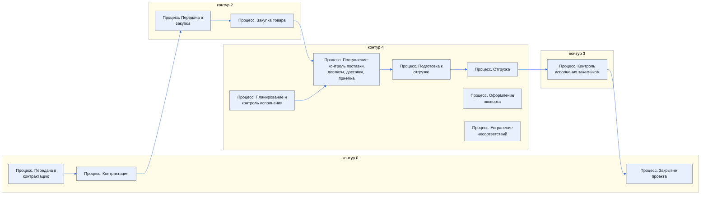

> Черновик: текст не проверен.

# Процессы: обзор и как читать

Источник — регламент «Распределение задач Контрактация — Исполнение», лист «10.10.2026 Версия К»: 12 процессов, 138 шагов.
В регламенте у каждого шага цветом отмечено, какой столбец (Менеджер, ТС, Закупщик, K, АС, M, Владелец процесса) исполнитель,
соисполнитель, с кем согласуют и кого уведомляют. Столбцы K и M в регламенте подписаны именами — здесь только буквы.

## Три слоя

- **Обязанность** — абстрактная роль «тот, кто …»: одна обязанность — один ответственный. Каждый шаг делает ровно одна обязанность;
  у шага ещё может быть тот, кто ставит задачу, принимает результат, отслеживает, согласует, помогает и кого уведомляют.
- **Должность** — кто по факту. У обязанности поле «предполагаем, что выполняет» — наша догадка, её и проверяем.
- **Место работы** — лист таблицы, задача Битрикс24, 1С, папка Диска, почта, ЭДО.

Переназначить обязанность — поменять одну строку в `reg/oby.yaml`; все схемы и карточки пересоберутся.

## Как читать страницу процесса

1. **Как в регламенте** — дорожки по столбцам регламента, шаги по порядку; таблица отметок (И, С, Сг, У, В) — как в xlsx.
2. **По обязанностям** — дорожки по должностям, которые мы предполагаем; стрелки «ставит», «передаёт», пунктир «следит», «согласует».
3. **Шаги и обязанности** — таблица: кто делает, кто ставит и принимает, кто согласует, где.
4. **Где работают** и **Статусы** — если в шагах есть места и смена статусов.

У каждой должности и обязанности своя карточка: все шаги по процессам, откуда задача и кому результат. Карточки можно показать
сотрудникам для проверки.

## Карта процессов

| Процесс | Контур | Шагов | Обязанностей |
|---|---|---|---|
| [Процесс. Передача в контрактацию](../../pro/r01-peredacha-v-kontraktatsiyu/index.md) | 0 | 5 | 3 |
| [Процесс. Контрактация](../../pro/r02-kontraktatsiya/index.md) | 0 | 16 | 9 |
| [Процесс. Передача в закупки](../../pro/r03-peredacha-v-zakupki/index.md) | 2 | 8 | 6 |
| [Процесс. Закупка товара](../../pro/r04-zakupka-tovara/index.md) | 2 | 26 | 22 |
| [Процесс. Планирование и контроль исполнения](../../pro/r05-planirovanie-ispolneniya/index.md) | 4 | 3 | 3 |
| [Процесс. Поступление: контроль поставки, доплаты, доставка, приёмка](../../pro/r06-postuplenie/index.md) | 4 | 32 | 24 |
| [Процесс. Подготовка к отгрузке](../../pro/r07-podgotovka-k-otgruzke/index.md) | 4 | 11 | 6 |
| [Процесс. Отгрузка](../../pro/r08-otgruzka/index.md) | 4 | 6 | 5 |
| [Процесс. Оформление экспорта](../../pro/r09-oformlenie-eksporta/index.md) | 4 | 2 | 2 |
| [Процесс. Устранение несоответствий](../../pro/r10-nesootvetstviya/index.md) | 4 | 14 | 5 |
| [Процесс. Контроль исполнения заказчиком](../../pro/r11-kontrol-zakazchika/index.md) | 3 | 10 | 7 |
| [Процесс. Закрытие проекта](../../pro/r12-zakrytie-proekta/index.md) | 0 | 5 | 1 |

## Статусы через все процессы

**Статус проекта**

```mermaid
%%{init: {"theme": "base", "themeVariables": {"fontSize": "16px", "primaryColor": "#e8f0fe", "primaryTextColor": "#111827", "primaryBorderColor": "#4b5563", "lineColor": "#2563eb", "textColor": "#111827", "clusterBkg": "#fffbe6", "clusterBorder": "#9ca3af", "edgeLabelBackground": "#ffffff", "signalColor": "#2563eb", "signalTextColor": "#1d4ed8", "noteBkgColor": "#fff3b0", "noteTextColor": "#111827", "noteBorderColor": "#a16207", "actorBkg": "#e8f0fe", "actorTextColor": "#111827", "actorBorder": "#4b5563", "actorLineColor": "#9ca3af", "labelBoxBkgColor": "#e8f0fe", "labelTextColor": "#111827"}}}%%
stateDiagram-v2
  direction LR
  state "Заключаем договор" as st0
  state "Договор заключен" as st1
  state "Передано в Закупки" as st2
  state "Исполнение: Закупаем товары" as st3
  state "Исполняем договор" as st4
  state "Закрыт" as st5
  [*] --> st0
  st0 --> st1 : контрактация 16
  st1 --> st0 : передача в закупки 0
  st0 --> st2 : передача в закупки 5
  st2 --> st3 : закупка товара 2
  st3 --> st4 : закупка товара 25
  st4 --> st5 : закрытие проекта 4
```

**Статус сделки**

**Статус товара**

## Расхождения и вопросы

Собраны сборщиком: где регламент и наше толкование расходятся, где нет исполнителя, где нарушено «одна обязанность — один ответственный».

| Где | Что |
|---|---|
| [Процесс. Контрактация](../../pro/r02-kontraktatsiya/index.md), шаг 11 | в регламенте у шага нет исполнителя; толкуем как «Ведущий договор с заказчиком» |
| [Процесс. Контрактация](../../pro/r02-kontraktatsiya/index.md), шаг 17 | в регламенте у шага нет исполнителя; толкуем как «Отправляющий оригиналы документов» |
| [Процесс. Передача в закупки](../../pro/r03-peredacha-v-zakupki/index.md), шаг 6 | в регламенте делает H Менеджер, а «Принимающий задачу на закупку» мы предполагаем за Закупщик (специалист по закупке) |
| [Процесс. Планирование и контроль исполнения](../../pro/r05-planirovanie-ispolneniya/index.md), шаг «Отчетность» | в регламенте у шага нет исполнителя; толкуем как «Проводящий отчётность» |
| [Процесс. Поступление: контроль поставки, доплаты, доставка, приёмка](../../pro/r06-postuplenie/index.md), шаги 5, 20 | в регламенте несколько основных исполнителей: J Закупщик, L АС |
| [Процесс. Оформление экспорта](../../pro/r09-oformlenie-eksporta/index.md), шаг «Оформление экспорта» | в регламенте у шага нет исполнителя; толкуем как «Оформляющий экспорт» |
| [Процесс. Устранение несоответствий](../../pro/r10-nesootvetstviya/index.md), шаг 16 | в регламенте у шага нет исполнителя; толкуем как «Ответственный за почтовый ящик» |
| [Процесс. Устранение несоответствий](../../pro/r10-nesootvetstviya/index.md), шаг 17 | в регламенте несколько основных исполнителей: H Менеджер, I ТС (эксперт), L АС, столбец M |
| [Процесс. Устранение несоответствий](../../pro/r10-nesootvetstviya/index.md), шаг 22 | в регламенте у шага нет исполнителя; толкуем как «Ставящий товарам статус «Несоответствие»» |
| [Процесс. Контроль исполнения заказчиком](../../pro/r11-kontrol-zakazchika/index.md), шаг 39 | в регламенте у шага нет исполнителя; толкуем как «Ведущий судебно-исковую работу» |
| [Процесс. Закрытие проекта](../../pro/r12-zakrytie-proekta/index.md), шаги 0, 1, 2, 3, 4 | в регламенте у шага нет исполнителя; толкуем как «Закрывающий проект» |
| [Отправляющий оригиналы документов](../../reg/oby/otpravka-originalov.md) | предполагаем несколько должностей — нарушает «один ответственный» |
| [Ставящий задачу на закупку](../../reg/oby/postanovka-zakupki.md) | предполагаем несколько должностей — нарушает «один ответственный» |
| [Проверяющий счета перед оплатой](../../reg/oby/proverka-schetov.md) | предполагаем несколько должностей — нарушает «один ответственный» |
| [Оплачивающий счета](../../reg/oby/oplata.md) | предполагаем несколько должностей — нарушает «один ответственный» |
| [Проводящий отчётность](../../reg/oby/otchetnost.md) | не знаем, какая должность выполняет |
| [Определяющий плановые сроки поставки](../../reg/oby/plan-sroki.md) | предполагаем несколько должностей — нарушает «один ответственный» |
| [Предъявляющий к приёмке УПД поставщика](../../reg/oby/upd-postavshchika.md) | предполагаем несколько должностей — нарушает «один ответственный» |
| [Оформляющий экспорт](../../reg/oby/eksport.md) | не знаем, какая должность выполняет |
| [Ведущий судебно-исковую работу](../../reg/oby/sud.md) | не знаем, какая должность выполняет |
| [Ответственный за почтовый ящик](../../reg/oby/otvetstvennyy-za-yashchik.md) | предполагаем несколько должностей — нарушает «один ответственный» |
| [Ставящий товарам статус «Несоответствие»](../../reg/oby/status-nesootvetstvie.md) | не знаем, какая должность выполняет |
| [Закрывающий проект](../../reg/oby/zakrytie-proekta.md) | не знаем, какая должность выполняет |
| [Процесс. Контрактация](../../pro/r02-kontraktatsiya/index.md), шаг 18 | работа переходит от «Логист» к «Менеджер по продажам», но что передаётся — не записано |
| [Процесс. Передача в закупки](../../pro/r03-peredacha-v-zakupki/index.md), шаг 7 | работа переходит от «Закупщик» к «Менеджер проекта», но что передаётся — не записано |
| [Процесс. Поступление: контроль поставки, доплаты, доставка, приёмка](../../pro/r06-postuplenie/index.md), шаг 28 | работа переходит от «Хранитель учёта и документов» к «Логист», но что передаётся — не записано |
| [Процесс. Контроль исполнения заказчиком](../../pro/r11-kontrol-zakazchika/index.md), шаг 31 | работа переходит от «Менеджер проекта» к «Хранитель учёта и документов», но что передаётся — не записано |
