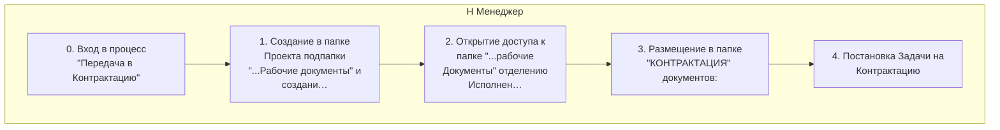
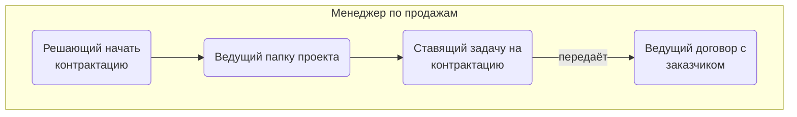
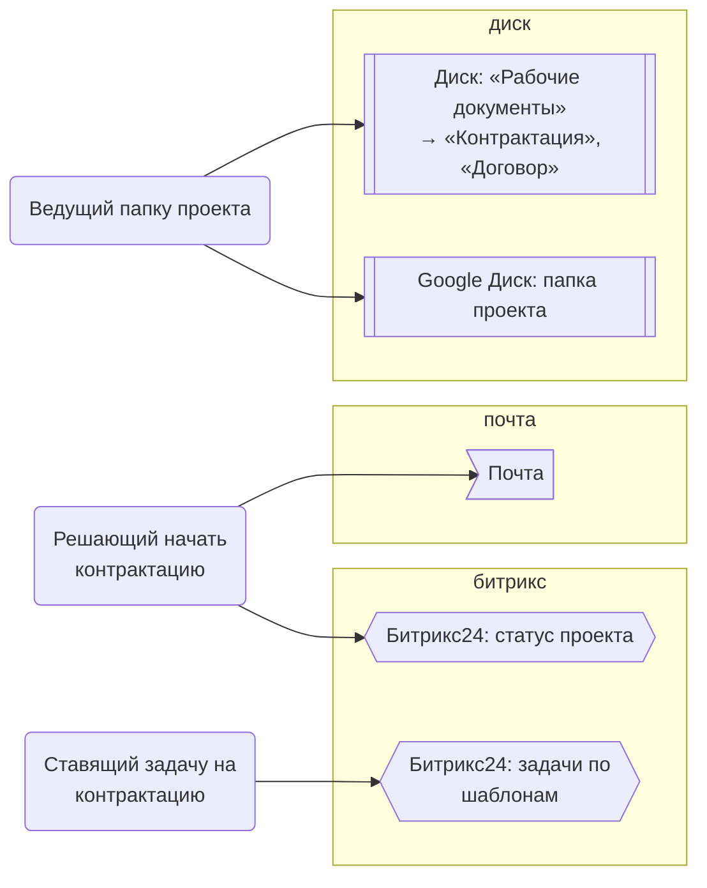
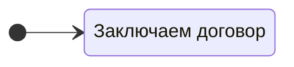

> Черновик: текст не проверен.

# Передача в контрактацию

Процесс регламента «Распределение задач» (лист «10.10.2026 Версия К»), в регламенте — «Передача в контрактацию». Контур 0.
Как читать схемы и что значат обязанности — [обзор процессов](../../pro/obzor/index.md).

Шаги «как записано» — `reglament.yaml` (собран скриптом из регламента), наше толкование — `protsess.yaml`. Ниже всё собрано из них.

## Как в регламенте

Дорожки — столбцы регламента с основным исполнителем; шаги — по порядку. Пунктир — шаг без исполнителя.

| № | Шаг | H Менеджер |
|---|---|---|
| 0 | Вход в процесс "Передача в Контрактацию" | И |
| 1 | Создание в папке Проекта подпапки "...Рабочие документы" и создание в ней папки "КОНТРАКТАЦИЯ". | И |
| 2 | Открытие доступа к папке "...рабочие Документы" отделению Исполнения | И |
| 3 | Размещение в папке "КОНТРАКТАЦИЯ" документов: | И |
| 4 | Постановка Задачи на Контрактацию | И |

И — исполнитель, С — соисполнитель, Сг — согласование, У — информируемый, В — владелец процесса.

## По обязанностям

Дорожки — должности, которые мы предполагаем; узлы — обязанности. Сплошная стрелка — ставит задачу или передаёт результат, пунктир — следит или согласует; стрелка без подписи — дальше по порядку.

## Шаги и обязанности

| № | Шаг | Делает | Ставит → принимает | Согласуют, помогают, узнают | Где |
|---|---|---|---|---|---|
| 0 | Вход в процесс "Передача в Контрактацию" | [Решающий начать контрактацию](../../reg/oby/reshenie-kontraktatsiya.md) | — → — |  | [Битрикс24: статус проекта](../../reg/mes.md#bitriks-status-proekta), [Почта](../../reg/mes.md#pochta) |
| 1 | Создание в папке Проекта подпапки "...Рабочие документы" и создание в ней папки "КОНТРАКТАЦИЯ". | [Ведущий папку проекта](../../reg/oby/papka-proekta.md) | — → — |  | [Диск: «Рабочие документы» → «Контрактация», «Договор»](../../reg/mes.md#disk-kontraktatsiya) |
| 2 | Открытие доступа к папке "...рабочие Документы" отделению Исполнения | [Ведущий папку проекта](../../reg/oby/papka-proekta.md) | — → — | узнают о результате: [Логист](../../reg/rol/logist.md) | [Google Диск: папка проекта](../../reg/mes.md#disk-papka-proekta) |
| 3 | Размещение в папке "КОНТРАКТАЦИЯ" документов: | [Ведущий папку проекта](../../reg/oby/papka-proekta.md) | — → — |  | [Диск: «Рабочие документы» → «Контрактация», «Договор»](../../reg/mes.md#disk-kontraktatsiya) |
| 4 | Постановка Задачи на Контрактацию | [Ставящий задачу на контрактацию](../../reg/oby/postanovka-kontraktatsii.md) | — → [Ведущий договор с заказчиком](../../reg/oby/dogovor-s-zakazchikom.md) |  | [Битрикс24: задачи по шаблонам](../../reg/mes.md#bitriks-zadacha) |

## Где работают

## Статусы

**Статус проекта**

Дальше: [Процесс. Контрактация](../r02-kontraktatsiya/index.md).
