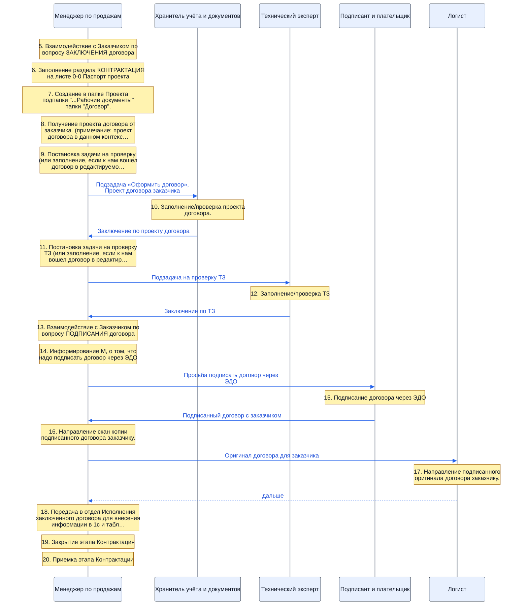
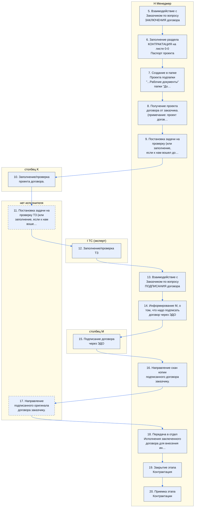
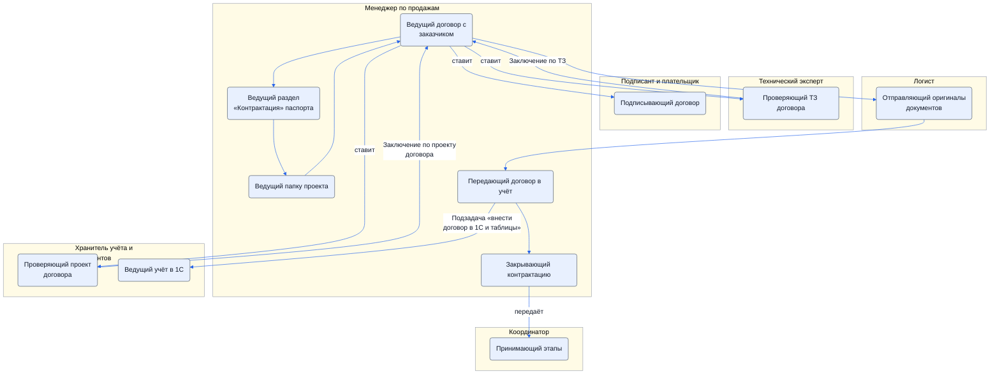
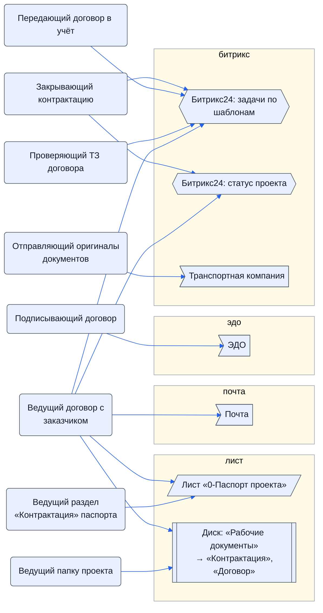

> Черновик: текст не проверен.

# Контрактация

Процесс регламента «Распределение задач» (лист «10.10.2026 Версия К»), в регламенте — «КОНТРАКТАЦИЯ». Контур 0.
Как читать схемы и что значат обязанности — [обзор процессов](../../pro/obzor/index.md).

Шаги «как записано» — `reglament.yaml` (собран скриптом из регламента), наше толкование — `protsess.yaml`. Ниже всё собрано из них.

## Дорожки по должностям

Вертикальная дорожка — должность, которую мы предполагаем; заметка — шаг в её дорожке; стрелка — работа переходит к другой должности (ставит задачу или делает следующий шаг).

## Как в регламенте

Дорожки — столбцы регламента с основным исполнителем; шаги — по порядку. Пунктир — шаг без исполнителя.

| № | Шаг | H Менеджер | I ТС (эксперт) | столбец K | L АС | столбец M |
|---|---|---|---|---|---|---|
| 5 | Взаимодействие с Заказчиком по вопросу ЗАКЛЮЧЕНИЯ договора | И |  |  |  |  |
| 6 | Заполнение раздела КОНТРАКТАЦИЯ на листе 0-0 Паспорт проекта | И |  |  |  |  |
| 7 | Создание в папке Проекта подпапки "...Рабочие документы" папки "Договор". | И |  |  |  |  |
| 8 | Получение проекта договора от заказчика. (примечание: проект договора в данном контексте это в том числе редактируемая версия текста договора). | И |  |  |  |  |
| 9 | Постановка задачи на проверку (или заполнение, если к нам вошел договор в редактируемом формате) направленного проекта договора. | И |  |  |  |  |
| 10 | Заполнение/проверка проекта договора. | С |  | И |  |  |
| 11 | Постановка задачи на проверку ТЗ (или заполнение, если к нам вошел договор в редактируемом формате) направленного ТЗ и перечня документов которые нужно включить в счета или договоры (лист 3-3) | С |  |  |  |  |
| 12 | Заполнение/проверка ТЗ | С | И |  |  |  |
| 13 | Взаимодействие с Заказчиком по вопросу ПОДПИСАНИЯ договора | И |  |  |  |  |
| 14 | Информирование M, о том, что надо подписать договор через ЭДО | И |  |  |  |  |
| 15 | Подписание договора через ЭДО |  |  |  |  | И |
| 16 | Направление скан копии подписанного договора заказчику. | И |  |  |  |  |
| 17 | Направление подписанного оригинала договора заказчику. |  |  |  | С | С |
| 18 | Передача в отдел Исполнения заключенного договора для внесения информации в 1с и табличные системы. | И |  |  |  |  |
| 19 | Закрытие этапа Контрактация | И |  |  |  |  |
| 20 | Приемка этапа Контрактации | И |  |  |  |  |

И — исполнитель, С — соисполнитель, Сг — согласование, У — информируемый, В — владелец процесса.

## По обязанностям

Дорожки — должности, которые мы предполагаем; узлы — обязанности. Сплошная стрелка — ставит задачу или передаёт результат, пунктир — следит или согласует; стрелка без подписи — дальше по порядку.

## Шаги и обязанности

| № | Шаг | Делает | Ставит → принимает | Передаёт | Согласуют, помогают, узнают | Где |
|---|---|---|---|---|---|---|
| 5 | Взаимодействие с Заказчиком по вопросу ЗАКЛЮЧЕНИЯ договора | [Ведущий договор с заказчиком](../../reg/oby/dogovor-s-zakazchikom.md) | — → — |  |  | [Почта](../../reg/mes.md#pochta) |
| 6 | Заполнение раздела КОНТРАКТАЦИЯ на листе 0-0 Паспорт проекта | [Ведущий раздел «Контрактация» паспорта](../../reg/oby/pasport-kontraktatsiya.md) | — → — |  |  | [Лист «0-Паспорт проекта»](../../reg/mes.md#lis-0-pasport) |
| 7 | Создание в папке Проекта подпапки "...Рабочие документы" папки "Договор". | [Ведущий папку проекта](../../reg/oby/papka-proekta.md) | — → — |  |  | [Диск: «Рабочие документы» → «Контрактация», «Договор»](../../reg/mes.md#disk-kontraktatsiya) |
| 8 | Получение проекта договора от заказчика. (примечание: проект договора в данном контексте это в том числе редактируемая версия текста договора). | [Ведущий договор с заказчиком](../../reg/oby/dogovor-s-zakazchikom.md) | — → — |  |  | [Почта](../../reg/mes.md#pochta), [Диск: «Рабочие документы» → «Контрактация», «Договор»](../../reg/mes.md#disk-kontraktatsiya), [Лист «0-Паспорт проекта»](../../reg/mes.md#lis-0-pasport) |
| 9 | Постановка задачи на проверку (или заполнение, если к нам вошел договор в редактируемом формате) направленного проекта договора. *Задача ставится K, в части ТЗ — ТС; подзадача «Оформить договор» внутри «Заключить договор».* | [Ведущий договор с заказчиком](../../reg/oby/dogovor-s-zakazchikom.md) | — → [Проверяющий проект договора](../../reg/oby/proverka-dogovora.md) | [Подзадача «Оформить договор»](../../reg/art.md#podzadacha-dogovor), [Проект договора заказчика](../../reg/art.md#proekt-dogovora) |  | [Битрикс24: задачи по шаблонам](../../reg/mes.md#bitriks-zadacha) |
| 10 | Заполнение/проверка проекта договора. | [Проверяющий проект договора](../../reg/oby/proverka-dogovora.md) | [Ведущий договор с заказчиком](../../reg/oby/dogovor-s-zakazchikom.md) → [Ведущий договор с заказчиком](../../reg/oby/dogovor-s-zakazchikom.md) | [Заключение по проекту договора](../../reg/art.md#zaklyuchenie-dogovor) | помогают: [Менеджер по продажам](../../reg/rol/prodazhi.md) |  |
| 11 | Постановка задачи на проверку ТЗ (или заполнение, если к нам вошел договор в редактируемом формате) направленного ТЗ и перечня документов которые нужно включить в счета или договоры (лист 3-3) *В регламенте у шага нет основного исполнителя — только соисполнитель H.* | [Ведущий договор с заказчиком](../../reg/oby/dogovor-s-zakazchikom.md) | — → [Проверяющий ТЗ договора](../../reg/oby/proverka-tz.md) | [Подзадача на проверку ТЗ](../../reg/art.md#podzadacha-tz) |  | [Битрикс24: задачи по шаблонам](../../reg/mes.md#bitriks-zadacha) |
| 12 | Заполнение/проверка ТЗ | [Проверяющий ТЗ договора](../../reg/oby/proverka-tz.md) | [Ведущий договор с заказчиком](../../reg/oby/dogovor-s-zakazchikom.md) → [Ведущий договор с заказчиком](../../reg/oby/dogovor-s-zakazchikom.md) | [Заключение по ТЗ](../../reg/art.md#zaklyuchenie-tz) |  | [Битрикс24: задачи по шаблонам](../../reg/mes.md#bitriks-zadacha) |
| 13 | Взаимодействие с Заказчиком по вопросу ПОДПИСАНИЯ договора | [Ведущий договор с заказчиком](../../reg/oby/dogovor-s-zakazchikom.md) | — → — |  |  | [Почта](../../reg/mes.md#pochta) |
| 14 | Информирование M, о том, что надо подписать договор через ЭДО | [Ведущий договор с заказчиком](../../reg/oby/dogovor-s-zakazchikom.md) | — → [Подписывающий договор](../../reg/oby/podpisanie.md) | [Просьба подписать договор через ЭДО](../../reg/art.md#poruchenie-podpisat) |  |  |
| 15 | Подписание договора через ЭДО | [Подписывающий договор](../../reg/oby/podpisanie.md) | [Ведущий договор с заказчиком](../../reg/oby/dogovor-s-zakazchikom.md) → — | [Подписанный договор с заказчиком](../../reg/art.md#dogovor-podpisannyy) |  | [ЭДО](../../reg/mes.md#edo) |
| 16 | Направление скан копии подписанного договора заказчику. | [Ведущий договор с заказчиком](../../reg/oby/dogovor-s-zakazchikom.md) | — → — | [Оригинал договора для заказчика](../../reg/art.md#original-dogovora) |  | [Почта](../../reg/mes.md#pochta), [Битрикс24: статус проекта](../../reg/mes.md#bitriks-status-proekta) |
| 17 | Направление подписанного оригинала договора заказчику. | [Отправляющий оригиналы документов](../../reg/oby/otpravka-originalov.md) | — → — |  |  | [Транспортная компания](../../reg/mes.md#transportnaya-kompaniya) |
| 18 | Передача в отдел Исполнения заключенного договора для внесения информации в 1с и табличные системы. | [Передающий договор в учёт](../../reg/oby/peredacha-v-uchet.md) | — → [Ведущий учёт в 1С](../../reg/oby/uchet-1s.md) | [Подзадача «внести договор в 1С и таблицы»](../../reg/art.md#podzadacha-uchet) |  | [Битрикс24: задачи по шаблонам](../../reg/mes.md#bitriks-zadacha) |
| 19 | Закрытие этапа Контрактация | [Закрывающий контрактацию](../../reg/oby/zakrytie-kontraktatsii.md) | — → — |  |  | [Битрикс24: статус проекта](../../reg/mes.md#bitriks-status-proekta), [Битрикс24: задачи по шаблонам](../../reg/mes.md#bitriks-zadacha) |
| 20 | Приемка этапа Контрактации | [Закрывающий контрактацию](../../reg/oby/zakrytie-kontraktatsii.md) | — → [Принимающий этапы](../../reg/oby/priemka-etapov.md) |  |  | [Битрикс24: задачи по шаблонам](../../reg/mes.md#bitriks-zadacha) |

## Где работают

## Статусы

**Статус проекта**

```mermaid
%%{init: {"theme": "base", "themeVariables": {"fontSize": "16px", "primaryColor": "#e8f0fe", "primaryTextColor": "#111827", "primaryBorderColor": "#4b5563", "lineColor": "#2563eb", "textColor": "#111827", "clusterBkg": "#fffbe6", "clusterBorder": "#9ca3af", "edgeLabelBackground": "#ffffff", "signalColor": "#2563eb", "signalTextColor": "#1d4ed8", "noteBkgColor": "#fff3b0", "noteTextColor": "#111827", "noteBorderColor": "#a16207", "actorBkg": "#e8f0fe", "actorTextColor": "#111827", "actorBorder": "#4b5563", "actorLineColor": "#9ca3af", "labelBoxBkgColor": "#e8f0fe", "labelTextColor": "#111827"}}}%%
stateDiagram-v2
  direction LR
  state "Договор заключен" as st0
  [*] --> st0
```

Дальше: [Процесс. Передача в закупки](../r03-peredacha-v-zakupki/index.md).
