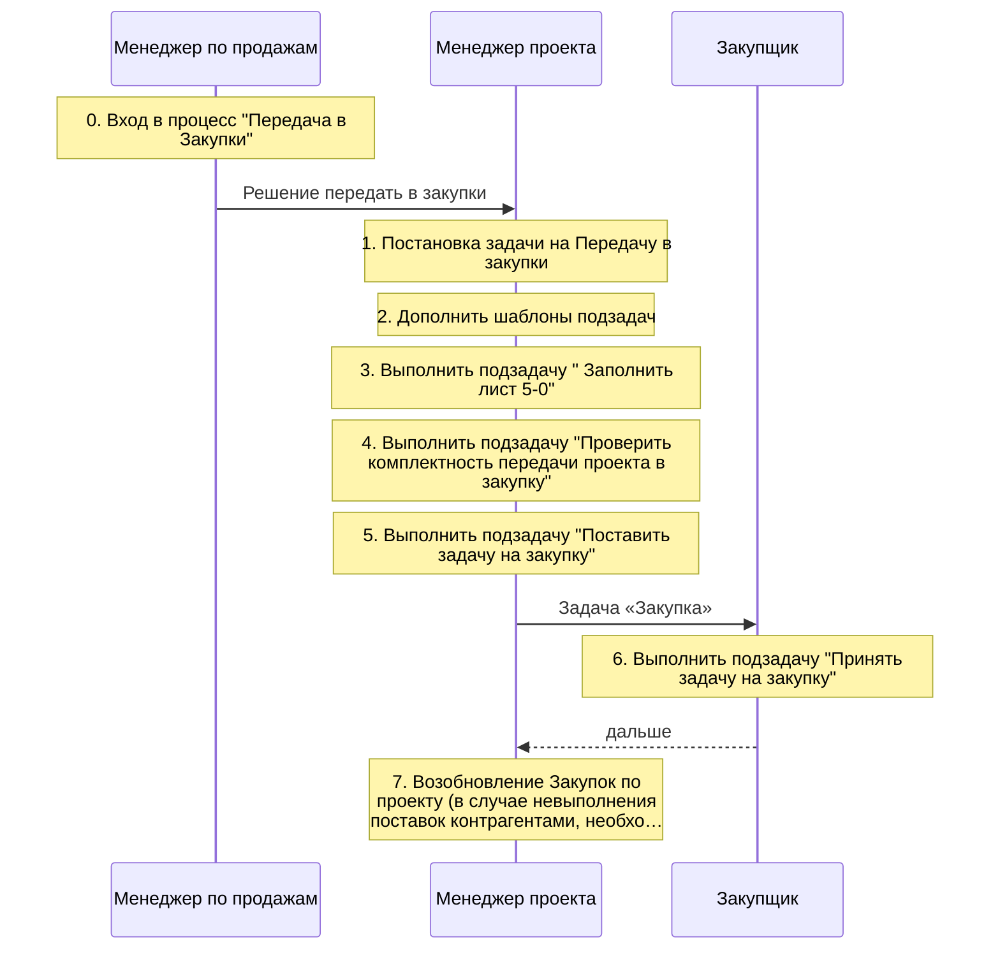
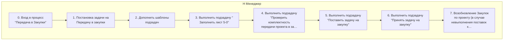
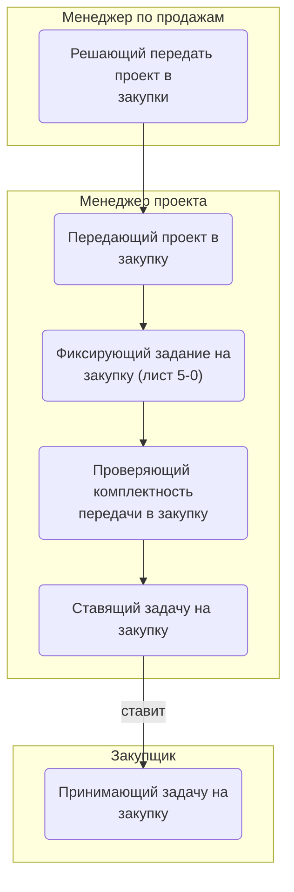
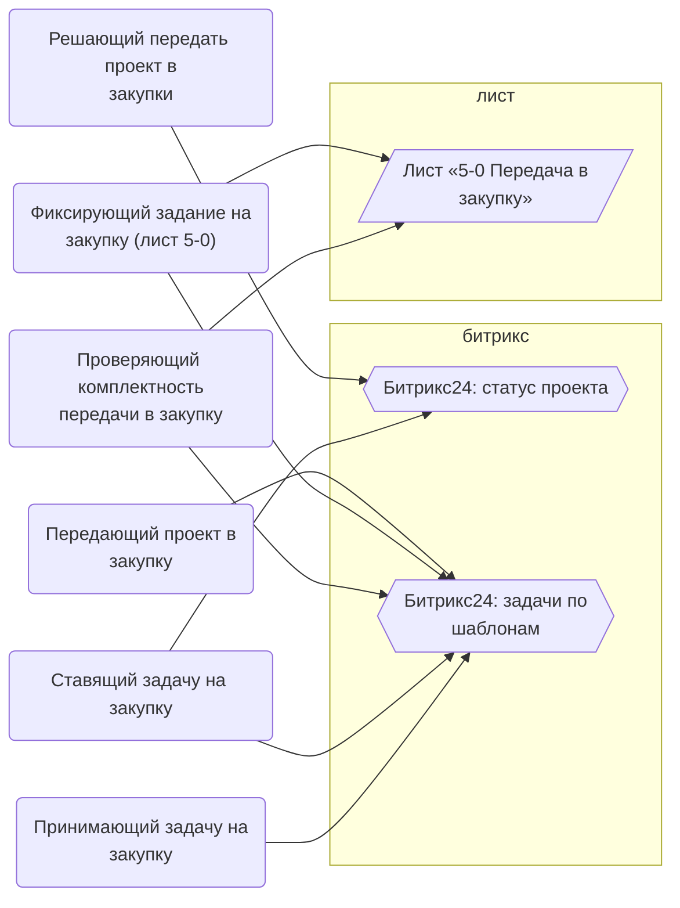
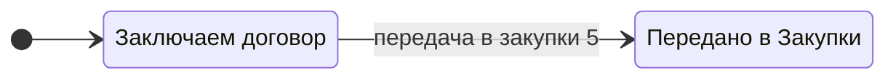

> Черновик: текст не проверен.

# Передача в закупки

Процесс регламента «Распределение задач» (лист «10.10.2026 Версия К»), в регламенте — «ПЕРЕДАЧА В ЗАКУПКИ». Контур 2.
Как читать схемы и что значат обязанности — [обзор процессов](../../pro/obzor/index.md).

Шаги «как записано» — `reglament.yaml` (собран скриптом из регламента), наше толкование — `protsess.yaml`. Ниже всё собрано из них.

## Дорожки по должностям

Вертикальная дорожка — должность, которую мы предполагаем; заметка — шаг в её дорожке; стрелка — работа переходит к другой должности (ставит задачу или делает следующий шаг).

## Как в регламенте

Дорожки — столбцы регламента с основным исполнителем; шаги — по порядку. Пунктир — шаг без исполнителя.

| № | Шаг | H Менеджер | I ТС (эксперт) |
|---|---|---|---|
| 0 | Вход в процесс "Передача в Закупки" | И |  |
| 1 | Постановка задачи на Передачу в закупки | И |  |
| 2 | Дополнить шаблоны подзадач | И |  |
| 3 | Выполнить подзадачу " Заполнить лист 5-0" | И | С |
| 4 | Выполнить подзадачу "Проверить комплектность передачи проекта в закупку" | И |  |
| 5 | Выполнить подзадачу "Поставить задачу на закупку" | И |  |
| 6 | Выполнить подзадачу "Принять задачу на закупку" | И |  |
| 7 | Возобновление Закупок по проекту (в случае невыполнения поставок контрагентами, необходимости дозакупить что-либо и т.д.) | И |  |

И — исполнитель, С — соисполнитель, Сг — согласование, У — информируемый, В — владелец процесса.

## По обязанностям

Дорожки — должности, которые мы предполагаем; узлы — обязанности. Сплошная стрелка — ставит задачу или передаёт результат, пунктир — следит или согласует; стрелка без подписи — дальше по порядку.

## Шаги и обязанности

| № | Шаг | Делает | Ставит → принимает | Передаёт | Согласуют, помогают, узнают | Где |
|---|---|---|---|---|---|---|
| 0 | Вход в процесс "Передача в Закупки" | [Решающий передать проект в закупки](../../reg/oby/reshenie-peredachi.md) | — → — | [Решение передать в закупки](../../reg/art.md#reshenie-peredat) |  | [Битрикс24: статус проекта](../../reg/mes.md#bitriks-status-proekta) |
| 1 | Постановка задачи на Передачу в закупки | [Передающий проект в закупку](../../reg/oby/peredacha-v-zakupku.md) | — → — | [Задача «Передача в закупку»](../../reg/art.md#zadacha-peredacha) |  | [Битрикс24: задачи по шаблонам](../../reg/mes.md#bitriks-zadacha) |
| 2 | Дополнить шаблоны подзадач | [Передающий проект в закупку](../../reg/oby/peredacha-v-zakupku.md) | — → — |  |  | [Битрикс24: задачи по шаблонам](../../reg/mes.md#bitriks-zadacha) |
| 3 | Выполнить подзадачу " Заполнить лист 5-0" | [Фиксирующий задание на закупку (лист 5-0)](../../reg/oby/list-5-0.md) | — → — | [Задание на закупку (лист 5-0)](../../reg/art.md#list-5-0) | помогают: [Технический эксперт (ТС)](../../reg/rol/tekh.md) | [Лист «5-0 Передача в закупку»](../../reg/mes.md#lis-5-0), [Битрикс24: задачи по шаблонам](../../reg/mes.md#bitriks-zadacha) |
| 4 | Выполнить подзадачу "Проверить комплектность передачи проекта в закупку" | [Проверяющий комплектность передачи в закупку](../../reg/oby/proverka-komplektnosti.md) | — → — |  |  | [Битрикс24: задачи по шаблонам](../../reg/mes.md#bitriks-zadacha), [Лист «5-0 Передача в закупку»](../../reg/mes.md#lis-5-0) |
| 5 | Выполнить подзадачу "Поставить задачу на закупку" | [Ставящий задачу на закупку](../../reg/oby/postanovka-zakupki.md) | — → [Принимающий задачу на закупку](../../reg/oby/prinyatie-zakupki.md) | [Задача «Закупка»](../../reg/art.md#zadacha-zakupka) |  | [Битрикс24: задачи по шаблонам](../../reg/mes.md#bitriks-zadacha), [Битрикс24: статус проекта](../../reg/mes.md#bitriks-status-proekta) |
| 6 | Выполнить подзадачу "Принять задачу на закупку" | [Принимающий задачу на закупку](../../reg/oby/prinyatie-zakupki.md) | [Ставящий задачу на закупку](../../reg/oby/postanovka-zakupki.md) → — |  |  | [Битрикс24: задачи по шаблонам](../../reg/mes.md#bitriks-zadacha) |
| 7 | Возобновление Закупок по проекту (в случае невыполнения поставок контрагентами, необходимости дозакупить что-либо и т.д.) *Возобновление закупки при недопоставке — тот же, кто ставит задачу.* | [Ставящий задачу на закупку](../../reg/oby/postanovka-zakupki.md) | — → [Принимающий задачу на закупку](../../reg/oby/prinyatie-zakupki.md) | [Задача «Закупка»](../../reg/art.md#zadacha-zakupka) |  | [Битрикс24: задачи по шаблонам](../../reg/mes.md#bitriks-zadacha), [Битрикс24: статус проекта](../../reg/mes.md#bitriks-status-proekta) |

## Где работают

## Статусы

**Статус проекта**

Дальше: [Процесс. Закупка товара](../r04-zakupka-tovara/index.md).
