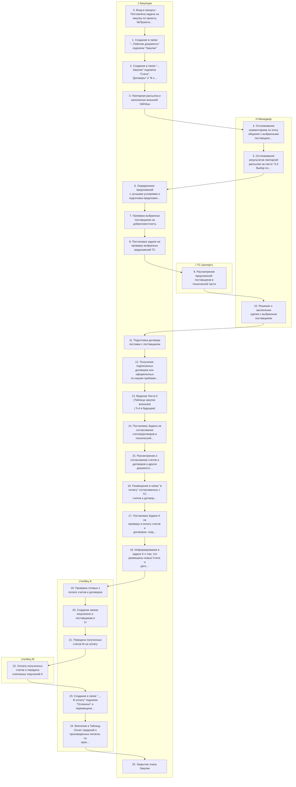
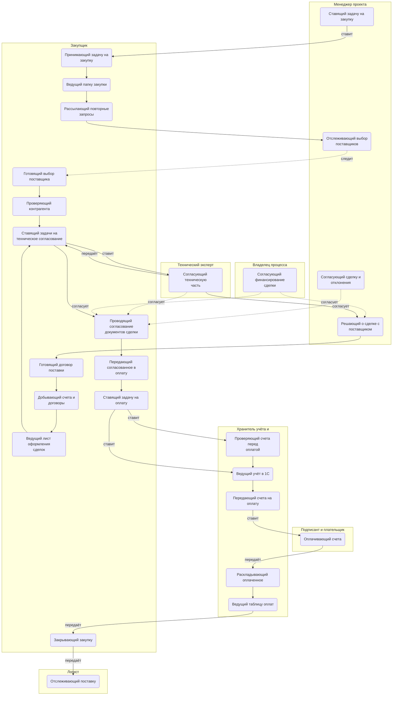
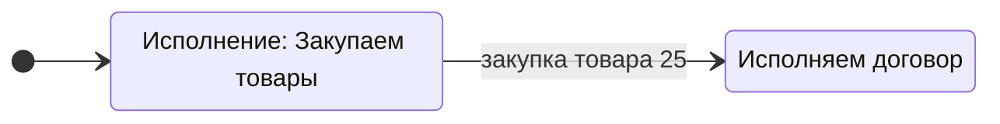
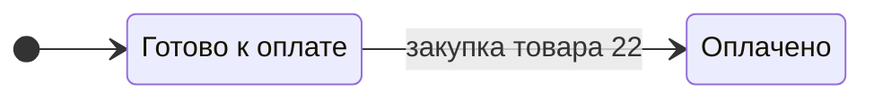

> Черновик: текст не проверен.

# Закупка товара

Процесс регламента «Распределение задач» (лист «10.10.2026 Версия К»), в регламенте — «ЗАКУПКА ТОВАРА (владелец процесса - Закупщик)». Контур 2.
Как читать схемы и что значат обязанности — [обзор процессов](../../pro/obzor/index.md).

Шаги «как записано» — `reglament.yaml` (собран скриптом из регламента), наше толкование — `protsess.yaml`. Ниже всё собрано из них.

## Как в регламенте

Дорожки — столбцы регламента с основным исполнителем; шаги — по порядку. Пунктир — шаг без исполнителя.

| № | Шаг | H Менеджер | I ТС (эксперт) | J Закупщик | столбец K | столбец M | N Владелец процесса |
|---|---|---|---|---|---|---|---|
| 0 | Вход в процесс- Поставлена задача на закупку по проекту. №Проекта -Закзачик-предмет: Закупить товары" (или принятие этой задачи?!) |  |  | И |  |  |  |
| 1 | Создание в папке "...Рабочие документы" подпапки "Закупки" |  |  | И |  |  |  |
| 2 | Создание в папке "... Закупки" подпапок "Счета", "Договоры" и "В оплату" |  |  | И |  |  |  |
| 3 | Повторная рассылка и заполнение внешней таблицы |  |  | И |  |  |  |
| 4 | Отслеживание комментариев по итогу общения с выбранными поставщиками на листе "5 Закупка товара". | И |  |  |  |  |  |
| 5 | Отслеживания результатов повторной рассылки на листе "3-3 Выбор поставщиков" В случае необходимости замены поставщиков, принятие решения по такой замене. | И |  |  |  |  |  |
| 6 | Определение предложений с лучшими условиями и подготовка предложения по Окончательному выбору поставщика. |  |  | И |  |  |  |
| 7 | Проверка выбранных поставщиков на добросовестность |  |  | И |  |  |  |
| 8 | Постановка задачи на проверку выбранных предложений ТС |  |  | И |  |  |  |
| 9 | Рассмотрение предложений поставщиков в технической части |  | И |  |  |  |  |
| 10 | Решение о заключении сделки с выбранным поставщиком | И |  |  |  |  |  |
| 11 | Подготовка договора поставки с поставщиком |  |  | И | С |  |  |
| 12 | Получение подписанных договоров или оформленных по нашим требованиям счетов от выбранных Поставщиков |  |  | И |  |  |  |
| 13 | Ведение Листа 5 (Таблица закупки внешняя) ( 5-4 в будущем) |  |  | И |  |  |  |
| 14 | Постановка Задачи на согласование счетов/договоров в технической части |  |  | И |  |  |  |
| 15 | Рассмотрение и согласование счетов и договоров и других документов в технической части (в том числе путем подготовки ТЗ для договора с поставщиком) | Сг | Сг | И |  |  | Сг |
| 16 | Размещение в папке "в оплату" согласованных с ТС счетов и договоров для оплаты |  |  | И |  |  |  |
| 17 | Постановка Задачи K на проверку и оплату счетов и договоров, созданию в 1с Заказа покупателя и заказов поставщикам |  |  | И |  |  |  |
| 18 | Информирование в задаче K о том, что размещены новые Счета и договора | С |  | И |  |  |  |
| 19 | Проверка готовых к оплате счетов и договоров |  |  |  | И |  |  |
| 20 | Создание заказа покупателя и поставщикам в 1с |  |  |  | И |  |  |
| 21 | Передача полученных счетов M на оплату |  |  |  | И |  |  |
| 22 | Оплата полученных счетов и передача платежных поручений K |  |  |  |  | И |  |
| 23 | Создание в папке ".... В оплату" подпапки "Оплачено" и перемещение в нее всех оплаченных счетов и договоров. Создание папки "Платежные поручения" и перемещение в нее всех Платежных поручений по оплаченным счетам и договорам |  |  |  | И |  |  |
| 24 | Внесение в Таблицу Оплат сведений о произведенных оплатах по проекту |  |  |  | И |  |  |
| 25 | Закрытие этапа Закупки | С |  | И |  |  |  |

И — исполнитель, С — соисполнитель, Сг — согласование, У — информируемый, В — владелец процесса.

## По обязанностям

Дорожки — должности, которые мы предполагаем; узлы — обязанности. Сплошная стрелка — ставит задачу или передаёт результат, пунктир — следит или согласует; стрелка без подписи — дальше по порядку.

## Шаги и обязанности

| № | Шаг | Делает | Ставит → принимает | Согласуют, помогают, узнают | Где |
|---|---|---|---|---|---|
| 0 | Вход в процесс- Поставлена задача на закупку по проекту. №Проекта -Закзачик-предмет: Закупить товары" (или принятие этой задачи?!) | [Принимающий задачу на закупку](../../reg/oby/prinyatie-zakupki.md) | [Ставящий задачу на закупку](../../reg/oby/postanovka-zakupki.md) → — |  | [Битрикс24: задачи по шаблонам](../../reg/mes.md#bitriks-zadacha) |
| 1 | Создание в папке "...Рабочие документы" подпапки "Закупки" | [Ведущий папку закупки](../../reg/oby/papka-zakupki.md) | — → — |  | [Диск: «Рабочие документы» → «Закупки»](../../reg/mes.md#disk-zakupki) |
| 2 | Создание в папке "... Закупки" подпапок "Счета", "Договоры" и "В оплату" | [Ведущий папку закупки](../../reg/oby/papka-zakupki.md) | — → — |  | [Диск: «Рабочие документы» → «Закупки»](../../reg/mes.md#disk-zakupki), [Битрикс24: статус проекта](../../reg/mes.md#bitriks-status-proekta) |
| 3 | Повторная рассылка и заполнение внешней таблицы | [Рассылающий повторные запросы](../../reg/oby/povtornaya-rassylka.md) | — → — |  | [Лист «5-2 Запросы КП Закупки»](../../reg/mes.md#lis-5-2), [Лист «5-1 Сбор КП Закупки»](../../reg/mes.md#lis-5-1), [Почта](../../reg/mes.md#pochta) |
| 4 | Отслеживание комментариев по итогу общения с выбранными поставщиками на листе "5 Закупка товара". | [Отслеживающий выбор поставщиков](../../reg/oby/kontrol-vybora.md) | — → — | отслеживает: [Готовящий выбор поставщика](../../reg/oby/vybor-postavshchika.md) | [Лист «5-3 Выбор поставщиков Закупки»](../../reg/mes.md#lis-5-3) |
| 5 | Отслеживания результатов повторной рассылки на листе "3-3 Выбор поставщиков" В случае необходимости замены поставщиков, принятие решения по такой замене. | [Отслеживающий выбор поставщиков](../../reg/oby/kontrol-vybora.md) | — → — |  | [Лист «5-3 Выбор поставщиков Закупки»](../../reg/mes.md#lis-5-3) |
| 6 | Определение предложений с лучшими условиями и подготовка предложения по Окончательному выбору поставщика. | [Готовящий выбор поставщика](../../reg/oby/vybor-postavshchika.md) | — → — |  | [Лист «5-3 Выбор поставщиков Закупки»](../../reg/mes.md#lis-5-3), [Почта](../../reg/mes.md#pochta) |
| 7 | Проверка выбранных поставщиков на добросовестность | [Проверяющий контрагента](../../reg/oby/proverka-kontragenta.md) | — → — |  | [Таблица проверки контрагентов](../../reg/mes.md#tablitsa-kontragentov), [Лист «Отзывы о поставщиках»](../../reg/mes.md#lis-otzyvy) |
| 8 | Постановка задачи на проверку выбранных предложений ТС | [Ставящий задачи на техническое согласование](../../reg/oby/postanovka-teh-soglasovaniya.md) | — → [Согласующий техническую часть](../../reg/oby/teh-soglasovanie.md) |  | [Битрикс24: задачи по шаблонам](../../reg/mes.md#bitriks-zadacha) |
| 9 | Рассмотрение предложений поставщиков в технической части *Регламент: «как эти заключения отражаются в таблице, если не попадают на 3-2?».* | [Согласующий техническую часть](../../reg/oby/teh-soglasovanie.md) | [Ставящий задачи на техническое согласование](../../reg/oby/postanovka-teh-soglasovaniya.md) → [Ставящий задачи на техническое согласование](../../reg/oby/postanovka-teh-soglasovaniya.md) |  | [Битрикс24: задачи по шаблонам](../../reg/mes.md#bitriks-zadacha) |
| 10 | Решение о заключении сделки с выбранным поставщиком | [Решающий о сделке с поставщиком](../../reg/oby/reshenie-sdelka.md) | — → — | согласуют: [Согласующий финансирование сделки](../../reg/oby/soglasovanie-finansirovaniya.md) |  |
| 11 | Подготовка договора поставки с поставщиком | [Готовящий договор поставки](../../reg/oby/dogovor-postavki.md) | — → — | помогают: [Хранитель учёта и документов (столбец K)](../../reg/rol/khranitel.md) | [Диск: «Рабочие документы» → «Закупки»](../../reg/mes.md#disk-zakupki) |
| 12 | Получение подписанных договоров или оформленных по нашим требованиям счетов от выбранных Поставщиков | [Добывающий счета и договоры](../../reg/oby/poluchenie-schetov.md) | — → — |  | [Почта](../../reg/mes.md#pochta), [Диск: «Рабочие документы» → «Закупки»](../../reg/mes.md#disk-zakupki) |
| 13 | Ведение Листа 5 (Таблица закупки внешняя) ( 5-4 в будущем) | [Ведущий лист оформления сделок](../../reg/oby/vedenie-sdelok.md) | — → — |  | [Лист «5-5 Оформление сделок»](../../reg/mes.md#lis-5-5) |
| 14 | Постановка Задачи на согласование счетов/договоров в технической части | [Ставящий задачи на техническое согласование](../../reg/oby/postanovka-teh-soglasovaniya.md) | — → [Согласующий техническую часть](../../reg/oby/teh-soglasovanie.md) |  | [Битрикс24: задачи по шаблонам](../../reg/mes.md#bitriks-zadacha) |
| 15 | Рассмотрение и согласование счетов и договоров и других документов в технической части (в том числе путем подготовки ТЗ для договора с поставщиком) | [Проводящий согласование документов сделки](../../reg/oby/soglasovanie-dokumentov.md) | — → — | согласуют: [Согласующий техническую часть](../../reg/oby/teh-soglasovanie.md), [Согласующий сделку и отклонения](../../reg/oby/soglasovanie-otkloneniy.md), [Согласующий финансирование сделки](../../reg/oby/soglasovanie-finansirovaniya.md) | [Битрикс24: задачи по шаблонам](../../reg/mes.md#bitriks-zadacha), [Диск: «Рабочие документы» → «Закупки»](../../reg/mes.md#disk-zakupki) |
| 16 | Размещение в папке "в оплату" согласованных с ТС счетов и договоров для оплаты | [Передающий согласованное в оплату](../../reg/oby/v-oplatu.md) | — → — |  | [Диск: «Рабочие документы» → «Закупки»](../../reg/mes.md#disk-zakupki), [Лист «5-5 Оформление сделок»](../../reg/mes.md#lis-5-5) |
| 17 | Постановка Задачи K на проверку и оплату счетов и договоров, созданию в 1с Заказа покупателя и заказов поставщикам | [Ставящий задачу на оплату](../../reg/oby/postanovka-oplaty.md) | — → [Проверяющий счета перед оплатой](../../reg/oby/proverka-schetov.md) |  | [Битрикс24: задачи по шаблонам](../../reg/mes.md#bitriks-zadacha) |
| 18 | Информирование в задаче K о том, что размещены новые Счета и договора | [Ставящий задачу на оплату](../../reg/oby/postanovka-oplaty.md) | — → — | узнают о результате: [Менеджер проекта](../../reg/rol/proekt.md) | [Битрикс24: задачи по шаблонам](../../reg/mes.md#bitriks-zadacha) |
| 19 | Проверка готовых к оплате счетов и договоров | [Проверяющий счета перед оплатой](../../reg/oby/proverka-schetov.md) | [Ставящий задачу на оплату](../../reg/oby/postanovka-oplaty.md) → — |  | [Диск: «Рабочие документы» → «Закупки»](../../reg/mes.md#disk-zakupki) |
| 20 | Создание заказа покупателя и поставщикам в 1с | [Ведущий учёт в 1С](../../reg/oby/uchet-1s.md) | [Ставящий задачу на оплату](../../reg/oby/postanovka-oplaty.md) → — |  | [1С](../../reg/mes.md#1s) |
| 21 | Передача полученных счетов M на оплату | [Передающий счета на оплату](../../reg/oby/peredacha-na-oplatu.md) | — → [Оплачивающий счета](../../reg/oby/oplata.md) |  |  |
| 22 | Оплата полученных счетов и передача платежных поручений K | [Оплачивающий счета](../../reg/oby/oplata.md) | [Передающий счета на оплату](../../reg/oby/peredacha-na-oplatu.md) → [Раскладывающий оплаченное](../../reg/oby/arhiv-oplat.md) |  |  |
| 23 | Создание в папке ".... В оплату" подпапки "Оплачено" и перемещение в нее всех оплаченных счетов и договоров. Создание папки "Платежные поручения" и перемещение в нее всех Платежных поручений по оплаченным счетам и договорам | [Раскладывающий оплаченное](../../reg/oby/arhiv-oplat.md) | — → — |  | [Диск: «Рабочие документы» → «Закупки»](../../reg/mes.md#disk-zakupki) |
| 24 | Внесение в Таблицу Оплат сведений о произведенных оплатах по проекту *Директор: задачу по оплате у K принимает сотрудник контура 2.* | [Ведущий таблицу оплат](../../reg/oby/tablitsa-oplat.md) | — → [Закрывающий закупку](../../reg/oby/zakrytie-zakupki.md) |  | [Внешняя таблица оплат](../../reg/mes.md#tablitsa-oplat), [Лист «6 Оплаты»](../../reg/mes.md#lis-6-oplaty) |
| 25 | Закрытие этапа Закупки *Директор: задачу по закупке у сотрудника контура 2 принимает логист.* | [Закрывающий закупку](../../reg/oby/zakrytie-zakupki.md) | — → [Отслеживающий поставку](../../reg/oby/kontrol-postavki.md) | помогают: [Менеджер проекта](../../reg/rol/proekt.md) | [Битрикс24: задачи по шаблонам](../../reg/mes.md#bitriks-zadacha), [Битрикс24: статус проекта](../../reg/mes.md#bitriks-status-proekta) |

## Где работают

```mermaid
flowchart LR
  o_prinyatie_zakupki("Принимающий задачу на<br/>закупку")
  o_papka_zakupki("Ведущий папку закупки")
  o_povtornaya_rassylka("Рассылающий повторные<br/>запросы")
  o_kontrol_vybora("Отслеживающий выбор<br/>поставщиков")
  o_vybor_postavshchika("Готовящий выбор поставщика")
  o_proverka_kontragenta("Проверяющий контрагента")
  o_postanovka_teh_soglasovaniya("Ставящий задачи на<br/>техническое согласование")
  o_teh_soglasovanie("Согласующий техническую<br/>часть")
  o_dogovor_postavki("Готовящий договор поставки")
  o_poluchenie_schetov("Добывающий счета и<br/>договоры")
  o_vedenie_sdelok("Ведущий лист оформления<br/>сделок")
  o_soglasovanie_dokumentov("Проводящий согласование<br/>документов сделки")
  o_v_oplatu("Передающий согласованное в<br/>оплату")
  o_postanovka_oplaty("Ставящий задачу на оплату")
  o_proverka_schetov("Проверяющий счета перед<br/>оплатой")
  o_uchet_1s("Ведущий учёт в 1С")
  o_arhiv_oplat("Раскладывающий оплаченное")
  o_tablitsa_oplat("Ведущий таблицу оплат")
  o_zakrytie_zakupki("Закрывающий закупку")
  subgraph v________["битрикс"]
    m_bitriks_zadacha{{"Битрикс24: задачи по<br/>шаблонам"}}
    m_bitriks_status_proekta{{"Битрикс24: статус проекта"}}
  end
  subgraph v_____["диск"]
    m_disk_zakupki[["Диск: «Рабочие документы»<br/>→ «Закупки»"]]
  end
  subgraph v_____["лист"]
    m_lis_5_2[/"Лист «5-2 Запросы КП<br/>Закупки»"/]
    m_lis_5_1[/"Лист «5-1 Сбор КП Закупки»"/]
    m_lis_5_3[/"Лист «5-3 Выбор<br/>поставщиков Закупки»"/]
    m_lis_otzyvy[/"Лист «Отзывы о<br/>поставщиках»"/]
    m_lis_5_5[/"Лист «5-5 Оформление<br/>сделок»"/]
    m_lis_6_oplaty[/"Лист «6 Оплаты»"/]
  end
  subgraph v______["почта"]
    m_pochta>"Почта"]
  end
  subgraph v________["таблица"]
    m_tablitsa_kontragentov[/"Таблица проверки<br/>контрагентов"/]
    m_tablitsa_oplat[/"Внешняя таблица оплат"/]
  end
  subgraph v_1_["1с"]
    m_1s[("1С")]
  end
  o_prinyatie_zakupki --> m_bitriks_zadacha
  o_papka_zakupki --> m_disk_zakupki
  o_papka_zakupki --> m_bitriks_status_proekta
  o_povtornaya_rassylka --> m_lis_5_2
  o_povtornaya_rassylka --> m_lis_5_1
  o_povtornaya_rassylka --> m_pochta
  o_kontrol_vybora --> m_lis_5_3
  o_vybor_postavshchika --> m_lis_5_3
  o_vybor_postavshchika --> m_pochta
  o_proverka_kontragenta --> m_tablitsa_kontragentov
  o_proverka_kontragenta --> m_lis_otzyvy
  o_postanovka_teh_soglasovaniya --> m_bitriks_zadacha
  o_teh_soglasovanie --> m_bitriks_zadacha
  o_dogovor_postavki --> m_disk_zakupki
  o_poluchenie_schetov --> m_pochta
  o_poluchenie_schetov --> m_disk_zakupki
  o_vedenie_sdelok --> m_lis_5_5
  o_soglasovanie_dokumentov --> m_bitriks_zadacha
  o_soglasovanie_dokumentov --> m_disk_zakupki
  o_v_oplatu --> m_disk_zakupki
  o_v_oplatu --> m_lis_5_5
  o_postanovka_oplaty --> m_bitriks_zadacha
  o_proverka_schetov --> m_disk_zakupki
  o_uchet_1s --> m_1s
  o_arhiv_oplat --> m_disk_zakupki
  o_tablitsa_oplat --> m_tablitsa_oplat
  o_tablitsa_oplat --> m_lis_6_oplaty
  o_zakrytie_zakupki --> m_bitriks_zadacha
  o_zakrytie_zakupki --> m_bitriks_status_proekta
```

## Статусы

**Статус проекта**

**Статус сделки**

Дальше: [Процесс. Поступление: контроль поставки, доплаты, доставка, приёмка](../r06-postuplenie/index.md).
