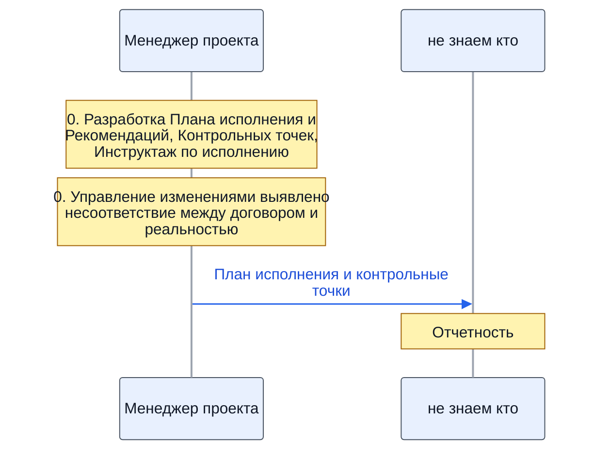
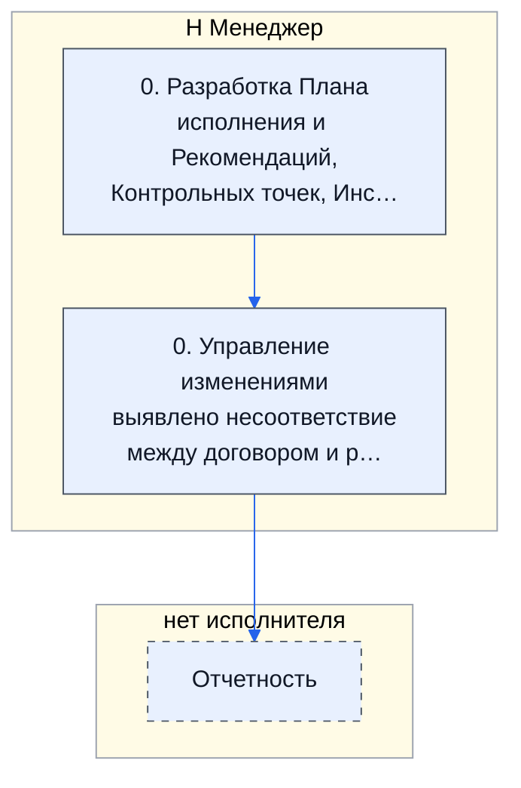
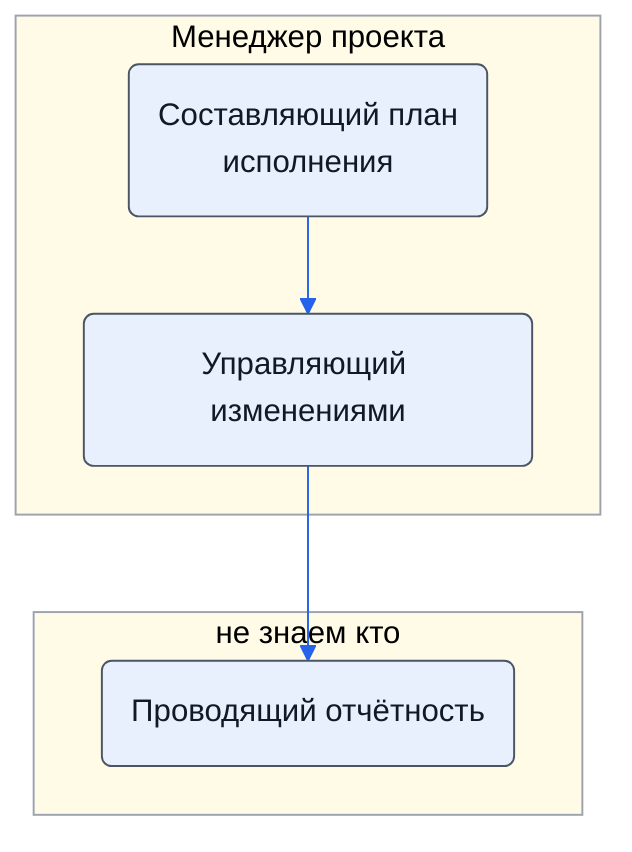

> Черновик: текст не проверен.

# Планирование и контроль исполнения

Процесс регламента «Распределение задач» (лист «10.10.2026 Версия К»), в регламенте — «ПЛАНИРОВАНИЕ И КОНТРОЛЬ ИСПОЛНЕНИЯ». Контур 4.
Как читать схемы и что значат обязанности — [обзор процессов](../../pro/obzor/index.md).

Шаги «как записано» — `reglament.yaml` (собран скриптом из регламента), наше толкование — `protsess.yaml`. Ниже всё собрано из них.

## Дорожки по должностям

Вертикальная дорожка — должность, которую мы предполагаем; заметка — шаг в её дорожке; стрелка — работа переходит к другой должности (ставит задачу или делает следующий шаг).

## Как в регламенте

Дорожки — столбцы регламента с основным исполнителем; шаги — по порядку. Пунктир — шаг без исполнителя.

| № | Шаг | H Менеджер | I ТС (эксперт) | J Закупщик | столбец K | L АС | столбец M | N Владелец процесса |
|---|---|---|---|---|---|---|---|---|
| 0 | Разработка Плана исполнения и Рекомендаций, Контрольных точек, Инструктаж по исполнению | И | У | У | У | У | У | У |
| 0 | Управление изменениями выявлено несоответствие между договором и реальностью | И | У | У | У | У | У | У |
| — | Отчетность |  |  |  |  |  |  |  |

И — исполнитель, С — соисполнитель, Сг — согласование, У — информируемый, В — владелец процесса.

## По обязанностям

Дорожки — должности, которые мы предполагаем; узлы — обязанности. Сплошная стрелка — ставит задачу или передаёт результат, пунктир — следит или согласует; стрелка без подписи — дальше по порядку.

## Шаги и обязанности

| № | Шаг | Делает | Ставит → принимает | Передаёт | Согласуют, помогают, узнают | Где |
|---|---|---|---|---|---|---|
| 0 | Разработка Плана исполнения и Рекомендаций, Контрольных точек, Инструктаж по исполнению | [Составляющий план исполнения](../../reg/oby/plan-ispolneniya.md) | — → — | [План исполнения и контрольные точки](../../reg/art.md#plan-ispolneniya) | узнают о результате: [Технический эксперт (ТС)](../../reg/rol/tekh.md), [Закупщик (специалист по закупке)](../../reg/rol/zakupka.md), [Хранитель учёта и документов (столбец K)](../../reg/rol/khranitel.md), [Логист](../../reg/rol/logist.md), [Подписант и плательщик (столбец M)](../../reg/rol/podpisant.md), [Владелец процесса (руководитель исполнителя)](../../reg/rol/vladelets.md) |  |
| 0 | Управление изменениями выявлено несоответствие между договором и реальностью | [Управляющий изменениями](../../reg/oby/upravlenie-izmeneniyami.md) | — → — |  | узнают о результате: [Технический эксперт (ТС)](../../reg/rol/tekh.md), [Закупщик (специалист по закупке)](../../reg/rol/zakupka.md), [Хранитель учёта и документов (столбец K)](../../reg/rol/khranitel.md), [Логист](../../reg/rol/logist.md), [Подписант и плательщик (столбец M)](../../reg/rol/podpisant.md), [Владелец процесса (руководитель исполнителя)](../../reg/rol/vladelets.md) |  |
| — | Отчетность | [Проводящий отчётность](../../reg/oby/otchetnost.md) | — → — |  |  |  |

Дальше: [Процесс. Поступление: контроль поставки, доплаты, доставка, приёмка](../r06-postuplenie/index.md).
