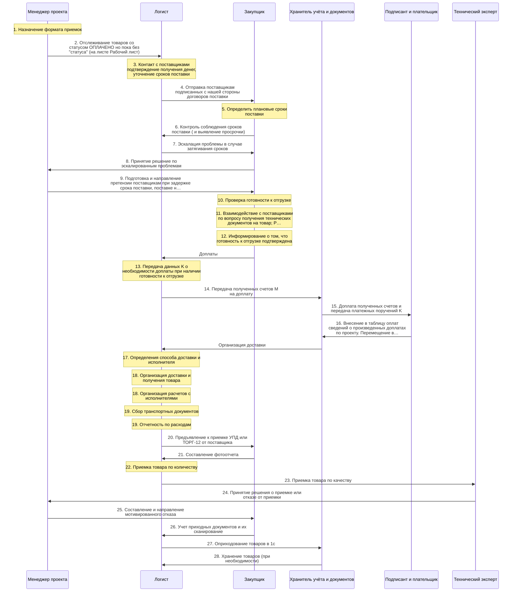
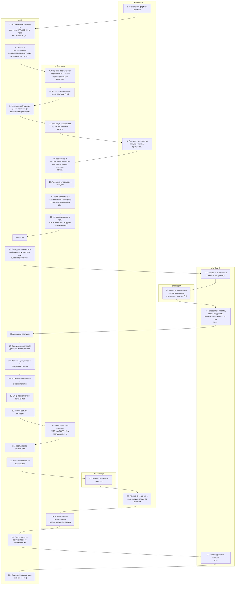
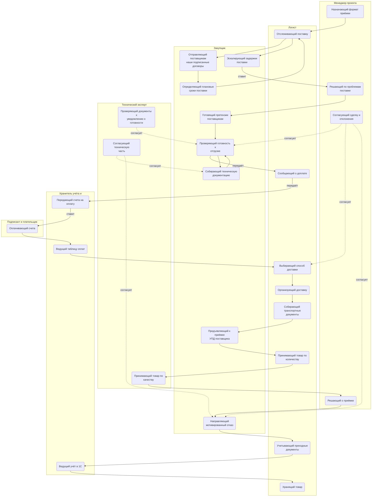
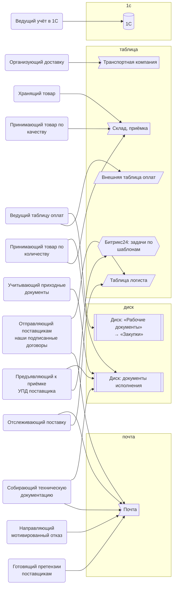
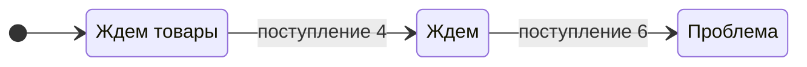

> Черновик: текст не проверен.

# Поступление: контроль поставки, доплаты, доставка, приёмка

Процесс регламента «Распределение задач» (лист «10.10.2026 Версия К»), в регламенте — «ПОСТУПЛЕНИЕ». Контур 4.
Как читать схемы и что значат обязанности — [обзор процессов](../../pro/obzor/index.md).

Шаги «как записано» — `reglament.yaml` (собран скриптом из регламента), наше толкование — `protsess.yaml`. Ниже всё собрано из них.

## Дорожки по должностям

Вертикальная дорожка — должность, которую мы предполагаем; заметка — шаг в её дорожке; стрелка — работа переходит к другой должности (ставит задачу или делает следующий шаг).

## Как в регламенте

Дорожки — столбцы регламента с основным исполнителем; шаги — по порядку. Пунктир — шаг без исполнителя.

| № | Шаг | H Менеджер | I ТС (эксперт) | J Закупщик | столбец K | L АС | столбец M | N Владелец процесса |
|---|---|---|---|---|---|---|---|---|
| 1 | Назначение формата приемок | И | У | У |  | У |  |  |
| 2 | Отслеживание товаров со статусом ОПЛАЧЕНО но пока без "статуса" (на листе Рабочий лист) |  |  |  |  | И |  |  |
| 3 | Контакт с поставщиками подтверждение получения денег, уточнение сроков поставки |  |  |  |  | И |  |  |
| 4 | Отправка поставщикам подписанных с нашей стороны договоров поставки |  |  | И |  |  |  |  |
| 5 | Определить плановые сроки поставки |  |  | И |  | И |  |  |
| 6 | Контроль соблюдения сроков поставки ( и выявление просрочки) |  |  |  |  | И |  |  |
| 7 | Эскалация проблемы в случае затягивания сроков | У |  | И |  |  |  |  |
| 8 | Принятие решение по эскалированным проблемам | И |  | У |  |  |  |  |
| 9 | Подготовка и направление претензии поставщикам при задержке срока поставки, поставке некачественного товара, недопоставке и тд |  |  | И | С |  |  |  |
| 10 | Проверка готовности к отгрузке | Сг | Сг | И |  | У |  | У |
| 11 | Взаимодействие с поставщиками по вопросу получения технических документов на товар; Размещение в папке проекта "Техническая документация на товар" всех документов, полученных от поставщиков |  | Сг | И |  |  |  |  |
| 12 | Информирование о том, что готовность к отгрузке подтверждена |  |  | И |  | У |  |  |
| — | Доплаты |  |  |  |  | И |  |  |
| 13 | Передача данных K о необходимости доплаты при наличии готовности к отгрузке |  |  |  |  | И |  |  |
| 14 | Передача полученных счетов M на доплату |  |  |  | И |  |  |  |
| 15 | Доплата полученных счетов и передача платежных поручений K |  |  |  |  |  | И |  |
| 16 | Внесение в таблицу оплат сведений о произведенных доплатах по проекту. Перемещение в папку "Платежные поручения" всех Платежных поручений по оплаченным счетам и договорам |  |  |  | И |  |  |  |
| — | Организация доставки |  |  |  |  | И |  |  |
| 17 | Определения способа доставки и исполнителя | Сг |  | Сг |  | И |  |  |
| 18 | Организация доставки и получения товара |  |  |  |  | И |  |  |
| 18 | Организация расчетов с исполнителями |  |  |  |  | И |  |  |
| 19 | Сбор транспортных документов |  |  |  | У | И |  |  |
| 19 | Отчетность по расходам |  |  |  | У | И |  |  |
| 20 | Предъявление к приемке УПД или ТОРГ-12 от поставщика |  |  | И |  | И |  |  |
| 21 | Составление фотоотчета | У | У | У |  | И |  |  |
| 22 | Приемка товара по количеству | У | У | У |  | И |  |  |
| 23 | Приемка товара по качеству | У | И | У |  | У |  |  |
| 24 | Принятие решения о приемке или отказе от приемки | И | У | У |  | У |  |  |
| 25 | Составление и направление мотивированного отказа | Сг | Сг | И |  |  |  |  |
| 26 | Учет приходных документов и их сканирование |  |  |  |  | И |  |  |
| 27 | Оприходование товаров в 1с |  |  |  | И |  |  |  |
| 28 | Хранение товаров (при необходимости) |  |  |  |  | И |  |  |

И — исполнитель, С — соисполнитель, Сг — согласование, У — информируемый, В — владелец процесса.

## По обязанностям

Дорожки — должности, которые мы предполагаем; узлы — обязанности. Сплошная стрелка — ставит задачу или передаёт результат, пунктир — следит или согласует; стрелка без подписи — дальше по порядку.

## Шаги и обязанности

| № | Шаг | Делает | Ставит → принимает | Согласуют, помогают, узнают | Где |
|---|---|---|---|---|---|
| 1 | Назначение формата приемок | [Назначающий формат приёмки](../../reg/oby/format-priemki.md) | — → — | узнают о результате: [Технический эксперт (ТС)](../../reg/rol/tekh.md), [Закупщик (специалист по закупке)](../../reg/rol/zakupka.md), [Логист](../../reg/rol/logist.md) |  |
| 2 | Отслеживание товаров со статусом ОПЛАЧЕНО но пока без "статуса" (на листе Рабочий лист) | [Отслеживающий поставку](../../reg/oby/kontrol-postavki.md) | — → — |  | [Таблица логиста](../../reg/mes.md#tablitsa-logista) |
| 3 | Контакт с поставщиками подтверждение получения денег, уточнение сроков поставки | [Отслеживающий поставку](../../reg/oby/kontrol-postavki.md) | — → — |  | [Почта](../../reg/mes.md#pochta), [Таблица логиста](../../reg/mes.md#tablitsa-logista) |
| 4 | Отправка поставщикам подписанных с нашей стороны договоров поставки | [Отправляющий поставщикам наши подписанные договоры](../../reg/oby/otpravka-dogovorov-postavshchikam.md) | — → — |  | [Почта](../../reg/mes.md#pochta), [Таблица логиста](../../reg/mes.md#tablitsa-logista) |
| 5 | Определить плановые сроки поставки | [Определяющий плановые сроки поставки](../../reg/oby/plan-sroki.md) | — → — |  |  |
| 6 | Контроль соблюдения сроков поставки ( и выявление просрочки) | [Отслеживающий поставку](../../reg/oby/kontrol-postavki.md) | — → — |  | [Таблица логиста](../../reg/mes.md#tablitsa-logista) |
| 7 | Эскалация проблемы в случае затягивания сроков | [Эскалирующий задержки поставки](../../reg/oby/eskalatsiya.md) | — → [Решающий по проблемам поставки](../../reg/oby/reshenie-problem.md) |  |  |
| 8 | Принятие решение по эскалированным проблемам | [Решающий по проблемам поставки](../../reg/oby/reshenie-problem.md) | [Эскалирующий задержки поставки](../../reg/oby/eskalatsiya.md) → — | узнают о результате: [Закупщик (специалист по закупке)](../../reg/rol/zakupka.md) |  |
| 9 | Подготовка и направление претензии поставщикам при задержке срока поставки, поставке некачественного товара, недопоставке и тд | [Готовящий претензии поставщикам](../../reg/oby/pretenzii-postavshchikam.md) | — → — | помогают: [Хранитель учёта и документов (столбец K)](../../reg/rol/khranitel.md) | [Почта](../../reg/mes.md#pochta) |
| 10 | Проверка готовности к отгрузке | [Проверяющий готовность к отгрузке](../../reg/oby/gotovnost-otgruzki.md) | — → — | согласуют: [Проверяющий документы к уведомлению о готовности](../../reg/oby/teh-gotovnost.md), [Согласующий сделку и отклонения](../../reg/oby/soglasovanie-otkloneniy.md); узнают о результате: [Логист](../../reg/rol/logist.md), [Владелец процесса (руководитель исполнителя)](../../reg/rol/vladelets.md) |  |
| 11 | Взаимодействие с поставщиками по вопросу получения технических документов на товар; Размещение в папке проекта "Техническая документация на товар" всех документов, полученных от поставщиков | [Собирающий техническую документацию](../../reg/oby/tehdokumentatsiya.md) | — → — | согласуют: [Согласующий техническую часть](../../reg/oby/teh-soglasovanie.md) | [Почта](../../reg/mes.md#pochta), [Диск: документы исполнения](../../reg/mes.md#disk-ispolnenie) |
| 12 | Информирование о том, что готовность к отгрузке подтверждена | [Проверяющий готовность к отгрузке](../../reg/oby/gotovnost-otgruzki.md) | — → [Сообщающий о доплате](../../reg/oby/zapros-doplaty.md) | узнают о результате: [Логист](../../reg/rol/logist.md) |  |
| — | Доплаты *Подраздел «Доплаты» — у него в регламенте отмечен исполнитель АС.* | [Сообщающий о доплате](../../reg/oby/zapros-doplaty.md) | — → — |  |  |
| 13 | Передача данных K о необходимости доплаты при наличии готовности к отгрузке | [Сообщающий о доплате](../../reg/oby/zapros-doplaty.md) | — → [Передающий счета на оплату](../../reg/oby/peredacha-na-oplatu.md) |  |  |
| 14 | Передача полученных счетов M на доплату | [Передающий счета на оплату](../../reg/oby/peredacha-na-oplatu.md) | — → [Оплачивающий счета](../../reg/oby/oplata.md) |  |  |
| 15 | Доплата полученных счетов и передача платежных поручений K | [Оплачивающий счета](../../reg/oby/oplata.md) | [Передающий счета на оплату](../../reg/oby/peredacha-na-oplatu.md) → — |  |  |
| 16 | Внесение в таблицу оплат сведений о произведенных доплатах по проекту. Перемещение в папку "Платежные поручения" всех Платежных поручений по оплаченным счетам и договорам | [Ведущий таблицу оплат](../../reg/oby/tablitsa-oplat.md) | — → — |  | [Внешняя таблица оплат](../../reg/mes.md#tablitsa-oplat), [Диск: «Рабочие документы» → «Закупки»](../../reg/mes.md#disk-zakupki) |
| — | Организация доставки *Подраздел «Организация доставки» — у него в регламенте отмечен исполнитель АС.* | [Выбирающий способ доставки](../../reg/oby/sposob-dostavki.md) | — → — |  |  |
| 17 | Определения способа доставки и исполнителя *Регламент: согласуют менеджер (при необходимости) и закупщик.* | [Выбирающий способ доставки](../../reg/oby/sposob-dostavki.md) | — → — | согласуют: [Согласующий сделку и отклонения](../../reg/oby/soglasovanie-otkloneniy.md); помогают: [Закупщик (специалист по закупке)](../../reg/rol/zakupka.md) |  |
| 18 | Организация доставки и получения товара | [Организующий доставку](../../reg/oby/dostavka.md) | — → — |  | [Транспортная компания](../../reg/mes.md#transportnaya-kompaniya) |
| 18 | Организация расчетов с исполнителями | [Организующий доставку](../../reg/oby/dostavka.md) | — → — |  | [Транспортная компания](../../reg/mes.md#transportnaya-kompaniya) |
| 19 | Сбор транспортных документов | [Собирающий транспортные документы](../../reg/oby/transportnye-dokumenty.md) | — → — | узнают о результате: [Хранитель учёта и документов (столбец K)](../../reg/rol/khranitel.md) |  |
| 19 | Отчетность по расходам | [Собирающий транспортные документы](../../reg/oby/transportnye-dokumenty.md) | — → — | узнают о результате: [Хранитель учёта и документов (столбец K)](../../reg/rol/khranitel.md) |  |
| 20 | Предъявление к приемке УПД или ТОРГ-12 от поставщика | [Предъявляющий к приёмке УПД поставщика](../../reg/oby/upd-postavshchika.md) | — → — |  | [Битрикс24: задачи по шаблонам](../../reg/mes.md#bitriks-zadacha), [Диск: документы исполнения](../../reg/mes.md#disk-ispolnenie) |
| 21 | Составление фотоотчета | [Принимающий товар по количеству](../../reg/oby/priemka-kolichestvo.md) | — → — | узнают о результате: [Менеджер проекта](../../reg/rol/proekt.md), [Технический эксперт (ТС)](../../reg/rol/tekh.md), [Закупщик (специалист по закупке)](../../reg/rol/zakupka.md) | [Склад, приёмка](../../reg/mes.md#sklad), [Диск: документы исполнения](../../reg/mes.md#disk-ispolnenie) |
| 22 | Приемка товара по количеству | [Принимающий товар по количеству](../../reg/oby/priemka-kolichestvo.md) | — → — | узнают о результате: [Менеджер проекта](../../reg/rol/proekt.md), [Технический эксперт (ТС)](../../reg/rol/tekh.md), [Закупщик (специалист по закупке)](../../reg/rol/zakupka.md) | [Склад, приёмка](../../reg/mes.md#sklad) |
| 23 | Приемка товара по качеству | [Принимающий товар по качеству](../../reg/oby/priemka-kachestvo.md) | — → — | узнают о результате: [Менеджер проекта](../../reg/rol/proekt.md), [Закупщик (специалист по закупке)](../../reg/rol/zakupka.md), [Логист](../../reg/rol/logist.md) | [Склад, приёмка](../../reg/mes.md#sklad) |
| 24 | Принятие решения о приемке или отказе от приемки | [Решающий о приёмке](../../reg/oby/reshenie-priemka.md) | — → — | узнают о результате: [Технический эксперт (ТС)](../../reg/rol/tekh.md), [Закупщик (специалист по закупке)](../../reg/rol/zakupka.md), [Логист](../../reg/rol/logist.md) |  |
| 25 | Составление и направление мотивированного отказа | [Направляющий мотивированный отказ](../../reg/oby/motivirovannyy-otkaz.md) | — → — | согласуют: [Согласующий сделку и отклонения](../../reg/oby/soglasovanie-otkloneniy.md), [Согласующий техническую часть](../../reg/oby/teh-soglasovanie.md) | [Почта](../../reg/mes.md#pochta) |
| 26 | Учет приходных документов и их сканирование | [Учитывающий приходные документы](../../reg/oby/prihodnye-dokumenty.md) | — → — |  | [Диск: документы исполнения](../../reg/mes.md#disk-ispolnenie) |
| 27 | Оприходование товаров в 1с | [Ведущий учёт в 1С](../../reg/oby/uchet-1s.md) | — → — |  | [1С](../../reg/mes.md#1s) |
| 28 | Хранение товаров (при необходимости) | [Хранящий товар](../../reg/oby/hranenie.md) | — → — |  | [Склад, приёмка](../../reg/mes.md#sklad) |

## Где работают

## Статусы

**Статус товара**

Дальше: [Процесс. Подготовка к отгрузке](../r07-podgotovka-k-otgruzke/index.md).
