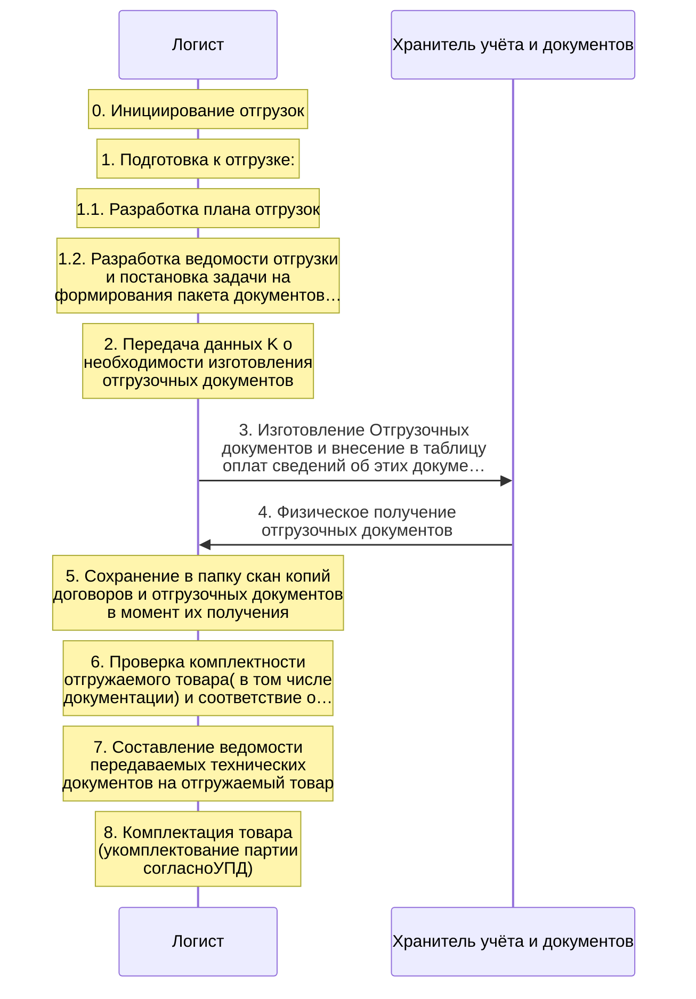
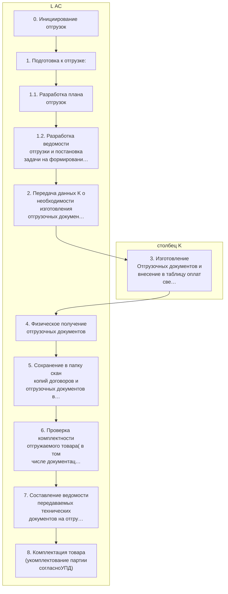
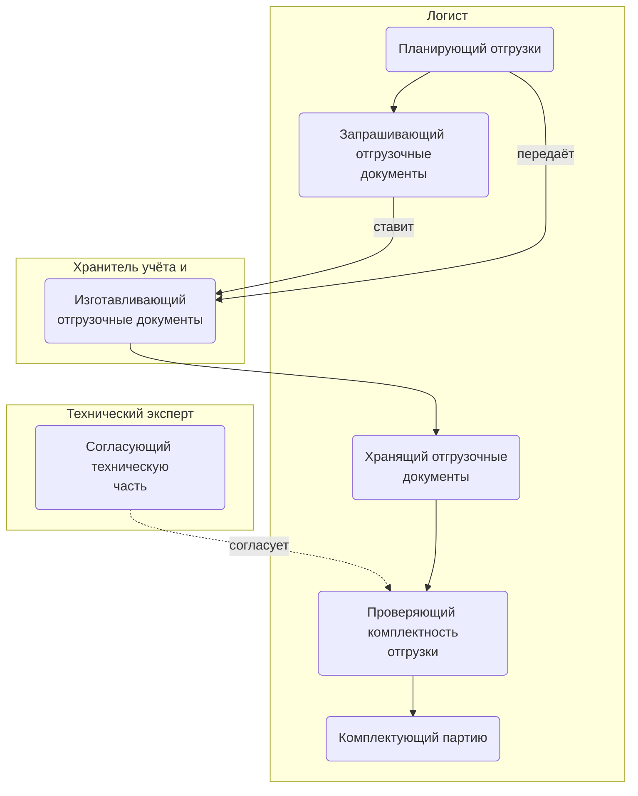
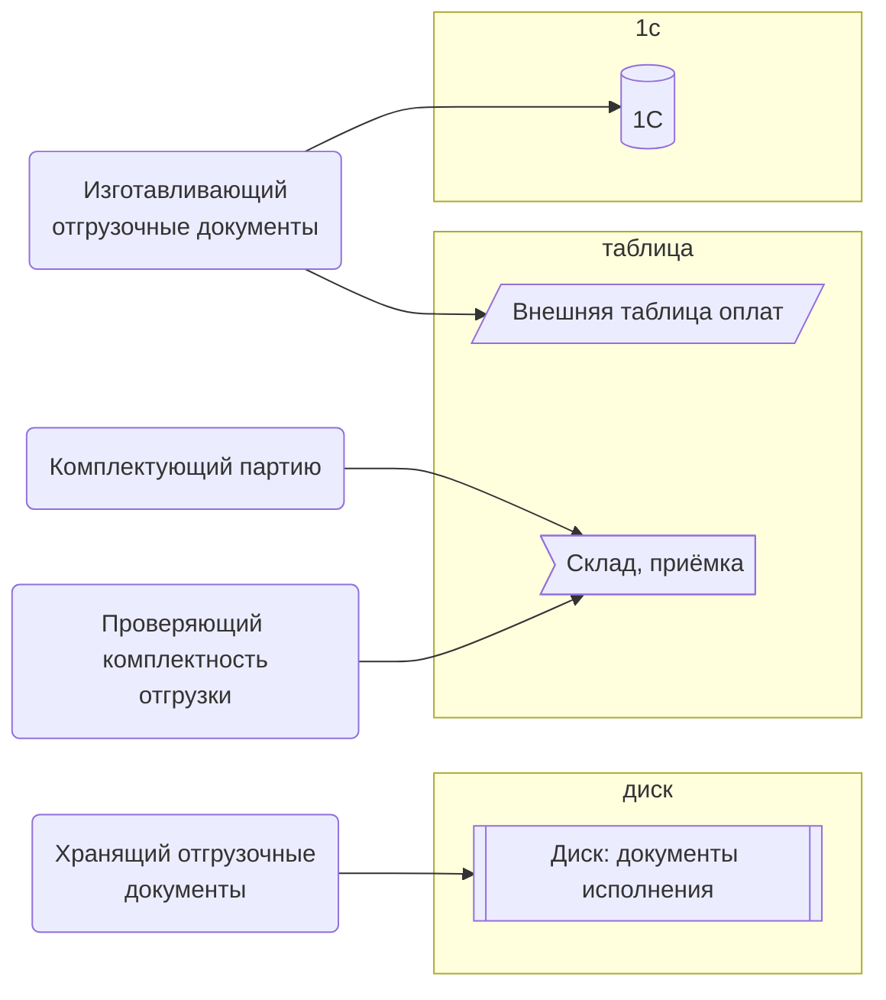

> Черновик: текст не проверен.

# Подготовка к отгрузке

Процесс регламента «Распределение задач» (лист «10.10.2026 Версия К»), в регламенте — «ПОДГОТОВКА К ОТГРУЗКЕ». Контур 4.
Как читать схемы и что значат обязанности — [обзор процессов](../../pro/obzor/index.md).

Шаги «как записано» — `reglament.yaml` (собран скриптом из регламента), наше толкование — `protsess.yaml`. Ниже всё собрано из них.

## Дорожки по должностям

Вертикальная дорожка — должность, которую мы предполагаем; заметка — шаг в её дорожке; стрелка — работа переходит к другой должности (ставит задачу или делает следующий шаг).

## Как в регламенте

Дорожки — столбцы регламента с основным исполнителем; шаги — по порядку. Пунктир — шаг без исполнителя.

| № | Шаг | H Менеджер | I ТС (эксперт) | столбец K | L АС |
|---|---|---|---|---|---|
| 0 | Инициирование отгрузок |  |  |  | И |
| 1 | Подготовка к отгрузке: |  |  |  | И |
| 1.1 | Разработка плана отгрузок |  |  |  | И |
| 1.2 | Разработка ведомости отгрузки и постановка задачи на формирования пакета документов для нее. |  |  |  | И |
| 2 | Передача данных K о необходимости изготовления отгрузочных документов |  |  |  | И |
| 3 | Изготовление Отгрузочных документов и внесение в таблицу оплат сведений об этих документах |  |  | И |  |
| 4 | Физическое получение отгрузочных документов |  |  |  | И |
| 5 | Сохранение в папку скан копий договоров и отгрузочных документов в момент их получения |  |  |  | И |
| 6 | Проверка комплектности отгружаемого товара( в том числе документации) и соответствие отгрузочным документам | У | Сг |  | И |
| 7 | Составление ведомости передаваемых технических документов на отгружаемый товар | У | Сг |  | И |
| 8 | Комплектация товара (укомплектование партии согласноУПД) |  |  |  | И |

И — исполнитель, С — соисполнитель, Сг — согласование, У — информируемый, В — владелец процесса.

## По обязанностям

Дорожки — должности, которые мы предполагаем; узлы — обязанности. Сплошная стрелка — ставит задачу или передаёт результат, пунктир — следит или согласует; стрелка без подписи — дальше по порядку.

## Шаги и обязанности

| № | Шаг | Делает | Ставит → принимает | Согласуют, помогают, узнают | Где |
|---|---|---|---|---|---|
| 0 | Инициирование отгрузок | [Планирующий отгрузки](../../reg/oby/plan-otgruzok.md) | — → — |  |  |
| 1 | Подготовка к отгрузке: | [Планирующий отгрузки](../../reg/oby/plan-otgruzok.md) | — → — |  |  |
| 1.1 | Разработка плана отгрузок | [Планирующий отгрузки](../../reg/oby/plan-otgruzok.md) | — → — |  |  |
| 1.2 | Разработка ведомости отгрузки и постановка задачи на формирования пакета документов для нее. | [Планирующий отгрузки](../../reg/oby/plan-otgruzok.md) | — → [Изготавливающий отгрузочные документы](../../reg/oby/otgruzochnye-dokumenty.md) |  |  |
| 2 | Передача данных K о необходимости изготовления отгрузочных документов | [Запрашивающий отгрузочные документы](../../reg/oby/zapros-otgruzochnyh.md) | — → [Изготавливающий отгрузочные документы](../../reg/oby/otgruzochnye-dokumenty.md) |  |  |
| 3 | Изготовление Отгрузочных документов и внесение в таблицу оплат сведений об этих документах | [Изготавливающий отгрузочные документы](../../reg/oby/otgruzochnye-dokumenty.md) | [Запрашивающий отгрузочные документы](../../reg/oby/zapros-otgruzochnyh.md) → — |  | [1С](../../reg/mes.md#1s), [Внешняя таблица оплат](../../reg/mes.md#tablitsa-oplat) |
| 4 | Физическое получение отгрузочных документов | [Хранящий отгрузочные документы](../../reg/oby/dokumenty-otgruzki.md) | — → — |  |  |
| 5 | Сохранение в папку скан копий договоров и отгрузочных документов в момент их получения | [Хранящий отгрузочные документы](../../reg/oby/dokumenty-otgruzki.md) | — → — |  | [Диск: документы исполнения](../../reg/mes.md#disk-ispolnenie) |
| 6 | Проверка комплектности отгружаемого товара( в том числе документации) и соответствие отгрузочным документам | [Проверяющий комплектность отгрузки](../../reg/oby/komplektnost-otgruzki.md) | — → — | согласуют: [Согласующий техническую часть](../../reg/oby/teh-soglasovanie.md); узнают о результате: [Менеджер проекта](../../reg/rol/proekt.md) | [Склад, приёмка](../../reg/mes.md#sklad) |
| 7 | Составление ведомости передаваемых технических документов на отгружаемый товар | [Проверяющий комплектность отгрузки](../../reg/oby/komplektnost-otgruzki.md) | — → — | согласуют: [Согласующий техническую часть](../../reg/oby/teh-soglasovanie.md); узнают о результате: [Менеджер проекта](../../reg/rol/proekt.md) |  |
| 8 | Комплектация товара (укомплектование партии согласноУПД) | [Комплектующий партию](../../reg/oby/komplektatsiya.md) | — → — |  | [Склад, приёмка](../../reg/mes.md#sklad) |

## Где работают

Дальше: [Процесс. Отгрузка](../r08-otgruzka/index.md).
