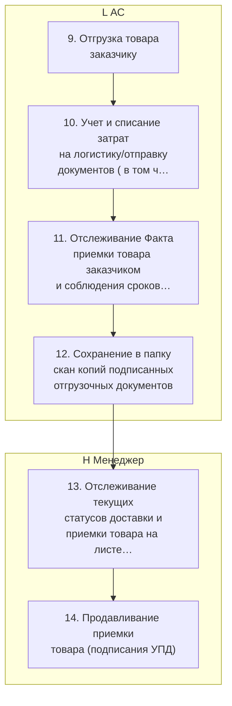
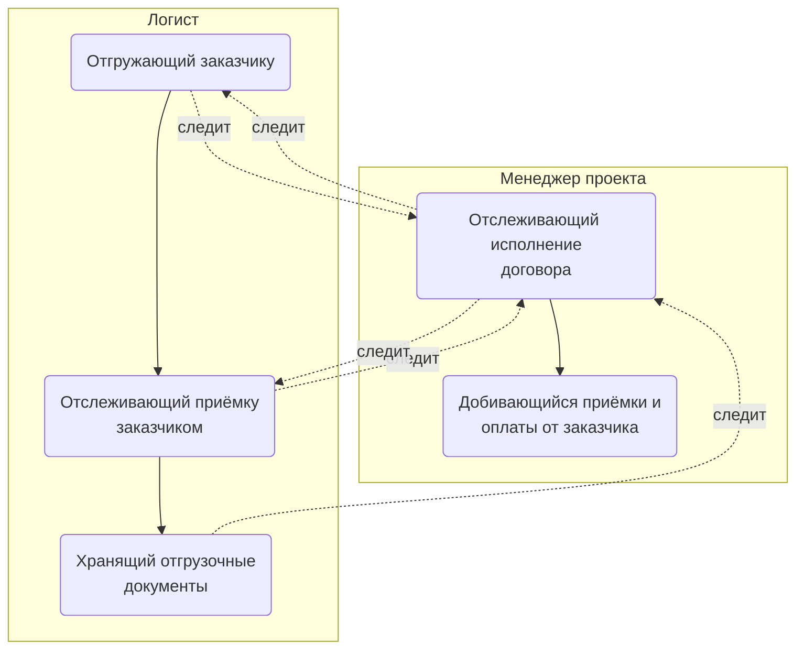
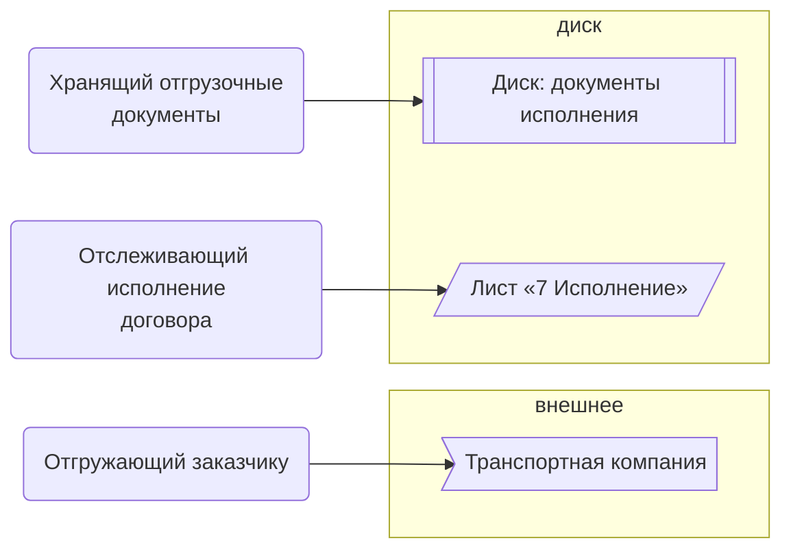

> Черновик: текст не проверен.

# Отгрузка

Процесс регламента «Распределение задач» (лист «10.10.2026 Версия К»), в регламенте — «ОТГРУЗКА». Контур 4.
Как читать схемы и что значат обязанности — [обзор процессов](../../pro/obzor/index.md).

Шаги «как записано» — `reglament.yaml` (собран скриптом из регламента), наше толкование — `protsess.yaml`. Ниже всё собрано из них.

## Как в регламенте

Дорожки — столбцы регламента с основным исполнителем; шаги — по порядку. Пунктир — шаг без исполнителя.

| № | Шаг | H Менеджер | L АС |
|---|---|---|---|
| 9 | Отгрузка товара заказчику | В | И |
| 10 | Учет и списание затрат на логистику/отправку документов ( в том числе Хранение товаров) | В | И |
| 11 | Отслеживание Факта приемки товара заказчиком и соблюдения сроков приемки | В | И |
| 12 | Сохранение в папку скан копий подписанных отгрузочных документов | В | И |
| 13 | Отслеживание текущих статусов доставки и приемки товара на листе "7 Исполнение" в таблице проекта или в сводной таблице проекта. Контроль за ходом деятельности логиста, в случае необходимости принятие - оперативных решений | И |  |
| 14 | Продавливание приемки товара (подписания УПД) | И | С |

И — исполнитель, С — соисполнитель, Сг — согласование, У — информируемый, В — владелец процесса.

## По обязанностям

Дорожки — должности, которые мы предполагаем; узлы — обязанности. Сплошная стрелка — ставит задачу или передаёт результат, пунктир — следит или согласует; стрелка без подписи — дальше по порядку.

## Шаги и обязанности

| № | Шаг | Делает | Ставит → принимает | Согласуют, помогают, узнают | Где |
|---|---|---|---|---|---|
| 9 | Отгрузка товара заказчику | [Отгружающий заказчику](../../reg/oby/otgruzka.md) | — → — | отслеживает: [Отслеживающий исполнение договора](../../reg/oby/kontrol-ispolneniya.md) | [Транспортная компания](../../reg/mes.md#transportnaya-kompaniya) |
| 10 | Учет и списание затрат на логистику/отправку документов ( в том числе Хранение товаров) | [Отгружающий заказчику](../../reg/oby/otgruzka.md) | — → — | отслеживает: [Отслеживающий исполнение договора](../../reg/oby/kontrol-ispolneniya.md) |  |
| 11 | Отслеживание Факта приемки товара заказчиком и соблюдения сроков приемки | [Отслеживающий приёмку заказчиком](../../reg/oby/kontrol-priemki-zakazchikom.md) | — → — | отслеживает: [Отслеживающий исполнение договора](../../reg/oby/kontrol-ispolneniya.md) |  |
| 12 | Сохранение в папку скан копий подписанных отгрузочных документов | [Хранящий отгрузочные документы](../../reg/oby/dokumenty-otgruzki.md) | — → — | отслеживает: [Отслеживающий исполнение договора](../../reg/oby/kontrol-ispolneniya.md) | [Диск: документы исполнения](../../reg/mes.md#disk-ispolnenie) |
| 13 | Отслеживание текущих статусов доставки и приемки товара на листе "7 Исполнение" в таблице проекта или в сводной таблице проекта. Контроль за ходом деятельности логиста, в случае необходимости принятие - оперативных решений | [Отслеживающий исполнение договора](../../reg/oby/kontrol-ispolneniya.md) | — → — | отслеживает: [Отгружающий заказчику](../../reg/oby/otgruzka.md), [Отслеживающий приёмку заказчиком](../../reg/oby/kontrol-priemki-zakazchikom.md) | [Лист «7 Исполнение»](../../reg/mes.md#lis-7-ispolnenie) |
| 14 | Продавливание приемки товара (подписания УПД) | [Добивающийся приёмки и оплаты от заказчика](../../reg/oby/dozhim-zakazchika.md) | — → — | помогают: [Логист](../../reg/rol/logist.md) |  |

## Где работают

Дальше: [Процесс. Контроль исполнения заказчиком](../r11-kontrol-zakazchika/index.md).
