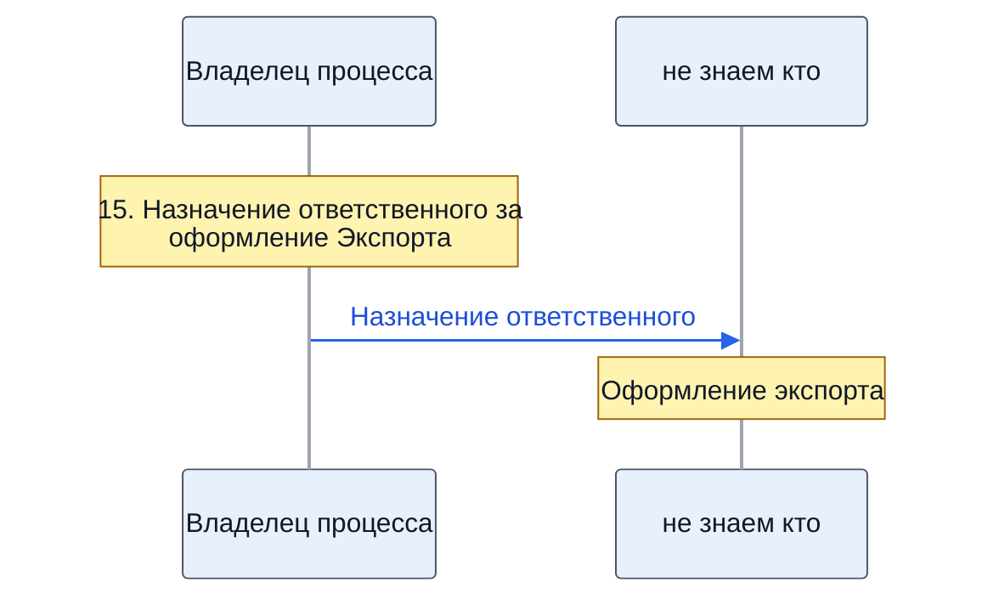
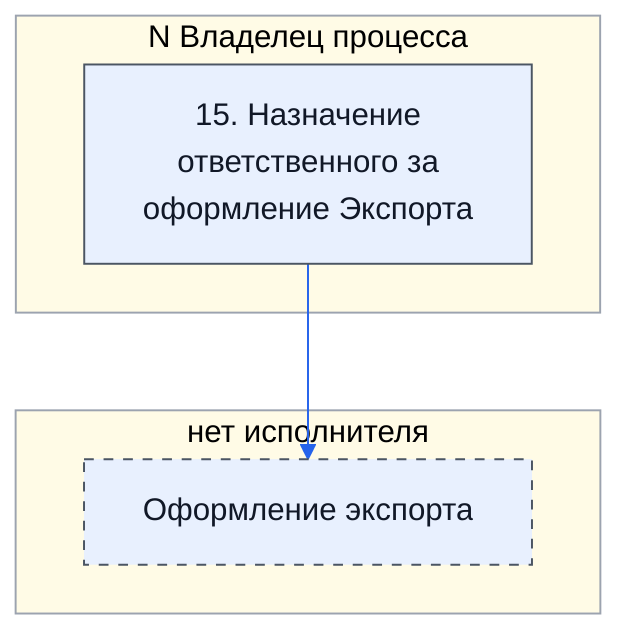
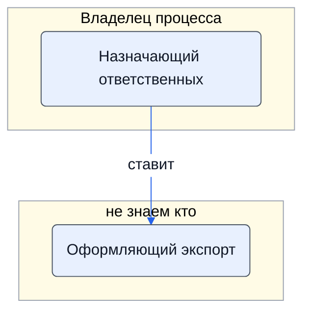

> Черновик: текст не проверен.

# Оформление экспорта

Процесс регламента «Распределение задач» (лист «10.10.2026 Версия К»), в регламенте — «ОФОРМЛЕНИЕ ЭКСПОРТА (если применимо)». Контур 4.
Как читать схемы и что значат обязанности — [обзор процессов](../../pro/obzor/index.md).

Шаги «как записано» — `reglament.yaml` (собран скриптом из регламента), наше толкование — `protsess.yaml`. Ниже всё собрано из них.

## Дорожки по должностям

Вертикальная дорожка — должность, которую мы предполагаем; заметка — шаг в её дорожке; стрелка — работа переходит к другой должности (ставит задачу или делает следующий шаг).

## Как в регламенте

Дорожки — столбцы регламента с основным исполнителем; шаги — по порядку. Пунктир — шаг без исполнителя.

| № | Шаг | N Владелец процесса |
|---|---|---|
| 15 | Назначение ответственного за оформление Экспорта | И |
| — | Оформление экспорта |  |

И — исполнитель, С — соисполнитель, Сг — согласование, У — информируемый, В — владелец процесса.

## По обязанностям

Дорожки — должности, которые мы предполагаем; узлы — обязанности. Сплошная стрелка — ставит задачу или передаёт результат, пунктир — следит или согласует; стрелка без подписи — дальше по порядку.

## Шаги и обязанности

| № | Шаг | Делает | Ставит → принимает | Передаёт | Согласуют, помогают, узнают | Где |
|---|---|---|---|---|---|---|
| 15 | Назначение ответственного за оформление Экспорта | [Назначающий ответственных](../../reg/oby/naznachenie-otvetstvennyh.md) | — → [Оформляющий экспорт](../../reg/oby/eksport.md) | [Назначение ответственного](../../reg/art.md#naznachenie) |  |  |
| — | Оформление экспорта | [Оформляющий экспорт](../../reg/oby/eksport.md) | [Назначающий ответственных](../../reg/oby/naznachenie-otvetstvennyh.md) → — |  |  |  |
