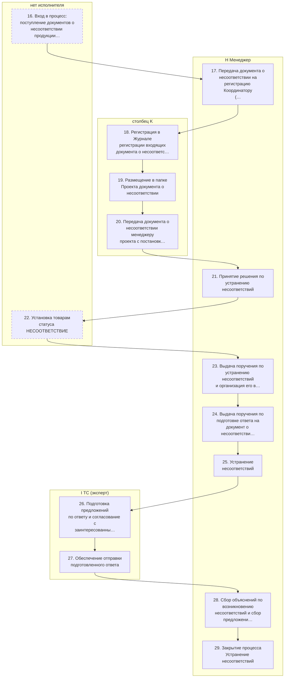
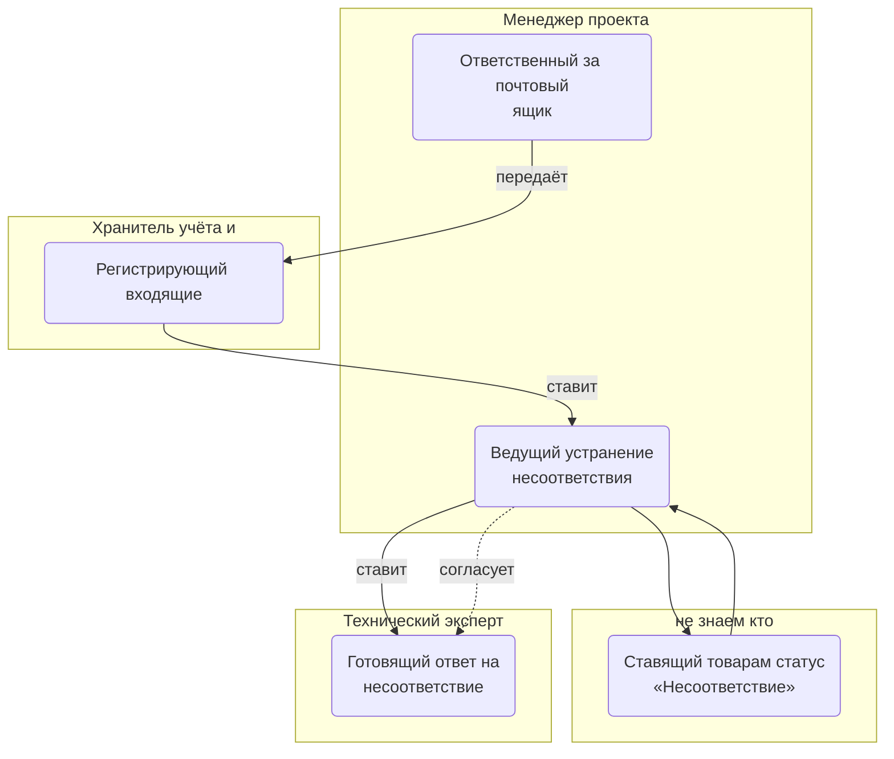
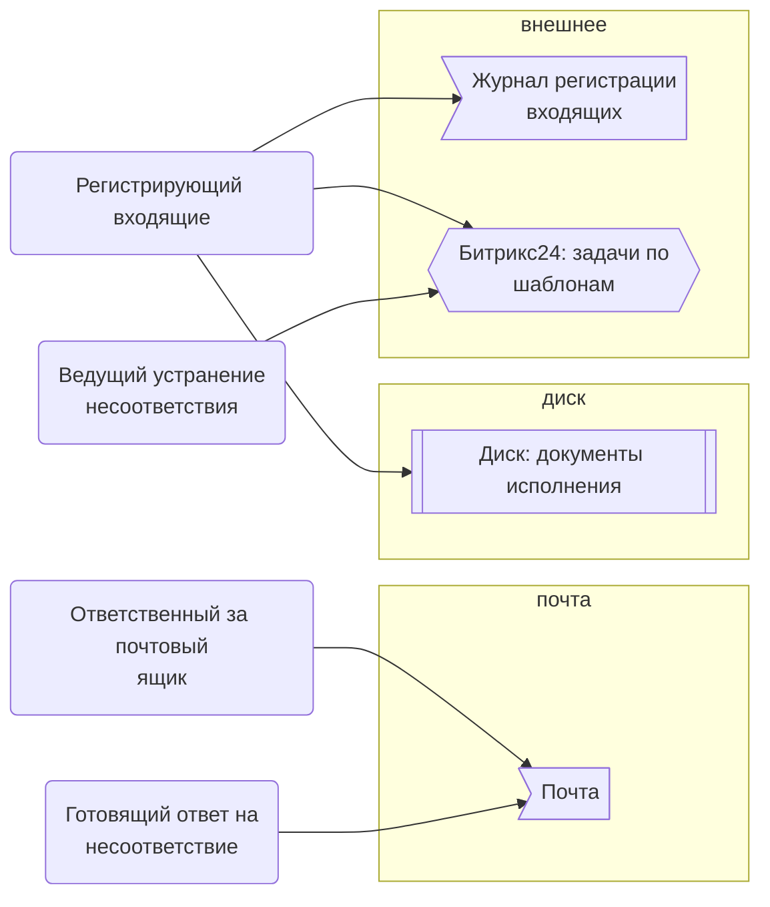
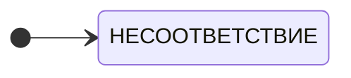

> Черновик: текст не проверен.

# Устранение несоответствий

Процесс регламента «Распределение задач» (лист «10.10.2026 Версия К»), в регламенте — «ИСПОЛНЕНИЕ (устранение несоответствий)». Контур 4.
Как читать схемы и что значат обязанности — [обзор процессов](../../pro/obzor/index.md).

Шаги «как записано» — `reglament.yaml` (собран скриптом из регламента), наше толкование — `protsess.yaml`. Ниже всё собрано из них.

## Как в регламенте

Дорожки — столбцы регламента с основным исполнителем; шаги — по порядку. Пунктир — шаг без исполнителя.

| № | Шаг | H Менеджер | I ТС (эксперт) | J Закупщик | столбец K | L АС | столбец M |
|---|---|---|---|---|---|---|---|
| 16 | Вход в процесс: поступление документов о несоответствии продукции требованиям договора |  |  |  |  |  |  |
| 17 | Передача документа о несоответствии на регистрацию Координатору | И | И |  | У | И | И |
| 18 | Регистрация в Журнале регистрации входящих документа о несоответствии |  |  |  | И |  |  |
| 19 | Размещение в папке Проекта документа о несоответствии |  |  |  | И |  |  |
| 20 | Передача документа о несоответствии менеджеру проекта с постановкой задачи | У |  |  | И |  |  |
| 21 | Принятие решения по устранению несоответствий | И |  |  |  |  |  |
| 22 | Установка товарам статуса НЕСООТВЕТСТВИЕ |  |  |  |  |  |  |
| 23 | Выдача поручения по устранению несоответствий и организация его выполнения | И |  |  |  |  |  |
| 24 | Выдача поручения по подготовке ответа на документ о несоответствии и организация его выполнения | И |  |  |  |  |  |
| 25 | Устранение несоответствий | И | С | С | С | С |  |
| 26 | Подготовка предложений по ответу и согласование с заинтересованными сторонами | Сг | И | Сг |  | Сг |  |
| 27 | Обеспечение отправки подготовленного ответа | У | И |  |  | У |  |
| 28 | Сбор объяснений по возникновению несоответствий и сбор предложений по предотвращению/снижению рисков возникновения подобных несоответствий | И | С | С | С | С |  |
| 29 | Закрытие процесса Устранение несоответствий | И |  |  |  | С |  |

И — исполнитель, С — соисполнитель, Сг — согласование, У — информируемый, В — владелец процесса.

## По обязанностям

Дорожки — должности, которые мы предполагаем; узлы — обязанности. Сплошная стрелка — ставит задачу или передаёт результат, пунктир — следит или согласует; стрелка без подписи — дальше по порядку.

## Шаги и обязанности

| № | Шаг | Делает | Ставит → принимает | Согласуют, помогают, узнают | Где |
|---|---|---|---|---|---|
| 16 | Вход в процесс: поступление документов о несоответствии продукции требованиям договора *Вход в процесс — у шага нет исполнителя; по смыслу документ получает ответственный за ящик.* | [Ответственный за почтовый ящик](../../reg/oby/otvetstvennyy-za-yashchik.md) | — → — |  | [Почта](../../reg/mes.md#pochta) |
| 17 | Передача документа о несоответствии на регистрацию Координатору | [Ответственный за почтовый ящик](../../reg/oby/otvetstvennyy-za-yashchik.md) | — → [Регистрирующий входящие](../../reg/oby/registratsiya-vhodyashchih.md) |  | [Почта](../../reg/mes.md#pochta) |
| 18 | Регистрация в Журнале регистрации входящих документа о несоответствии | [Регистрирующий входящие](../../reg/oby/registratsiya-vhodyashchih.md) | — → — |  | [Журнал регистрации входящих](../../reg/mes.md#zhurnal-vhodyashchih) |
| 19 | Размещение в папке Проекта документа о несоответствии | [Регистрирующий входящие](../../reg/oby/registratsiya-vhodyashchih.md) | — → — |  | [Диск: документы исполнения](../../reg/mes.md#disk-ispolnenie) |
| 20 | Передача документа о несоответствии менеджеру проекта с постановкой задачи | [Регистрирующий входящие](../../reg/oby/registratsiya-vhodyashchih.md) | — → [Ведущий устранение несоответствия](../../reg/oby/vedenie-nesootvetstviya.md) |  | [Битрикс24: задачи по шаблонам](../../reg/mes.md#bitriks-zadacha) |
| 21 | Принятие решения по устранению несоответствий | [Ведущий устранение несоответствия](../../reg/oby/vedenie-nesootvetstviya.md) | [Регистрирующий входящие](../../reg/oby/registratsiya-vhodyashchih.md) → — |  | [Битрикс24: задачи по шаблонам](../../reg/mes.md#bitriks-zadacha) |
| 22 | Установка товарам статуса НЕСООТВЕТСТВИЕ | [Ставящий товарам статус «Несоответствие»](../../reg/oby/status-nesootvetstvie.md) | — → — |  |  |
| 23 | Выдача поручения по устранению несоответствий и организация его выполнения | [Ведущий устранение несоответствия](../../reg/oby/vedenie-nesootvetstviya.md) | — → — |  |  |
| 24 | Выдача поручения по подготовке ответа на документ о несоответствии и организация его выполнения | [Ведущий устранение несоответствия](../../reg/oby/vedenie-nesootvetstviya.md) | — → [Готовящий ответ на несоответствие](../../reg/oby/otvet-nesootvetstvie.md) |  |  |
| 25 | Устранение несоответствий | [Ведущий устранение несоответствия](../../reg/oby/vedenie-nesootvetstviya.md) | — → — | помогают: [Технический эксперт (ТС)](../../reg/rol/tekh.md), [Закупщик (специалист по закупке)](../../reg/rol/zakupka.md), [Хранитель учёта и документов (столбец K)](../../reg/rol/khranitel.md), [Логист](../../reg/rol/logist.md) |  |
| 26 | Подготовка предложений по ответу и согласование с заинтересованными сторонами *Регламент: согласуют менеджер, закупщик и логист.* | [Готовящий ответ на несоответствие](../../reg/oby/otvet-nesootvetstvie.md) | [Ведущий устранение несоответствия](../../reg/oby/vedenie-nesootvetstviya.md) → — | согласуют: [Ведущий устранение несоответствия](../../reg/oby/vedenie-nesootvetstviya.md); помогают: [Закупщик (специалист по закупке)](../../reg/rol/zakupka.md), [Логист](../../reg/rol/logist.md) |  |
| 27 | Обеспечение отправки подготовленного ответа | [Готовящий ответ на несоответствие](../../reg/oby/otvet-nesootvetstvie.md) | — → — | узнают о результате: [Менеджер проекта](../../reg/rol/proekt.md), [Логист](../../reg/rol/logist.md) | [Почта](../../reg/mes.md#pochta) |
| 28 | Сбор объяснений по возникновению несоответствий и сбор предложений по предотвращению/снижению рисков возникновения подобных несоответствий | [Ведущий устранение несоответствия](../../reg/oby/vedenie-nesootvetstviya.md) | — → — | помогают: [Технический эксперт (ТС)](../../reg/rol/tekh.md), [Закупщик (специалист по закупке)](../../reg/rol/zakupka.md), [Хранитель учёта и документов (столбец K)](../../reg/rol/khranitel.md), [Логист](../../reg/rol/logist.md) |  |
| 29 | Закрытие процесса Устранение несоответствий | [Ведущий устранение несоответствия](../../reg/oby/vedenie-nesootvetstviya.md) | — → — | помогают: [Логист](../../reg/rol/logist.md) |  |

## Где работают

## Статусы

**Статус товара**

