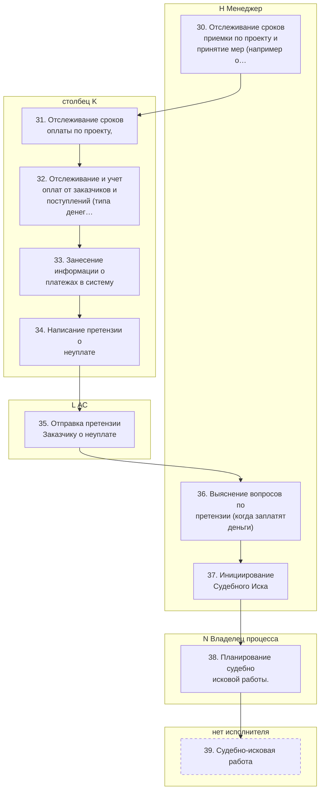
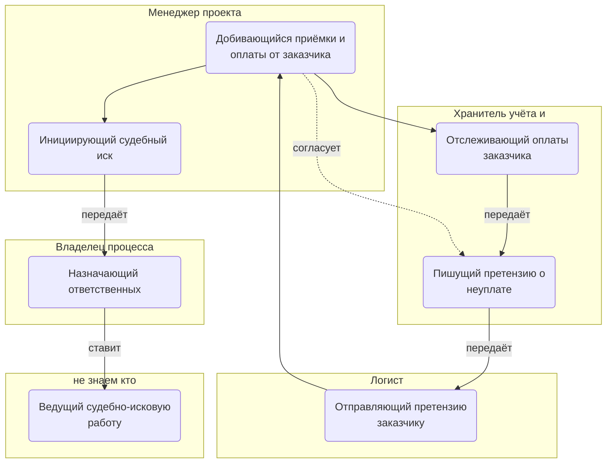
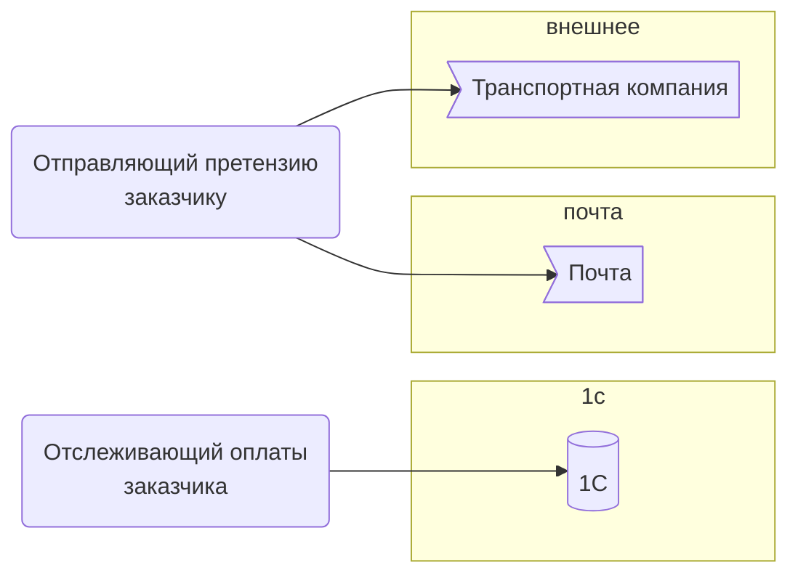

> Черновик: текст не проверен.

# Контроль исполнения заказчиком

Процесс регламента «Распределение задач» (лист «10.10.2026 Версия К»), в регламенте — «КОНТРОЛЬ ИСПОЛНЕНИЯ ЗАКАЗЧИКОМ». Контур 3.
Как читать схемы и что значат обязанности — [обзор процессов](../../pro/obzor/index.md).

Шаги «как записано» — `reglament.yaml` (собран скриптом из регламента), наше толкование — `protsess.yaml`. Ниже всё собрано из них.

## Как в регламенте

Дорожки — столбцы регламента с основным исполнителем; шаги — по порядку. Пунктир — шаг без исполнителя.

| № | Шаг | H Менеджер | столбец K | L АС | N Владелец процесса |
|---|---|---|---|---|---|
| 30 | Отслеживание сроков приемки по проекту и принятие мер (например отправка письма о том, что считаем, что замечаний нет.) | И |  | С |  |
| 31 | Отслеживание сроков оплаты по проекту, |  | И |  |  |
| 32 | Отслеживание и учет оплат от заказчиков и поступлений (типа денег от поставщиков и страховых) по проекту |  | И |  |  |
| 33 | Занесение информации о платежах в систему |  | И |  |  |
| 34 | Написание претензии о неуплате | Сг | И |  |  |
| 35 | Отправка претензии Заказчику о неуплате |  |  | И |  |
| 36 | Выяснение вопросов по претензии (когда заплатят деньги) | И |  | С |  |
| 37 | Инициирование Судебного Иска | И |  |  |  |
| 38 | Планирование судебно исковой работы. |  |  |  | И |
| 39 | Судебно-исковая работа |  |  |  |  |

И — исполнитель, С — соисполнитель, Сг — согласование, У — информируемый, В — владелец процесса.

## По обязанностям

Дорожки — должности, которые мы предполагаем; узлы — обязанности. Сплошная стрелка — ставит задачу или передаёт результат, пунктир — следит или согласует; стрелка без подписи — дальше по порядку.

## Шаги и обязанности

| № | Шаг | Делает | Ставит → принимает | Согласуют, помогают, узнают | Где |
|---|---|---|---|---|---|
| 30 | Отслеживание сроков приемки по проекту и принятие мер (например отправка письма о том, что считаем, что замечаний нет.) *Регламент: «нет инструмента, прописать инструмент».* | [Добивающийся приёмки и оплаты от заказчика](../../reg/oby/dozhim-zakazchika.md) | — → — | помогают: [Логист](../../reg/rol/logist.md) |  |
| 31 | Отслеживание сроков оплаты по проекту, | [Отслеживающий оплаты заказчика](../../reg/oby/oplaty-zakazchika.md) | — → [Пишущий претензию о неуплате](../../reg/oby/pretenziya-neuplata.md) |  |  |
| 32 | Отслеживание и учет оплат от заказчиков и поступлений (типа денег от поставщиков и страховых) по проекту | [Отслеживающий оплаты заказчика](../../reg/oby/oplaty-zakazchika.md) | — → — |  | [1С](../../reg/mes.md#1s) |
| 33 | Занесение информации о платежах в систему *Регламент: «что тут писать?» — в какую систему, не сказано.* | [Отслеживающий оплаты заказчика](../../reg/oby/oplaty-zakazchika.md) | — → — |  |  |
| 34 | Написание претензии о неуплате | [Пишущий претензию о неуплате](../../reg/oby/pretenziya-neuplata.md) | — → [Отправляющий претензию заказчику](../../reg/oby/otpravka-pretenzii.md) | согласуют: [Добивающийся приёмки и оплаты от заказчика](../../reg/oby/dozhim-zakazchika.md) |  |
| 35 | Отправка претензии Заказчику о неуплате | [Отправляющий претензию заказчику](../../reg/oby/otpravka-pretenzii.md) | — → — |  | [Почта](../../reg/mes.md#pochta), [Транспортная компания](../../reg/mes.md#transportnaya-kompaniya) |
| 36 | Выяснение вопросов по претензии (когда заплатят деньги) | [Добивающийся приёмки и оплаты от заказчика](../../reg/oby/dozhim-zakazchika.md) | — → — | помогают: [Логист](../../reg/rol/logist.md) |  |
| 37 | Инициирование Судебного Иска | [Инициирующий судебный иск](../../reg/oby/isk.md) | — → [Назначающий ответственных](../../reg/oby/naznachenie-otvetstvennyh.md) |  |  |
| 38 | Планирование судебно исковой работы. | [Назначающий ответственных](../../reg/oby/naznachenie-otvetstvennyh.md) | — → [Ведущий судебно-исковую работу](../../reg/oby/sud.md) |  |  |
| 39 | Судебно-исковая работа | [Ведущий судебно-исковую работу](../../reg/oby/sud.md) | [Назначающий ответственных](../../reg/oby/naznachenie-otvetstvennyh.md) → — |  |  |

## Где работают

Дальше: [Процесс. Закрытие проекта](../r12-zakrytie-proekta/index.md).
