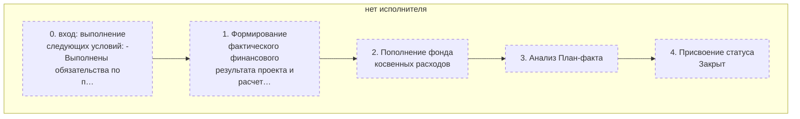
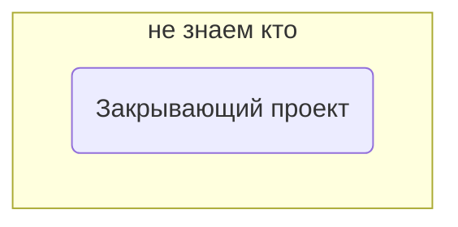
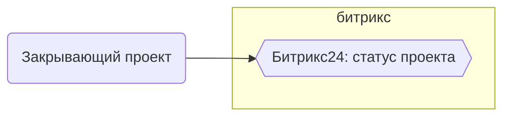
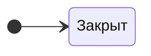

> Черновик: текст не проверен.

# Закрытие проекта

Процесс регламента «Распределение задач» (лист «10.10.2026 Версия К»), в регламенте — «ЗАКРЫТИЕ ПРОЕКТА». Контур 0.
Как читать схемы и что значат обязанности — [обзор процессов](../../pro/obzor/index.md).

Шаги «как записано» — `reglament.yaml` (собран скриптом из регламента), наше толкование — `protsess.yaml`. Ниже всё собрано из них.

## Как в регламенте

Дорожки — столбцы регламента с основным исполнителем; шаги — по порядку. Пунктир — шаг без исполнителя.

| № | Шаг |  |
|---|---|
| 0 | вход: выполнение следующих условий: - Выполнены обязательства по поставке (товар принят); - выполнены обызательства по оплате товара Покупателем. - В системе учета содержатся все затраты по проекту. - Завершена претензионно исковая работа (с покупателем и поставщиками) |  |
| 1 | Формирование фактического финансового результата проекта и расчет финансовых показателей проекта |  |
| 2 | Пополнение фонда косвенных расходов |  |
| 3 | Анализ План-факта |  |
| 4 | Присвоение статуса Закрыт |  |

И — исполнитель, С — соисполнитель, Сг — согласование, У — информируемый, В — владелец процесса.

## По обязанностям

Дорожки — должности, которые мы предполагаем; узлы — обязанности. Сплошная стрелка — ставит задачу или передаёт результат, пунктир — следит или согласует; стрелка без подписи — дальше по порядку.

## Шаги и обязанности

| № | Шаг | Делает | Ставит → принимает | Согласуют, помогают, узнают | Где |
|---|---|---|---|---|---|
| 0 | вход: выполнение следующих условий: - Выполнены обязательства по поставке (товар принят); - выполнены обызательства по оплате товара Покупателем. - В системе учета содержатся все затраты по проекту. - Завершена претензионно исковая работа (с покупателем и поставщиками) | [Закрывающий проект](../../reg/oby/zakrytie-proekta.md) | — → — |  |  |
| 1 | Формирование фактического финансового результата проекта и расчет финансовых показателей проекта | [Закрывающий проект](../../reg/oby/zakrytie-proekta.md) | — → — |  |  |
| 2 | Пополнение фонда косвенных расходов | [Закрывающий проект](../../reg/oby/zakrytie-proekta.md) | — → — |  |  |
| 3 | Анализ План-факта | [Закрывающий проект](../../reg/oby/zakrytie-proekta.md) | — → — |  |  |
| 4 | Присвоение статуса Закрыт | [Закрывающий проект](../../reg/oby/zakrytie-proekta.md) | — → — |  | [Битрикс24: статус проекта](../../reg/mes.md#bitriks-status-proekta) |

## Где работают

## Статусы

**Статус проекта**

