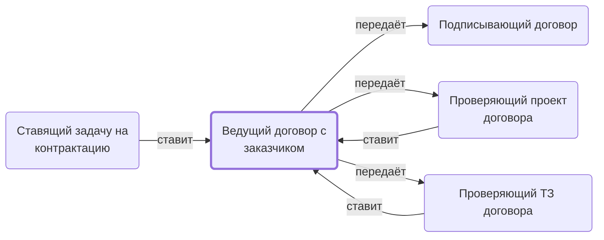

# Ведущий договор с заказчиком

Общается с заказчиком о заключении и подписании, получает проект договора, ставит задачи на его проверку, отправляет подписанный скан.

- **Обязанность:** одна, один ответственный. Ключ: `dogovor-s-zakazchikom`
- **Предполагаем, что выполняет:** [Менеджер по продажам](../../reg/rol/prodazhi.md)
- **Контур:** 0
- **Почему выделили:** Сквозная ответственность за договор с заказчиком до подписания.
- **Догадка, не подтверждено:** Директор: до договора — менеджер по продажам; в регламенте это столбец H, общий с менеджером проекта.
- *Черновик — проверить.*

## Откуда задача и кому результат

## Шаги

| Процесс | № | Шаг | Здесь |
|---|---|---|---|
| [Процесс. Передача в контрактацию](../../pro/r01-peredacha-v-kontraktatsiyu/index.md) | 4 | Постановка Задачи на Контрактацию | принимает результат |
| [Процесс. Контрактация](../../pro/r02-kontraktatsiya/index.md) | 5 | Взаимодействие с Заказчиком по вопросу ЗАКЛЮЧЕНИЯ договора | делает |
| [Процесс. Контрактация](../../pro/r02-kontraktatsiya/index.md) | 8 | Получение проекта договора от заказчика. (примечание: проект договора в данном контексте это в том числе редактируемая версия текста договора). | делает |
| [Процесс. Контрактация](../../pro/r02-kontraktatsiya/index.md) | 9 | Постановка задачи на проверку (или заполнение, если к нам вошел договор в редактируемом формате) направленного проекта договора. | делает |
| [Процесс. Контрактация](../../pro/r02-kontraktatsiya/index.md) | 10 | Заполнение/проверка проекта договора. | ставит задачу |
| [Процесс. Контрактация](../../pro/r02-kontraktatsiya/index.md) | 10 | Заполнение/проверка проекта договора. | принимает результат |
| [Процесс. Контрактация](../../pro/r02-kontraktatsiya/index.md) | 11 | Постановка задачи на проверку ТЗ (или заполнение, если к нам вошел договор в редактируемом формате) направленного ТЗ и перечня документов которые нужно включить в счета или договоры (лист 3-3) | делает |
| [Процесс. Контрактация](../../pro/r02-kontraktatsiya/index.md) | 12 | Заполнение/проверка ТЗ | ставит задачу |
| [Процесс. Контрактация](../../pro/r02-kontraktatsiya/index.md) | 12 | Заполнение/проверка ТЗ | принимает результат |
| [Процесс. Контрактация](../../pro/r02-kontraktatsiya/index.md) | 13 | Взаимодействие с Заказчиком по вопросу ПОДПИСАНИЯ договора | делает |
| [Процесс. Контрактация](../../pro/r02-kontraktatsiya/index.md) | 14 | Информирование M, о том, что надо подписать договор через ЭДО | делает |
| [Процесс. Контрактация](../../pro/r02-kontraktatsiya/index.md) | 15 | Подписание договора через ЭДО | ставит задачу |
| [Процесс. Контрактация](../../pro/r02-kontraktatsiya/index.md) | 16 | Направление скан копии подписанного договора заказчику. | делает |

**Получает:** [Заключение по проекту договора](../../reg/art.md#zaklyuchenie-dogovor), [Заключение по ТЗ](../../reg/art.md#zaklyuchenie-tz), [Подписанный договор с заказчиком](../../reg/art.md#dogovor-podpisannyy)

**Отдаёт:** [Подзадача «Оформить договор»](../../reg/art.md#podzadacha-dogovor), [Проект договора заказчика](../../reg/art.md#proekt-dogovora), [Подзадача на проверку ТЗ](../../reg/art.md#podzadacha-tz), [Просьба подписать договор через ЭДО](../../reg/art.md#poruchenie-podpisat), [Оригинал договора для заказчика](../../reg/art.md#original-dogovora)

**Где работает:** [Почта](../../reg/mes.md#pochta), [Диск: «Рабочие документы» → «Контрактация», «Договор»](../../reg/mes.md#disk-kontraktatsiya), [Лист «0-Паспорт проекта»](../../reg/mes.md#lis-0-pasport), [Битрикс24: задачи по шаблонам](../../reg/mes.md#bitriks-zadacha), [Битрикс24: статус проекта](../../reg/mes.md#bitriks-status-proekta)
