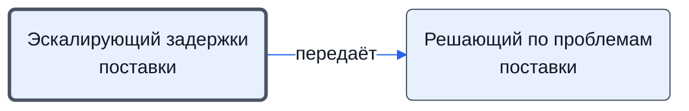

# Эскалирующий задержки поставки

Сообщает менеджеру о затягивании сроков поставки.

- **Обязанность:** одна, один ответственный. Ключ: `eskalatsiya`
- **Предполагаем, что выполняет:** [Закупщик (специалист по закупке)](../../reg/rol/zakupka.md)
- **Контур:** 4
- *Черновик — проверить.*

## Откуда задача и кому результат

## Шаги

| Процесс | № | Шаг | Здесь |
|---|---|---|---|
| [Процесс. Поступление: контроль поставки, доплаты, доставка, приёмка](../../pro/r06-postuplenie/index.md) | 7 | Эскалация проблемы в случае затягивания сроков | делает |
| [Процесс. Поступление: контроль поставки, доплаты, доставка, приёмка](../../pro/r06-postuplenie/index.md) | 8 | Принятие решение по эскалированным проблемам | ставит задачу |

**Получает:** [Сведения о просрочке поставки](../../reg/art.md#prosrochka)

**Отдаёт:** [Эскалация задержки](../../reg/art.md#eskalatsiya)
