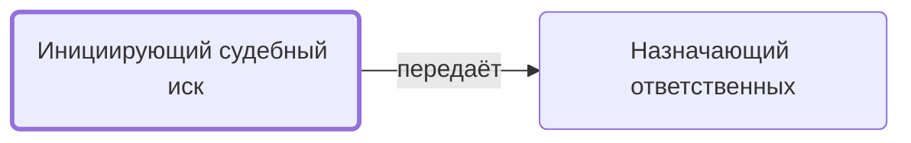

# Инициирующий судебный иск

Инициирует судебный иск к заказчику.

- **Обязанность:** одна, один ответственный. Ключ: `isk`
- **Предполагаем, что выполняет:** [Менеджер проекта](../../reg/rol/proekt.md)
- **Контур:** 3
- *Черновик — проверить.*

## Откуда задача и кому результат

## Шаги

| Процесс | № | Шаг | Здесь |
|---|---|---|---|
| [Процесс. Контроль исполнения заказчиком](../../pro/r11-kontrol-zakazchika/index.md) | 37 | Инициирование Судебного Иска | делает |

**Отдаёт:** [Решение инициировать иск](../../reg/art.md#isk)
