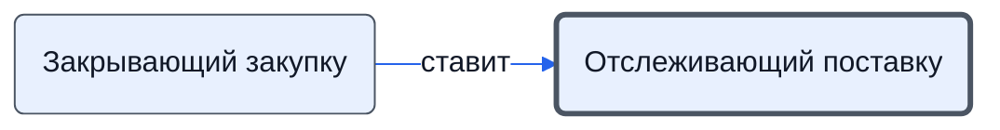

# Отслеживающий поставку

Находит оплаченные товары без статуса, подтверждает у поставщиков получение денег и сроки, следит за просрочками.

- **Обязанность:** одна, один ответственный. Ключ: `kontrol-postavki`
- **Предполагаем, что выполняет:** [Логист](../../reg/rol/logist.md)
- **Контур:** 4
- **Почему выделили:** Регламент: шаги 2, 3, 6 — у АС (логист); работа в таблице логиста.
- *Черновик — проверить.*

## Откуда задача и кому результат

## Шаги

| Процесс | № | Шаг | Здесь |
|---|---|---|---|
| [Процесс. Закупка товара](../../pro/r04-zakupka-tovara/index.md) | 25 | Закрытие этапа Закупки | принимает результат |
| [Процесс. Поступление: контроль поставки, доплаты, доставка, приёмка](../../pro/r06-postuplenie/index.md) | 2 | Отслеживание товаров со статусом ОПЛАЧЕНО но пока без "статуса" (на листе Рабочий лист) | делает |
| [Процесс. Поступление: контроль поставки, доплаты, доставка, приёмка](../../pro/r06-postuplenie/index.md) | 3 | Контакт с поставщиками подтверждение получения денег, уточнение сроков поставки | делает |
| [Процесс. Поступление: контроль поставки, доплаты, доставка, приёмка](../../pro/r06-postuplenie/index.md) | 6 | Контроль соблюдения сроков поставки ( и выявление просрочки) | делает |

**Получает:** [Формат приёмки](../../reg/art.md#format-priemki), [Плановые сроки поставки](../../reg/art.md#plan-sroki)

**Отдаёт:** [Статусы поставки (таблица логиста)](../../reg/art.md#statusy-postavki), [Сведения о просрочке поставки](../../reg/art.md#prosrochka)

**Где работает:** [Таблица логиста](../../reg/mes.md#tablitsa-logista), [Почта](../../reg/mes.md#pochta)
