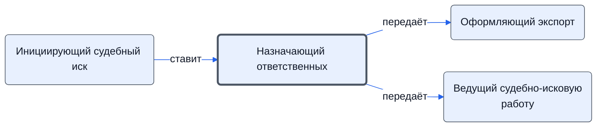

# Назначающий ответственных

Назначает ответственного за оформление экспорта и за судебно-исковую работу, решает, как вести суд.

- **Обязанность:** одна, один ответственный. Ключ: `naznachenie-otvetstvennyh`
- **Предполагаем, что выполняет:** [Владелец процесса (руководитель исполнителя)](../../reg/rol/vladelets.md)
- **Контур:** 0
- **Почему выделили:** Регламент: столбец N.
- *Черновик — проверить.*

## Откуда задача и кому результат

## Шаги

| Процесс | № | Шаг | Здесь |
|---|---|---|---|
| [Процесс. Оформление экспорта](../../pro/r09-oformlenie-eksporta/index.md) | 15 | Назначение ответственного за оформление Экспорта | делает |
| [Процесс. Оформление экспорта](../../pro/r09-oformlenie-eksporta/index.md) | — | Оформление экспорта | ставит задачу |
| [Процесс. Контроль исполнения заказчиком](../../pro/r11-kontrol-zakazchika/index.md) | 37 | Инициирование Судебного Иска | принимает результат |
| [Процесс. Контроль исполнения заказчиком](../../pro/r11-kontrol-zakazchika/index.md) | 38 | Планирование судебно исковой работы. | делает |
| [Процесс. Контроль исполнения заказчиком](../../pro/r11-kontrol-zakazchika/index.md) | 39 | Судебно-исковая работа | ставит задачу |

**Получает:** [Решение инициировать иск](../../reg/art.md#isk)

**Отдаёт:** [Назначение ответственного](../../reg/art.md#naznachenie)
