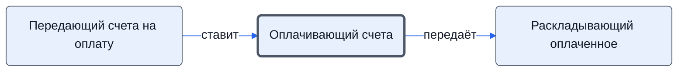

# Оплачивающий счета

Оплачивает счета и доплаты и возвращает платёжные поручения.

- **Обязанность:** одна, один ответственный. Ключ: `oplata`
- **Предполагаем, что выполняет:** [Подписант и плательщик (столбец M)](../../reg/rol/podpisant.md), [Казначей](../../reg/rol/kaznachey.md)
- **Контур:** 3
- **Почему выделили:** Регламент: только столбец M; роли.docx: Казначей «оплачивает».
- *Черновик — проверить.*

## Откуда задача и кому результат

## Шаги

| Процесс | № | Шаг | Здесь |
|---|---|---|---|
| [Процесс. Закупка товара](../../pro/r04-zakupka-tovara/index.md) | 21 | Передача полученных счетов M на оплату | принимает результат |
| [Процесс. Закупка товара](../../pro/r04-zakupka-tovara/index.md) | 22 | Оплата полученных счетов и передача платежных поручений K | делает |
| [Процесс. Поступление: контроль поставки, доплаты, доставка, приёмка](../../pro/r06-postuplenie/index.md) | 14 | Передача полученных счетов M на доплату | принимает результат |
| [Процесс. Поступление: контроль поставки, доплаты, доставка, приёмка](../../pro/r06-postuplenie/index.md) | 15 | Доплата полученных счетов и передача платежных поручений K | делает |

**Получает:** [Проверенные счета на оплату](../../reg/art.md#scheta-na-oplatu)

**Отдаёт:** [Платёжные поручения](../../reg/art.md#platezhki)
