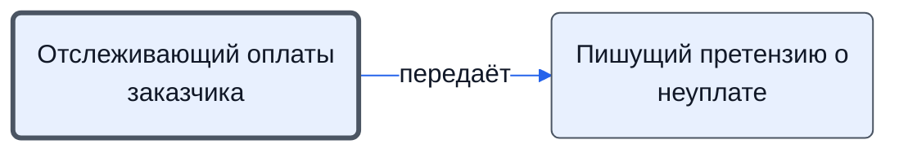

# Отслеживающий оплаты заказчика

Следит за сроками оплаты по проекту, учитывает поступления от заказчиков, поставщиков и страховых, вносит платежи в систему.

- **Обязанность:** одна, один ответственный. Ключ: `oplaty-zakazchika`
- **Предполагаем, что выполняет:** [Хранитель учёта и документов (столбец K)](../../reg/rol/khranitel.md)
- **Контур:** 3
- **Почему выделили:** Регламент: шаги 31–33 — столбец K.
- **Догадка, не подтверждено:** «Прописать инструмент» и «что тут писать?» — инструмента пока нет.
- *Черновик — проверить.*

## Откуда задача и кому результат

## Шаги

| Процесс | № | Шаг | Здесь |
|---|---|---|---|
| [Процесс. Контроль исполнения заказчиком](../../pro/r11-kontrol-zakazchika/index.md) | 31 | Отслеживание сроков оплаты по проекту, | делает |
| [Процесс. Контроль исполнения заказчиком](../../pro/r11-kontrol-zakazchika/index.md) | 32 | Отслеживание и учет оплат от заказчиков и поступлений (типа денег от поставщиков и страховых) по проекту | делает |
| [Процесс. Контроль исполнения заказчиком](../../pro/r11-kontrol-zakazchika/index.md) | 33 | Занесение информации о платежах в систему | делает |

**Где работает:** [1С](../../reg/mes.md#1s)
