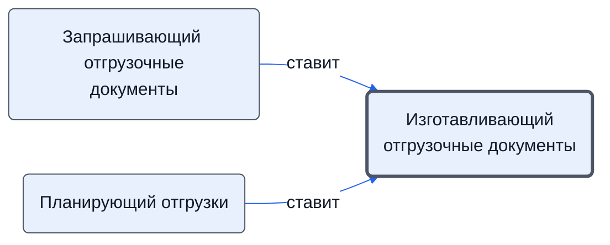

# Изготавливающий отгрузочные документы

Изготавливает отгрузочные документы и вносит сведения о них в таблицу оплат.

- **Обязанность:** одна, один ответственный. Ключ: `otgruzochnye-dokumenty`
- **Предполагаем, что выполняет:** [Хранитель учёта и документов (столбец K)](../../reg/rol/khranitel.md)
- **Контур:** 3
- *Черновик — проверить.*

## Откуда задача и кому результат

## Шаги

| Процесс | № | Шаг | Здесь |
|---|---|---|---|
| [Процесс. Подготовка к отгрузке](../../pro/r07-podgotovka-k-otgruzke/index.md) | 1.2 | Разработка ведомости отгрузки и постановка задачи на формирования пакета документов для нее. | принимает результат |
| [Процесс. Подготовка к отгрузке](../../pro/r07-podgotovka-k-otgruzke/index.md) | 2 | Передача данных K о необходимости изготовления отгрузочных документов | принимает результат |
| [Процесс. Подготовка к отгрузке](../../pro/r07-podgotovka-k-otgruzke/index.md) | 3 | Изготовление Отгрузочных документов и внесение в таблицу оплат сведений об этих документах | делает |

**Получает:** [Ведомость отгрузки и запрос отгрузочных документов](../../reg/art.md#zapros-otgruzochnyh)

**Отдаёт:** [Отгрузочные документы](../../reg/art.md#otgruzochnye)

**Где работает:** [1С](../../reg/mes.md#1s), [Внешняя таблица оплат](../../reg/mes.md#tablitsa-oplat)
