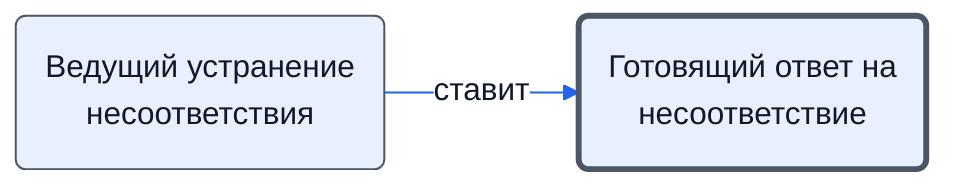

# Готовящий ответ на несоответствие

Готовит предложения по ответу, согласует и отправляет ответ.

- **Обязанность:** одна, один ответственный. Ключ: `otvet-nesootvetstvie`
- **Предполагаем, что выполняет:** [Технический эксперт (ТС)](../../reg/rol/tekh.md)
- **Контур:** 4
- **Почему выделили:** Регламент: шаги 26–27 у ТС; «ответ готовит лицо, которому поручили».
- *Черновик — проверить.*

## Откуда задача и кому результат

## Шаги

| Процесс | № | Шаг | Здесь |
|---|---|---|---|
| [Процесс. Устранение несоответствий](../../pro/r10-nesootvetstviya/index.md) | 24 | Выдача поручения по подготовке ответа на документ о несоответствии и организация его выполнения | принимает результат |
| [Процесс. Устранение несоответствий](../../pro/r10-nesootvetstviya/index.md) | 26 | Подготовка предложений по ответу и согласование с заинтересованными сторонами | делает |
| [Процесс. Устранение несоответствий](../../pro/r10-nesootvetstviya/index.md) | 27 | Обеспечение отправки подготовленного ответа | делает |

**Получает:** [Поручение подготовить ответ на несоответствие](../../reg/art.md#poruchenie-otvet)

**Отдаёт:** [Ответ на документ о несоответствии](../../reg/art.md#otvet-nesootv)

**Где работает:** [Почта](../../reg/mes.md#pochta)
