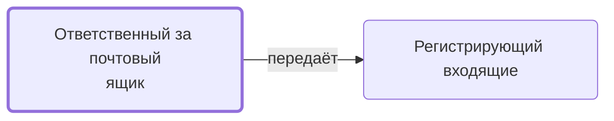

# Ответственный за почтовый ящик

Получив документ о несоответствии на свой ящик, передаёт его на регистрацию.

- **Обязанность:** одна, один ответственный. Ключ: `otvetstvennyy-za-yashchik`
- **Предполагаем, что выполняет:** [Менеджер проекта](../../reg/rol/proekt.md), [Технический эксперт (ТС)](../../reg/rol/tekh.md), [Логист](../../reg/rol/logist.md), [Подписант и плательщик (столбец M)](../../reg/rol/podpisant.md)
- **Контур:** 4
- **Почему выделили:** Регламент: «за передачу отвечает ответственный за почтовый ящик, на который поступил документ» — у шага четыре исполнителя.
- *Черновик — проверить.*

## Откуда задача и кому результат

## Шаги

| Процесс | № | Шаг | Здесь |
|---|---|---|---|
| [Процесс. Устранение несоответствий](../../pro/r10-nesootvetstviya/index.md) | 16 | Вход в процесс: поступление документов о несоответствии продукции требованиям договора | делает |
| [Процесс. Устранение несоответствий](../../pro/r10-nesootvetstviya/index.md) | 17 | Передача документа о несоответствии на регистрацию Координатору | делает |

**Где работает:** [Почта](../../reg/mes.md#pochta)
