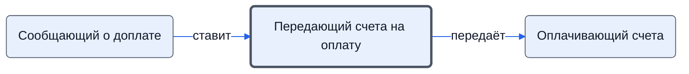

# Передающий счета на оплату

Передаёт проверенные счета на оплату и доплату тому, кто платит.

- **Обязанность:** одна, один ответственный. Ключ: `peredacha-na-oplatu`
- **Предполагаем, что выполняет:** [Хранитель учёта и документов (столбец K)](../../reg/rol/khranitel.md)
- **Контур:** 3
- **Почему выделили:** Регламент: шаги «Передача счетов M на оплату / доплату» — столбец K.
- *Черновик — проверить.*

## Откуда задача и кому результат

## Шаги

| Процесс | № | Шаг | Здесь |
|---|---|---|---|
| [Процесс. Закупка товара](../../pro/r04-zakupka-tovara/index.md) | 21 | Передача полученных счетов M на оплату | делает |
| [Процесс. Закупка товара](../../pro/r04-zakupka-tovara/index.md) | 22 | Оплата полученных счетов и передача платежных поручений K | ставит задачу |
| [Процесс. Поступление: контроль поставки, доплаты, доставка, приёмка](../../pro/r06-postuplenie/index.md) | 13 | Передача данных K о необходимости доплаты при наличии готовности к отгрузке | принимает результат |
| [Процесс. Поступление: контроль поставки, доплаты, доставка, приёмка](../../pro/r06-postuplenie/index.md) | 14 | Передача полученных счетов M на доплату | делает |
| [Процесс. Поступление: контроль поставки, доплаты, доставка, приёмка](../../pro/r06-postuplenie/index.md) | 15 | Доплата полученных счетов и передача платежных поручений K | ставит задачу |

**Получает:** [Сведения о необходимости доплаты](../../reg/art.md#zapros-doplaty)

**Отдаёт:** [Проверенные счета на оплату](../../reg/art.md#scheta-na-oplatu)
