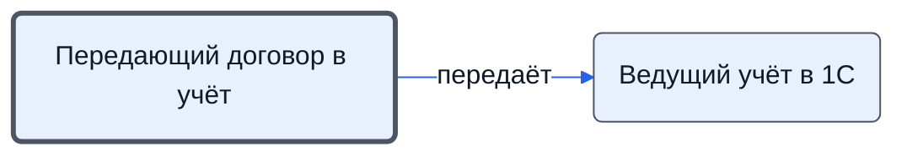

# Передающий договор в учёт

Ставит подзадачу внести номер и дату договора в 1С и таблицы и проверяет, что договор внесён.

- **Обязанность:** одна, один ответственный. Ключ: `peredacha-v-uchet`
- **Предполагаем, что выполняет:** [Менеджер по продажам](../../reg/rol/prodazhi.md)
- **Контур:** 0
- **Почему выделили:** Передача между контурами — отдельная ответственность (Контрактация 18).
- *Черновик — проверить.*

## Откуда задача и кому результат

## Шаги

| Процесс | № | Шаг | Здесь |
|---|---|---|---|
| [Процесс. Контрактация](../../pro/r02-kontraktatsiya/index.md) | 18 | Передача в отдел Исполнения заключенного договора для внесения информации в 1с и табличные системы. | делает |

**Отдаёт:** [Подзадача «внести договор в 1С и таблицы»](../../reg/art.md#podzadacha-uchet)

**Где работает:** [Битрикс24: задачи по шаблонам](../../reg/mes.md#bitriks-zadacha)
