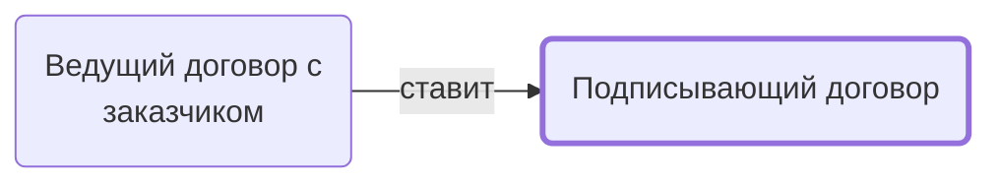

# Подписывающий договор

Подписывает договор с заказчиком через ЭДО.

- **Обязанность:** одна, один ответственный. Ключ: `podpisanie`
- **Предполагаем, что выполняет:** [Подписант и плательщик (столбец M)](../../reg/rol/podpisant.md)
- **Контур:** 0
- **Почему выделили:** Право подписи — отдельная ответственность (Контрактация 15, столбец M).
- *Черновик — проверить.*

## Откуда задача и кому результат

## Шаги

| Процесс | № | Шаг | Здесь |
|---|---|---|---|
| [Процесс. Контрактация](../../pro/r02-kontraktatsiya/index.md) | 14 | Информирование M, о том, что надо подписать договор через ЭДО | принимает результат |
| [Процесс. Контрактация](../../pro/r02-kontraktatsiya/index.md) | 15 | Подписание договора через ЭДО | делает |

**Где работает:** [ЭДО](../../reg/mes.md#edo)
