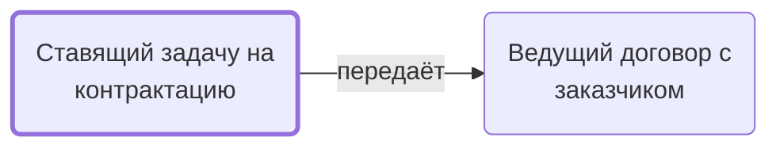

# Ставящий задачу на контрактацию

Ставит по шаблону задачу «Заключить договор»: папка, контакты заказчика, особые указания, чек-лист.

- **Обязанность:** одна, один ответственный. Ключ: `postanovka-kontraktatsii`
- **Предполагаем, что выполняет:** [Менеджер по продажам](../../reg/rol/prodazhi.md)
- **Контур:** 0
- **Почему выделили:** Постановка задачи — отдельная обязанность от её выполнения.
- **Догадка, не подтверждено:** В регламенте шаг у столбца H, но текст «постановка задачи Менеджеру» и «принять задачу у Координатора» — похоже, ставит Координатор.
- *Черновик — проверить.*

## Откуда задача и кому результат

## Шаги

| Процесс | № | Шаг | Здесь |
|---|---|---|---|
| [Процесс. Передача в контрактацию](../../pro/r01-peredacha-v-kontraktatsiyu/index.md) | 4 | Постановка Задачи на Контрактацию | делает |

**Где работает:** [Битрикс24: задачи по шаблонам](../../reg/mes.md#bitriks-zadacha)
