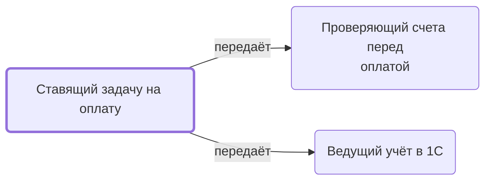

# Ставящий задачу на оплату

Ставит задачу «Оплатить счета» на проверку, оплату и заказы в 1С; сообщает в ней о новых счетах.

- **Обязанность:** одна, один ответственный. Ключ: `postanovka-oplaty`
- **Предполагаем, что выполняет:** [Закупщик (специалист по закупке)](../../reg/rol/zakupka.md)
- **Контур:** 2
- **Почему выделили:** Регламент: шаги 17–18 у закупщика.
- *Черновик — проверить.*

## Откуда задача и кому результат

## Шаги

| Процесс | № | Шаг | Здесь |
|---|---|---|---|
| [Процесс. Закупка товара](../../pro/r04-zakupka-tovara/index.md) | 17 | Постановка Задачи K на проверку и оплату счетов и договоров, созданию в 1с Заказа покупателя и заказов поставщикам | делает |
| [Процесс. Закупка товара](../../pro/r04-zakupka-tovara/index.md) | 18 | Информирование в задаче K о том, что размещены новые Счета и договора | делает |
| [Процесс. Закупка товара](../../pro/r04-zakupka-tovara/index.md) | 19 | Проверка готовых к оплате счетов и договоров | ставит задачу |
| [Процесс. Закупка товара](../../pro/r04-zakupka-tovara/index.md) | 20 | Создание заказа покупателя и поставщикам в 1с | ставит задачу |

**Где работает:** [Битрикс24: задачи по шаблонам](../../reg/mes.md#bitriks-zadacha)
