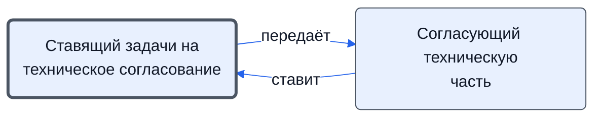

# Ставящий задачи на техническое согласование

Ставит ТС подзадачи: проверить выбранные предложения, согласовать счета и договоры; ведёт цепочку «задача — заключение».

- **Обязанность:** одна, один ответственный. Ключ: `postanovka-teh-soglasovaniya`
- **Предполагаем, что выполняет:** [Закупщик (специалист по закупке)](../../reg/rol/zakupka.md)
- **Контур:** 2
- **Почему выделили:** Регламент: шаги 8 и 14 у закупщика; решение по технике — у другой обязанности.
- *Черновик — проверить.*

## Откуда задача и кому результат

## Шаги

| Процесс | № | Шаг | Здесь |
|---|---|---|---|
| [Процесс. Закупка товара](../../pro/r04-zakupka-tovara/index.md) | 8 | Постановка задачи на проверку выбранных предложений ТС | делает |
| [Процесс. Закупка товара](../../pro/r04-zakupka-tovara/index.md) | 9 | Рассмотрение предложений поставщиков в технической части | ставит задачу |
| [Процесс. Закупка товара](../../pro/r04-zakupka-tovara/index.md) | 9 | Рассмотрение предложений поставщиков в технической части | принимает результат |
| [Процесс. Закупка товара](../../pro/r04-zakupka-tovara/index.md) | 14 | Постановка Задачи на согласование счетов/договоров в технической части | делает |

**Отдаёт:** [Подзадача ТС на проверку предложений](../../reg/art.md#podzadacha-ts)

**Где работает:** [Битрикс24: задачи по шаблонам](../../reg/mes.md#bitriks-zadacha)
