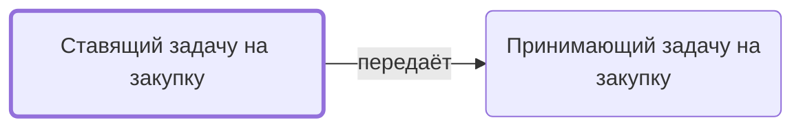

# Ставящий задачу на закупку

Ставит задачу «Закупка» конкретному закупщику: цель (мониторинг или закупка), сроки; статус «Передано в Закупки»; при недопоставке — заново.

- **Обязанность:** одна, один ответственный. Ключ: `postanovka-zakupki`
- **Предполагаем, что выполняет:** [Менеджер проекта](../../reg/rol/proekt.md), [Владелец процесса (руководитель исполнителя)](../../reg/rol/vladelets.md)
- **Контур:** 2 — вход
- **Почему выделили:** Регламент: ставит менеджер (Передача в закупки 5, 7); роли.docx: «Владелец процесса закупок ставит задачу «Закупить»».
- **Догадка, не подтверждено:** Источники расходятся — кто из двух?
- *Черновик — проверить.*

## Откуда задача и кому результат

## Шаги

| Процесс | № | Шаг | Здесь |
|---|---|---|---|
| [Процесс. Передача в закупки](../../pro/r03-peredacha-v-zakupki/index.md) | 5 | Выполнить подзадачу "Поставить задачу на закупку" | делает |
| [Процесс. Передача в закупки](../../pro/r03-peredacha-v-zakupki/index.md) | 6 | Выполнить подзадачу "Принять задачу на закупку" | ставит задачу |
| [Процесс. Передача в закупки](../../pro/r03-peredacha-v-zakupki/index.md) | 7 | Возобновление Закупок по проекту (в случае невыполнения поставок контрагентами, необходимости дозакупить что-либо и т.д.) | делает |
| [Процесс. Закупка товара](../../pro/r04-zakupka-tovara/index.md) | 0 | Вход в процесс- Поставлена задача на закупку по проекту. №Проекта -Закзачик-предмет: Закупить товары" (или принятие этой задачи?!) | ставит задачу |

**Где работает:** [Битрикс24: задачи по шаблонам](../../reg/mes.md#bitriks-zadacha), [Битрикс24: статус проекта](../../reg/mes.md#bitriks-status-proekta)
