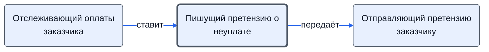

# Пишущий претензию о неуплате

Пишет претензию заказчику о неуплате, согласует с менеджером.

- **Обязанность:** одна, один ответственный. Ключ: `pretenziya-neuplata`
- **Предполагаем, что выполняет:** [Хранитель учёта и документов (столбец K)](../../reg/rol/khranitel.md)
- **Контур:** 3
- **Почему выделили:** Регламент: шаг 34 — столбец K.
- *Черновик — проверить.*

## Откуда задача и кому результат

## Шаги

| Процесс | № | Шаг | Здесь |
|---|---|---|---|
| [Процесс. Контроль исполнения заказчиком](../../pro/r11-kontrol-zakazchika/index.md) | 31 | Отслеживание сроков оплаты по проекту, | принимает результат |
| [Процесс. Контроль исполнения заказчиком](../../pro/r11-kontrol-zakazchika/index.md) | 34 | Написание претензии о неуплате | делает |

**Отдаёт:** [Претензия о неуплате](../../reg/art.md#pretenziya-neuplata)
