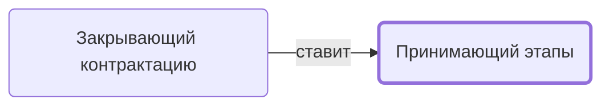

# Принимающий этапы

Принимает закрытые задачи этапов у исполнителей.

- **Обязанность:** одна, один ответственный. Ключ: `priemka-etapov`
- **Предполагаем, что выполняет:** [Координатор](../../reg/rol/koordinator.md)
- **Контур:** 0
- **Почему выделили:** «Менеджеру принять задачу по заключению договора у Координатора» — кто-то принимает результат этапа.
- **Догадка, не подтверждено:** Шага с исполнителем «Координатор» в регламенте нет — обязанность выведена из текста.
- *Черновик — проверить.*

## Откуда задача и кому результат

## Шаги

| Процесс | № | Шаг | Здесь |
|---|---|---|---|
| [Процесс. Контрактация](../../pro/r02-kontraktatsiya/index.md) | 20 | Приемка этапа Контрактации | принимает результат |
